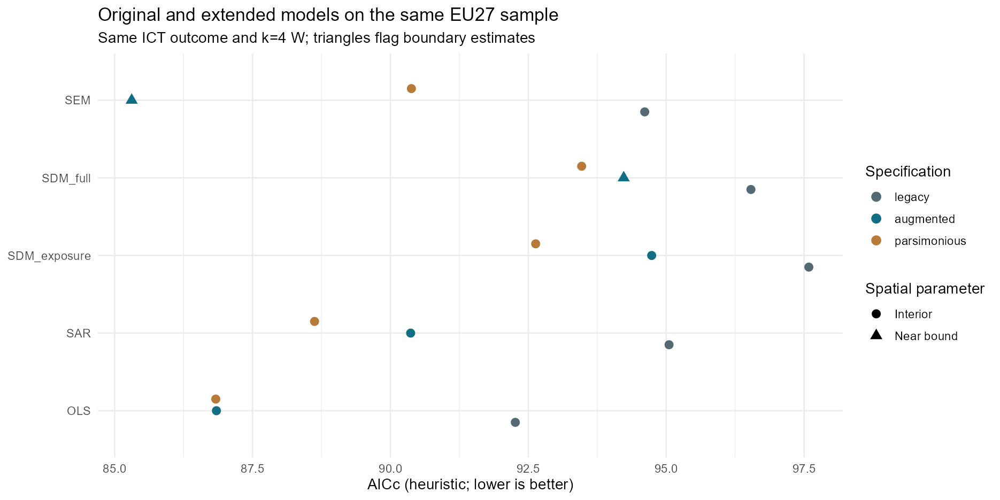
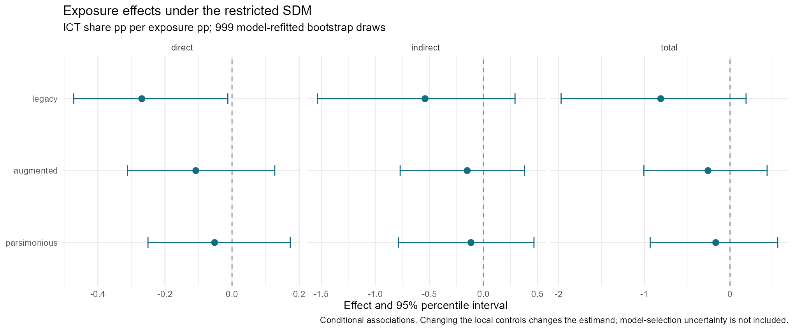
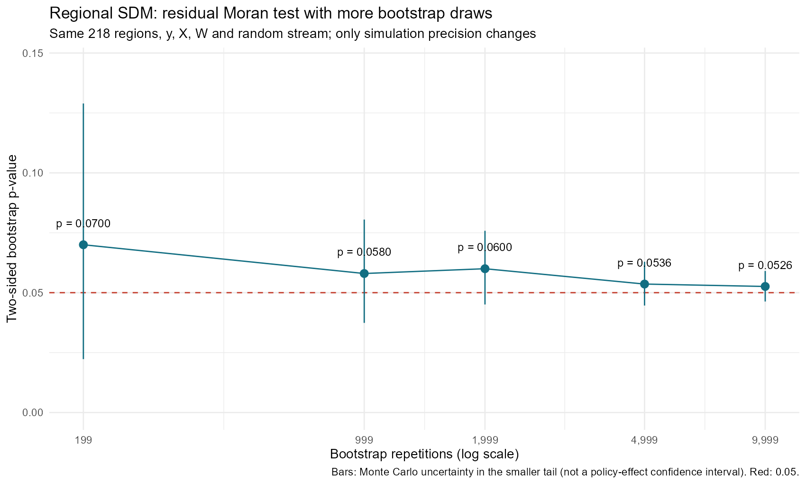
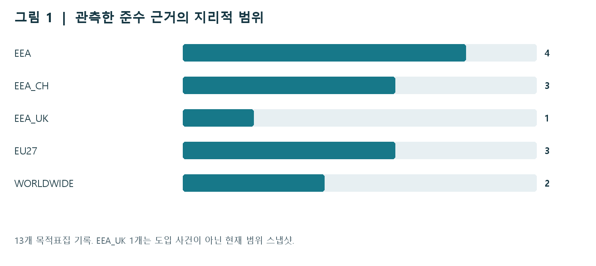
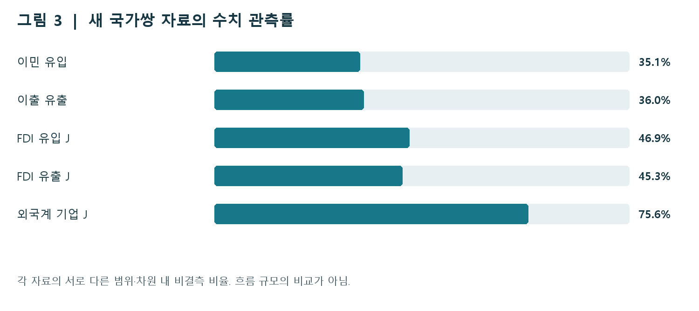

# DMA 규범 확산과 국제 이동 · 공간분석 PoC

**EU 규범이 비EU 서비스에 확산되는가, 기업·투자·인력의 위치가 달라지는가?** 두 질문을 분리해 검토하는 데이터·공간모형 연구입니다.

**[웹 보고서 바로 보기](https://mw48795472.github.io/DMA-Rule-Data-Analysis/)** · [분석 과정과 R 코드](https://mw48795472.github.io/DMA-Rule-Data-Analysis/analysis.html) · [23개 plot 해설](https://mw48795472.github.io/DMA-Rule-Data-Analysis/plots.html) · [추가 자료와 연구설계](https://mw48795472.github.io/DMA-Rule-Data-Analysis/mechanisms.html)

> 2026-11-02 자료 스냅샷 · 32개국·288개 국가-연도 · 지역 회귀 218개 지역
>
> 웹 본문은 **설명 → 실제 R 코드 → 결과·그림 → 해석**을 연결한 Markdown 문서입니다. 현재 결과는 기술·조건부 연관성 분석이며 DMA의 인과효과를 확정하지 않습니다.

## 1. 공간지연변수를 제한하면 공선성이 줄어든다

확장형 전체 SDM의 최대 VIF는 **43.29**, 노출도만 공간지연한 제한형은 **4.10**입니다. X와 WX를 함께 진단했으며 표준화 자체가 VIF를 낮추지는 않습니다.

```r
design_matrix<-function(d,zvars,m,W){
 Z<-model.matrix(reformulate(zvars),d)
 lags<-if(m=="SDM_full")zvars else if(m=="SDM_exposure")"z_exposure" else character()
 if(length(lags)){wx<-W%*%as.matrix(d[lags]);colnames(wx)<-paste0("lag.",lags);Z<-cbind(Z,wx)}
 Z
}
```

[실제 코드 · code/03_models.R L16–L21](https://github.com/mw48795472/DMA-Rule-Data-Analysis/blob/main/code/03_models.R#L16-L21)


## 2. 복잡한 공간모형이 항상 우세하지는 않다

같은 EU27 표본·ICT 고용비중을 비교하면 간결형의 AICc는 **OLS 86.83, SAR 88.62, SEM 90.38, 제한형 SDM 92.63**입니다. 확장형 SEM의 낮은 AICc(85.31)는 공간계수가 하한에 걸리는 문제와 함께 판단해야 합니다.



```r
# 저장된 모형 비교표에서 동일 표본·결과변수만 선택
comparison <- read.csv("outputs/all_model_comparisons.csv")
subset(comparison, group == "parsimonious",
       select = c(model, n, AICc, spatial_parameter, near_boundary))
```

## 3. 노출도 효과는 변수 구성에 민감하다

제한형 SDM의 직접효과는 기존 **−0.269**, 확장형 **−0.108**, 간결형 **−0.052%p**입니다. 확장형·간결형의 95% 구간은 0을 포함하며, 세 구성의 간접·총효과 구간도 0을 포함합니다. 공간 간접효과를 규범 확산의 직접 증거로 해석하지 않습니다.



## 4. 부트스트랩을 늘려도 잔차 판단은 경계적이다

지역 SDM 잔차 검정은 199회에서 **p=0.0700**, 9,999회에서 **p=0.0526**입니다. 몬테카를로 구간 **0.0463–0.0590**은 0.05를 가로지릅니다. 이는 검정 정밀도의 개선이며 정책 효과가 달라졌다는 뜻이 아닙니다.



실제 [모형 재적합 코드](code/07_refine_regional_bootstrap.R)에서는 동일 표본·W·난수열을 유지합니다. 원변수 Moran’s I, OLS 조정 잔차 검정, 공간모형 혁신잔차 부트스트랩을 구분합니다.

## 5. 준수 범위와 실제 이동을 다른 자료층으로 둔다

준수 변경 **12개 + 현재 범위 스냅샷 1개**, 기업 사건 **11건·목적지 관계 17개**를 수집했습니다. 발표·자기보고·시행일·실물 이전 완료를 구분하며 현재 스냅샷을 과거로 소급하지 않습니다.



국가쌍 자료 **205,784행 중 85,278행**에 수치가 있습니다. 연령·방향·산업·단위 차원을 포함한 셀이므로 이동 사건 수가 아닙니다. 일반 이민은 ICT 노동 이동과, FDI는 사업장 이전과 동일하지 않습니다.



| 연구 질문 | 관측 단위 | 다음에 필요한 증거 |
|---|---|---|
| 브뤼셀 효과 | 서비스·기능 × 이용자 시장 × 시점 | 비EU 실제 기능 가용성, 시행일, 현지 규제 |
| 티부형 기업 이동 | 기업·사업장 × 출발지·목적지 × 시점 | 완료 문서, 사업장 고용, 비이전 비교기업 |
| 투자·인력 이동 | 출발국 × 목적국 × 연도·산업/직업 | 사전 노출, 직업별 흐름, 결측·진짜 0 구분 |

## RStudio에서 그림까지 실행

저장소 전체를 내려받아 `DMA_PoC_v4.Rproj`를 열고 실행합니다.

```r
source("setup.R", encoding = "UTF-8")          # 최초 패키지 준비
source("RUN_PLOTS.R", encoding = "UTF-8")      # 기존 20개 그림
source("RUN_MECHANISMS.R", encoding = "UTF-8") # 새 자료와 3개 그림
```

위 그림 진입점은 저장된 결과를 사용합니다. 전체 분석 재적합은 `RUN_FULL_ANALYSIS.R`이며 9,999회 부트스트랩 등에 시간이 걸립니다. [재현 안내](https://mw48795472.github.io/DMA-Rule-Data-Analysis/reproduce.html) · [Python 노트북](MECHANISMS_REVIEW.ipynb)

## 보고서·원천자료

- [연구설계 보고서 PDF · 15쪽](reports/DMA_Mechanisms_Research_Design_20261102.pdf)
- [기존 20개 그림 보고서 PDF · 30쪽](reports/DMA_PoC_20plots_Report.pdf)
- `inputs/`: CSV·SHP·원문·출처 메타데이터 / `outputs/`: 결합·결측·검정 결과
- **신규 흐름 자료는 `outputs/mechanisms_20261102/flows/fresh/`**가 기준입니다.
- [신규 자료 목록](outputs/mechanisms_20261102/integration/integration_catalog.csv) · [파일 해시 목록](FILE_MANIFEST.csv)
- Eurostat·GISCO·공식 준수 문서·Eurofound 공개 사건을 사용했습니다. 개인 API 키는 필요하지 않으며 ERM 전수 CSV는 별도 연구 신청 대상입니다. URL과 수집 상태는 각 `SOURCE_MANIFEST.csv`, 이용조건은 해당 원천기관을 참고하세요.

문서 원문은 [`docs/*.md`](docs), 문서 생성기는 [`code/build_pages.py`](code/build_pages.py)입니다. 웹 배포는 기존 분석값을 변경하지 않습니다.
