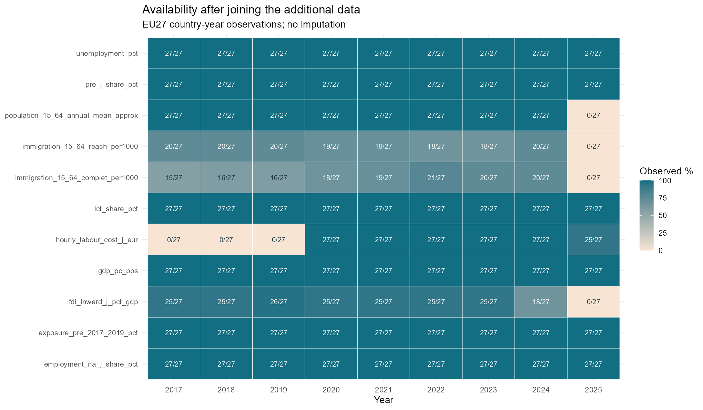
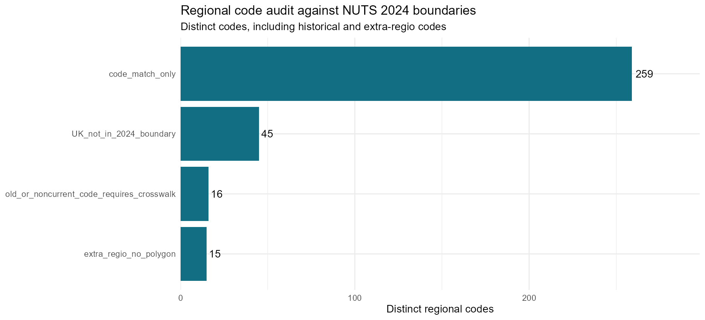
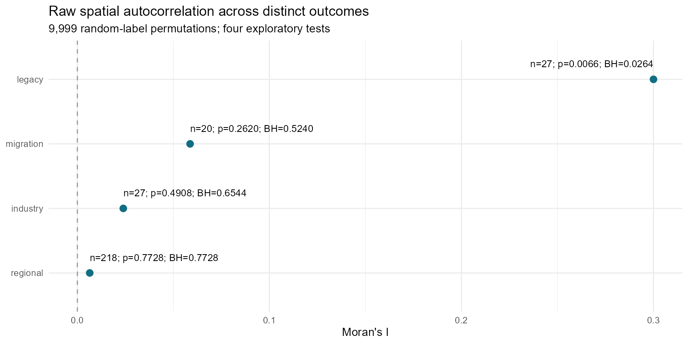
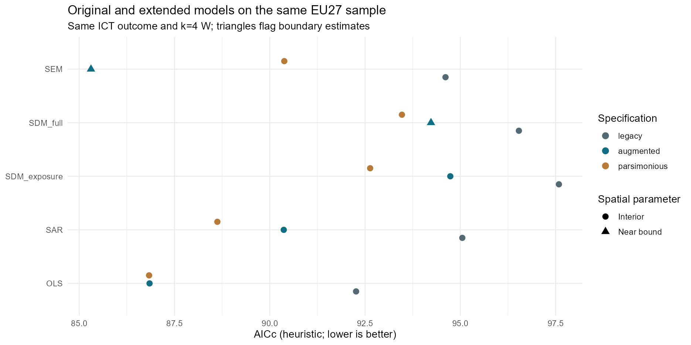
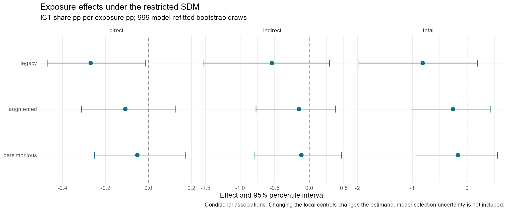
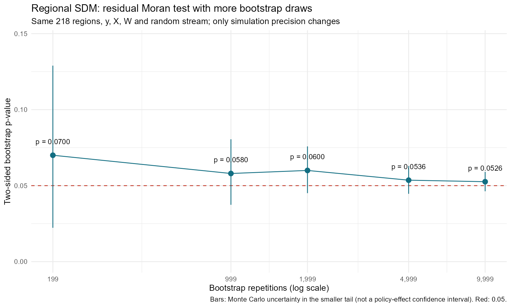
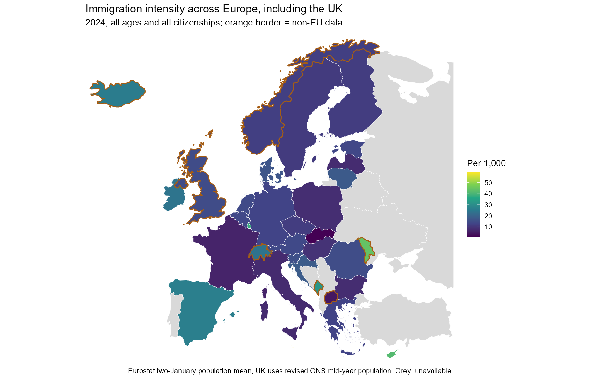
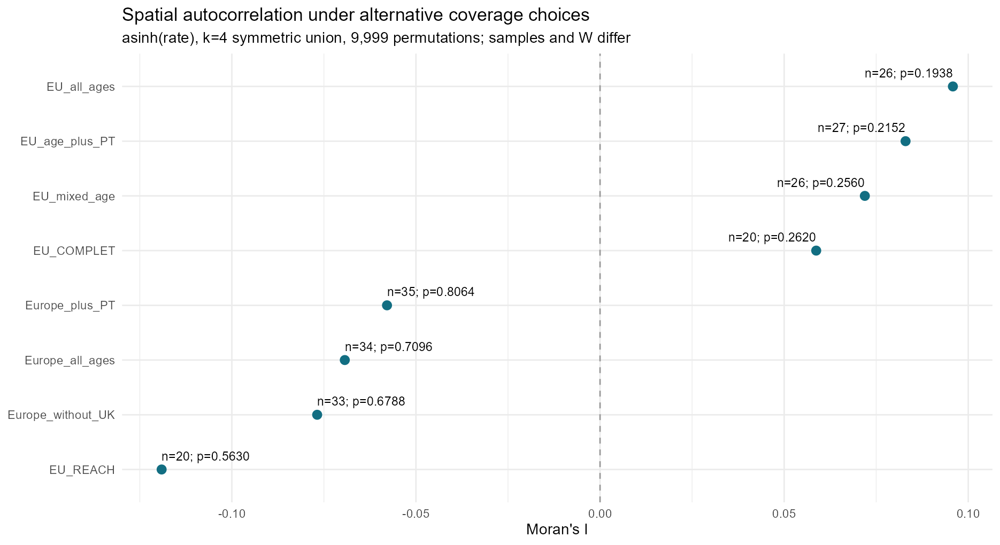
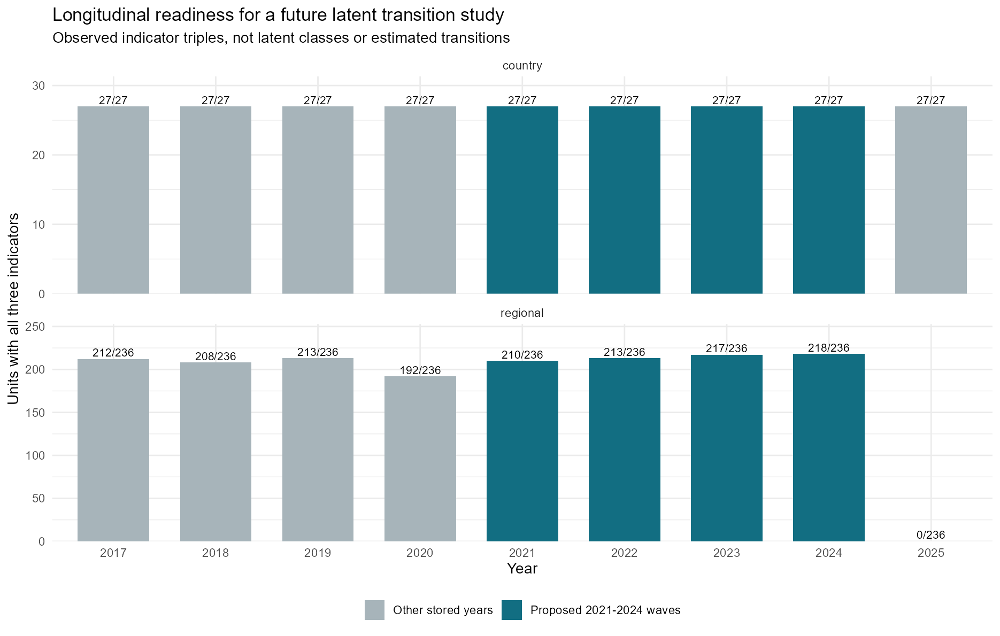

# 전처리에서 공간회귀까지

각 단계는 **분석 질문 → 실제 R 코드 → 저장 결과 → 해석** 순서입니다. 발췌 코드는 전체 파이프라인의 일부이므로 앞 단계의 객체가 필요합니다. 완전한 실행 진입점은 [재현 안내](reproduce.html)를 참고하세요.

## 1. 결측과 국가·연도 키를 점검한다

국가·연도 키의 중복을 먼저 검사하고 원래 288행을 유지하는 왼쪽 결합을 수행합니다. 없는 연도의 값을 이월하거나 누락을 0으로 대체하지 않습니다.

```r
before<-panel
stopifnot(nrow(additions)==288L,!anyDuplicated(additions[c("country","year")]))
panel<-merge(panel,additions,by=c("country","year"),all.x=TRUE,sort=FALSE)
panel<-panel[order(panel$country,panel$year),];rownames(panel)<-NULL
stopifnot(nrow(panel)==288L,!anyDuplicated(panel[c("country","year")]))
```

[실제 코드 · code/02_join_audit.R L39–L43](https://github.com/mw48795472/DMA-Rule-Data-Analysis/blob/main/code/02_join_audit.R#L39-L43)



**자료가 있다는 것과 두 이론을 측정한다는 것은 다른 문제다.** 2024년 EU27의 ICT 고용, 사전 노출도, GDP, 노동비용, 실업률, 사전 J산업 비중과 인구분모는 27개국 모두 관측된다. 연령별 이입률은 COMPLET와 REACH 각각 20개국, J산업 FDI/GDP는 18개국이다. 그림은 결측을 대체하지 않은 원자료의 가용성을 보여준다.

## 2. SHP와 지역코드의 유효성을 확인한다

국가 수치를 지역 자료에 복제하지 않습니다. NUTS 2024 코드 일치와 실제 통계 경계의 일치는 구별합니다.

```r
shp<-list.files(file.path(root,"inputs","additional","spatial","nuts2_2024"),"[.]shp$",full.names=TRUE,recursive=TRUE)
rg<-sf::st_read(shp[1],quiet=TRUE); stopifnot(!anyDuplicated(rg$NUTS_ID))
rg_valid<-data.frame(geo=rg$NUTS_ID,valid_before=sf::st_is_valid(rg),empty_before=sf::st_is_empty(rg))
rg<-sf::st_make_valid(rg);rg_valid$valid_after<-sf::st_is_valid(rg);save_csv(rg_valid,"region_geometry_validity.csv")
stopifnot(all(rg_valid$valid_after),!any(sf::st_is_empty(rg)))
```

[실제 코드 · code/02_join_audit.R L86–L90](https://github.com/mw48795472/DMA-Rule-Data-Analysis/blob/main/code/02_join_audit.R#L86-L90)



**회색 지역과 제외 코드는 경제적 부재가 아니라 자료 연결 문제일 수 있다.** 고유 지역코드 335개 중 코드 일치만 확인된 경우가 259개, 선택한 2024 경계에 없는 영국 코드가 45개, 과거·비현행 코드가 16개, 도형이 없는 extra-regio 코드가 15개다. 코드 일치 259개가 최종 회귀 표본 218개와 같은 집합은 아니다.

## 3. 표본 순서와 공간가중치 W를 고정한다

k=4 최근접 이웃 관계를 대칭 합집합으로 만들고 행 표준화합니다. 대칭화 전의 k와 최종 이웃 수는 다를 수 있습니다. W의 대각 원소는 0이며 각 행의 합은 1인지 검사합니다.

```r
make_weights <- function(dat,k=4){
 nb<-spdep::knn2nb(spdep::knearneigh(as.matrix(dat[c("x_m","y_m")]),k=k),row.names=dat$id,sym=TRUE)
 lw<-spdep::nb2listw(nb,style="W",zero.policy=FALSE);W<-spdep::listw2mat(lw)
 dimnames(W)<-list(dat$id,dat$id)
 stopifnot(all(abs(rowSums(W)-1)<1e-12),all(diag(W)==0),all(W>=0))
 list(W=W,lw=lw,nb=nb)
}
```

[실제 코드 · code/03_models.R L1–L7](https://github.com/mw48795472/DMA-Rule-Data-Analysis/blob/main/code/03_models.R#L1-L7)

## 4. X와 WX의 VIF를 함께 본다

VIF는 각 설명변수를 나머지 열로 회귀한 설명력으로 계산합니다. X만 검사하면 WX와의 공선성을 놓칠 수 있습니다. 제한형은 가설상 핵심인 사전 노출도에만 지연항을 둡니다.

```r
vif_values<-function(Z){
 v<-sapply(seq_len(ncol(Z)),function(j){
  e<-lm.fit(cbind(1,Z[,-j,drop=FALSE]),Z[,j])$residuals
  if(sum(e^2)<1e-20)Inf else sum((Z[,j]-mean(Z[,j]))^2)/sum(e^2)
 });setNames(v,colnames(Z))
}
```

[실제 코드 · code/03_models.R L9–L14](https://github.com/mw48795472/DMA-Rule-Data-Analysis/blob/main/code/03_models.R#L9-L14)

```r
design_matrix<-function(d,zvars,m,W){
 Z<-model.matrix(reformulate(zvars),d)
 lags<-if(m=="SDM_full")zvars else if(m=="SDM_exposure")"z_exposure" else character()
 if(length(lags)){wx<-W%*%as.matrix(d[lags]);colnames(wx)<-paste0("lag.",lags);Z<-cbind(Z,wx)}
 Z
}
```

[실제 코드 · code/03_models.R L16–L21](https://github.com/mw48795472/DMA-Rule-Data-Analysis/blob/main/code/03_models.R#L16-L21)


**제한형 SDM은 공선성을 줄이지만, 그 자체로 더 타당한 인과모형이 되지는 않는다.** 전체 X를 공간지연한 SDM의 최대 VIF는 기존 13.73, 사전 산업비중을 추가한 확장형 43.29, 노동비용을 뺀 간결형 5.89다. 노출도만 지연한 제한형은 각각 3.57, 4.10, 3.18로 낮아진다. 지역 전체 SDM의 최대 VIF는 별도 계산에서 3.96이다.

**브뤼셀 효과 관점** · 노출도와 주변 노출도의 계수를 더 안정적으로 비교할 설계 선택이다. VIF 감소는 규범 확산이라는 구성개념의 타당성을 보장하지 않는다.

**티부 효과 관점** · 노동비용을 빼면 공선성은 줄어도 입지·인력 이동의 중요한 조건이 누락될 수 있다. 제거 여부는 이론 및 측정 목적과 함께 결정해야 한다.

**해석의 한계** · VIF=5는 선별 기준이지 합격선이 아니다. 표준화는 VIF를 바꾸지 않는다. 이 검사는 X와 WX의 선형 중복이며 Wy의 내생성, 역인과, 누락변수 문제를 해결하지 않는다.

## 5. 원변수의 Moran’s I와 회귀 잔차 검정을 구분한다

원변수는 무작위배치 순열검정, OLS 잔차는 회귀 적합을 반영한 검정을 사용합니다. 공간모형의 혁신잔차는 해당 모형을 재적합하는 부트스트랩으로 진단합니다.

```r
set.seed(cfg$seed);raw<-spdep::moran.mc(d$outcome,w$lw,nsim=cfg$permutations,alternative="two.sided")
 adj<-spdep::lm.morantest(fits$OLS,w$lw,alternative="two.sided")
```

[실제 코드 · code/03_models.R L108–L109](https://github.com/mw48795472/DMA-Rule-Data-Analysis/blob/main/code/03_models.R#L108-L109)



**ICT 직업 고용비중의 군집과 일반 이입의 군집은 같은 결과가 아니다.** 국가 ICT 고용비중은 I=0.3000, p=0.0066으로 양의 군집 신호를 보인다. 4개 탐색 검정의 BH 보정 p=0.0264, 더 보수적인 BY 보정은 0.0550이다. 국가 J산업 비중은 I=0.0239, p=0.4908, 이입 강도는 I=0.0587, p=0.2620, 지역 J산업 비중은 I=0.0064, p=0.7728이다.

**브뤼셀 효과 관점** · ICT 역량이 유사한 국가들이 지리적으로 모여 있다는 기술적 증거다. EU 규범이 비EU 시장으로 이전되었다는 관측은 포함하지 않는다.

**티부 효과 관점** · 이입률의 전역 군집을 지지하는 증거는 약하다. 그러나 비인접 국가 간 이동, 특정 산업의 이동 또는 반대 방향 흐름은 전역 I에서 드러나지 않을 수 있다.

**해석의 한계** · 9,999회 순열과 해당 W에 조건부인 결과다. 무작위배치 귀무가설의 비기각은 이동 부재의 증명이 아니다. 서로 다른 n과 결과변수의 I를 효과 크기 순위로 해석하지 않는다.

## 6. 동일 표본에서 OLS·SAR·SEM·SDM을 적합한다

다음은 `run_group()` 내부의 실제 적합 함수입니다. `ff`에는 같은 표준화 설명변수를 사용하고, SDM에서만 Durbin 항을 추가합니다. SEM의 오차 공간의존성과 SAR의 종속변수 공간지연을 구별합니다.

```r
fit_one<-function(dd,m,ww){
  ff<-reformulate(zvars,response="outcome");lw<-spdep::mat2listw(ww,row.names=dd$id,style="W")
  eig<-Re(eigen(ww,only.values=TRUE)$values)
  if(m=="OLS")return(lm(ff,dd))
  if(m=="SEM")return(spatialreg::errorsarlm(ff,data=dd,listw=lw,method="eigen",interval=interval,control=list(pre_eig=eig),quiet=TRUE))
  du<-if(m=="SDM_full")TRUE else if(m=="SDM_exposure")~z_exposure else FALSE
  spatialreg::lagsarlm(ff,data=dd,listw=lw,Durbin=du,method="eigen",interval=interval,control=list(pre_eig=eig),quiet=TRUE)
 }
```

[실제 코드 · code/03_models.R L76–L83](https://github.com/mw48795472/DMA-Rule-Data-Analysis/blob/main/code/03_models.R#L76-L83)



**국가 수준에서는 SDM의 일관된 우위를 확인하지 못했다.** 기존 구성에서는 OLS의 AICc가 92.26으로 가장 작다. 확장형은 SEM 85.31이 OLS 86.85보다 작지만 공간계수가 하한 -0.999에 걸린다. 간결형은 OLS 86.83, SAR 88.62, SEM 90.38, 제한형 SDM 92.63이다. 확장형·간결형 OLS는 기존 OLS보다 적합도가 개선된다.

**브뤼셀 효과 관점** · 기존 산업 구조를 고려하면 국가별 ICT 고용 분포를 더 잘 설명한다는 결과다. 특정 공간모형의 선택을 브뤼셀 효과의 채택으로 치환할 수 없다.

**티부 효과 관점** · 고용비중은 지역의 상태이며 국경을 넘은 이동량이 아니다. SEM의 낮은 정보기준이나 음의 계수로 규제 회피를 입증할 수 없다.

**해석의 한계** · AICc는 같은 결과변수·표본·우도 척도 안에서 비교한다. 작은 n=27과 경계 추정의 영향을 받으며 예측 검증도 아니다. 확장형 SEM의 경계 문제는 그림 12에서 별도로 다룬다.

## 7. SDM 직접·간접·총효과를 분해한다

공간승수를 반영한 직접효과와 총효과의 차이를 간접효과로 정의합니다. 계산된 간접효과를 곧바로 EU 규범의 해외 확산으로 해석할 수는 없습니다.

```r
impact_values<-function(pt,W,zvars,ev){
 # W is row stochastic: total multiplier=1/(1-rho).
 # Trace formulas avoid a matrix inversion for every bootstrap replicate.
 a<-if(pt$type=="lag")pt$par else 0
 trS<-mean(1/(1-a*ev));trSW<-mean(ev/(1-a*ev))
 do.call(rbind,lapply(zvars,function(v){
  beta<-unname(pt$beta[v]);theta<-if(paste0("lag.",v)%in%names(pt$beta))unname(pt$beta[paste0("lag.",v)]) else 0
  direct<-trS*beta+trSW*theta;total<-(beta+theta)/(1-a)
  data.frame(term=v,direct=direct,indirect=total-direct,total=total)
 }))
}
```

[실제 코드 · code/03_models.R L49–L59](https://github.com/mw48795472/DMA-Rule-Data-Analysis/blob/main/code/03_models.R#L49-L59)



**기존의 음의 직접 연관성은 통제변수 구성을 바꾸면 약해진다.** 노출도 1%p에 대한 ICT 고용비중의 직접효과는 기존 -0.269%p(95% 구간 -0.472~-0.013), 확장형 -0.108(-0.311~0.127), 간결형 -0.052(-0.250~0.173)다. 세 구성의 간접·총효과 구간은 모두 0을 포함한다. 국가별 구간은 999회 모형 재적합 부트스트랩이다.

**브뤼셀 효과 관점** · 지역 간 연결을 고려한 조건부 연관성을 분해한 결과다. 간접효과는 규범 확산의 관측치가 아니며, 현재 수치로 해외 준수 확대를 지지한다고 말할 수 없다.

**티부 효과 관점** · 음의 직접효과는 인력 유출의 직접 증거가 아니다. 분모인 전체 고용의 변화, 산업구성, 과거 디지털화와 미관측 조건으로도 같은 패턴이 생길 수 있다.

**해석의 한계** · 2017~2019 조사연도 마켓플레이스 판매 비율은 DMA 처치량으로 확정되지 않았다. 공간승수로 계산한 효과도 인과 식별이 없으면 연관성이다. 구간은 모형 선택의 불확실성을 포함하지 않는다. [5]

## 8. 지역 SDM 잔차 검정의 반복 횟수를 늘린다

동일한 y·X·W·난수열을 유지하고, 모의 결과마다 모형을 다시 적합합니다. 199회에서 9,999회로 늘린 것은 검정의 시뮬레이션 정밀도이며 정책 효과의 변화가 아닙니다.

```r
summarise_B<-function(m){
 vals<-I_sim[seq_len(m)];a<-sum(vals<=I_observed);b<-sum(vals>=I_observed);s<-min(a,b)
 p<-min(1,2*(s+1)/(m+1));prob<-(s+1)/(m+1)
 ci<-binom.test(s,m)$conf.int
 data.frame(simulations=m,I=I_observed,smaller_tail_count=s,p_bootstrap=p,
 MC_SE_approx=2*sqrt(prob*(1-prob)/(m+1)),MC_lower=max(0,2*ci[1]),MC_upper=min(1,2*ci[2]),
 successful=m,failed=0,boundary_fraction=mean(abs(parameters[seq_len(m)])>.98))
}
```

[실제 코드 · code/07_refine_regional_bootstrap.R L39–L46](https://github.com/mw48795472/DMA-Rule-Data-Analysis/blob/main/code/07_refine_regional_bootstrap.R#L39-L46)

| simulations | p_bootstrap | MC_SE_approx | MC_lower | MC_upper |
| --- | --- | --- | --- | --- |
| 199 | 0.0700 | 0.0260 | 0.0223 | 0.1289 |
| 999 | 0.0580 | 0.0106 | 0.0374 | 0.0805 |
| 1999 | 0.0600 | 0.0076 | 0.0451 | 0.0758 |
| 4999 | 0.0536 | 0.0046 | 0.0446 | 0.0629 |
| 9999 | 0.0526 | 0.0032 | 0.0463 | 0.0590 |

[결과 CSV](https://github.com/mw48795472/DMA-Rule-Data-Analysis/blob/main/outputs/regional_sdm_bootstrap_comparison.csv)



**반복 증가는 모의실험 오차를 줄였고, 정책효과의 새로운 증거를 만든 것은 아니다.** 같은 218개 지역·자료·W·난수열에서 B=199의 p=0.0700이 B=9,999에서 0.0526이 된다. MC 표준오차는 0.02599→0.00320으로 약 8.1배 정밀해진다. 마지막 MC 구간은 0.04632~0.05905다. rho=0.4045와 AICc=705.8151은 변하지 않았다.

**브뤼셀 효과 관점** · 규범 확산에 대한 유의성이 아니라 혁신잔차 검정의 계산 정밀도를 보완한 것이다. 이 구간을 브뤼셀 효과의 신뢰구간으로 제시할 수 없다.

**티부 효과 관점** · 이동을 측정하는 추가 관측치가 늘어난 것이 아니므로 규제 유발 이동에 대한 식별력 증가로 볼 수 없다.

**해석의 한계** · 관측 p는 0.05보다 크지만 MC 구간은 0.05를 가로지른다. 무상관을 확정하거나 유의성이 나올 때까지 반복하지 않는다. 정규·등분산 혁신 가정은 남는다. 다른 지역 모형 잔차와 지역 효과 구간은 여전히 B=199다.

## 9. 영국·비EU 범위와 연령 정의를 별도로 비교한다



**비EU국을 포함해 비교 범위는 확대됐지만 처리군·대조군 설계는 아니다.** 조사 범위는 EU27과 비EU16의 43개국이며 기본 전체 연령 비율은 34개국에서 계산된다. GISCO 도형은 42개국에 연결된다. 관측된 비EU국은 주황 경계로 표시한다. 이 그림에는 포르투갈 INE 보완값이 들어가지 않으며 그림 19에서 별도로 다룬다.

**브뤼셀 효과 관점** · EU 밖의 비교 대상을 제시하는 배경 지도다. 비EU라는 분류는 DMA 비노출을 뜻하지 않으며 국외 서비스 제공자의 EU시장 준수와도 구분해야 한다. [1]

**티부 효과 관점** · 국경 간 인구 유입의 목적지 강도를 비교할 수 있다. 그러나 출발지가 EU인지, 규제를 피한 이동인지, ICT 종사자인지는 알 수 없다.

**해석의 한계** · 모든 유럽 국가를 망라하지 않는다. UK는 ONS 중간인구, 다른 기본값은 Eurostat 두 연초 인구 평균을 사용한다. 15~64세 지도와 전체 연령 지도의 수치를 직접 비교하지 않는다. XK는 별도 도형이 없다.



**검토한 k=4의 8개 대안 모두 뚜렷한 전역 군집 증거를 제시하지 않는다.** EU20 COMPLET는 I=0.05871, p=0.2620이다. 유럽34 전체 연령은 I=-0.06932, p=0.7096, 영국 제외33은 -0.07683, 0.6788, 포르투갈 포함35는 -0.05786, 0.8064다. 8개 기본 대안의 가장 작은 p도 0.1938이며 BH 보정 후 최소값은 0.5240이다.

**브뤼셀 효과 관점** · 이 검정은 인구 이입률의 지리적 군집을 검사한다. EU 규범이 비지리적 플랫폼 네트워크를 통해 확산되는지에 대한 반증 검정은 아니다.

**티부 효과 관점** · 현재 W에서 총이입률이 유사한 나라끼리 모인다는 증거는 약하다. 규제에 반응한 특정 흐름이 없다는 결론이나 비EU 유출이 없다는 결론으로 확장할 수 없다.

**해석의 한계** · 국가·연령 정의를 바꿀 때마다 표본과 W를 재구성한다. I 차이를 포르투갈·영국의 인과효과로 해석하지 않는다. 모두 asinh 비율의 양측 9,999회 순열이며 작은 표본과 결측의 영향을 받는다.

## 10. LTA는 아직 연구 준비 단계다



**잠재상태와 전이를 추정한 결과가 아니라 종단연구의 준비 상태다.** 2021~2024년 국가 표는 27×4=108행 모두 세 지표가 완전하다. 지역 표는 236×4=944행 중 858행이 완전하고, 네 시점 모두 완전한 지역은 205개다. 지역 완전관측 수는 210→213→217→218개이며, 2025년에는 지역 GDP 부재로 세 지표 완전행이 0개다.

**브뤼셀 효과 관점** · 디지털 노동시장·지역 경제구조 상태의 변화를 후속 분석할 수 있다. 지금 지표로 잠재상태에 ‘브뤼셀 확산형’이라는 이름을 붙일 측정 근거는 없다.

**티부 효과 관점** · 상태 전환이 나타나도 지역 내 산업 변화인지 국경 간 이동인지 구분해야 한다. 실제 이동 흐름을 외부 결과 또는 공변량으로 결합해야 한다.

**해석의 한계** · 108행은 독립 국가 108개가 아니다. 연속형 지표이므로 잠재프로파일 전이를 검토하고 시점 간 측정동일성, 공간·국가 의존성, 결측, 분류오차를 다뤄야 한다. 현재 상태 수·전이확률·BIC·entropy는 추정하지 않았다. [7]

[전체 그림과 시각화 코드 보기](plots.html) · [브뤼셀 효과·티부형 이동의 후속 검증 설계](mechanisms.html)
