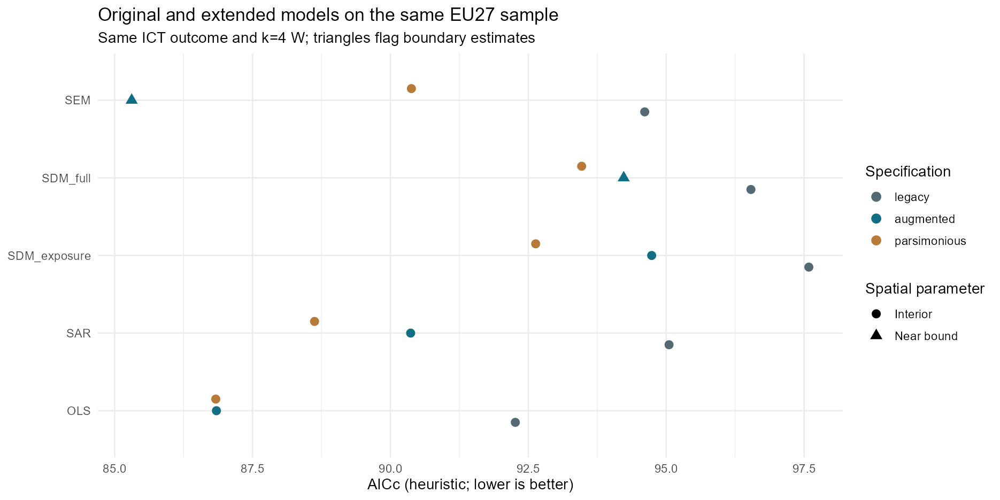
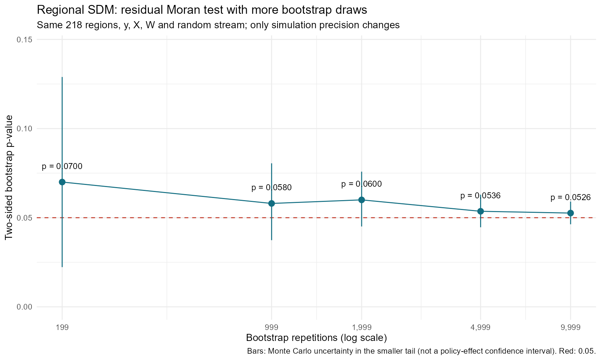
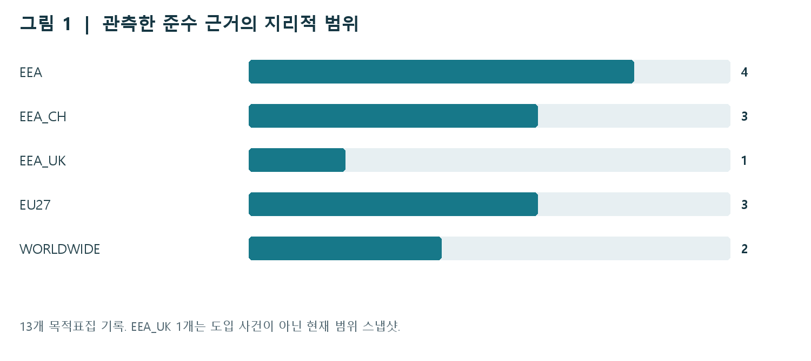
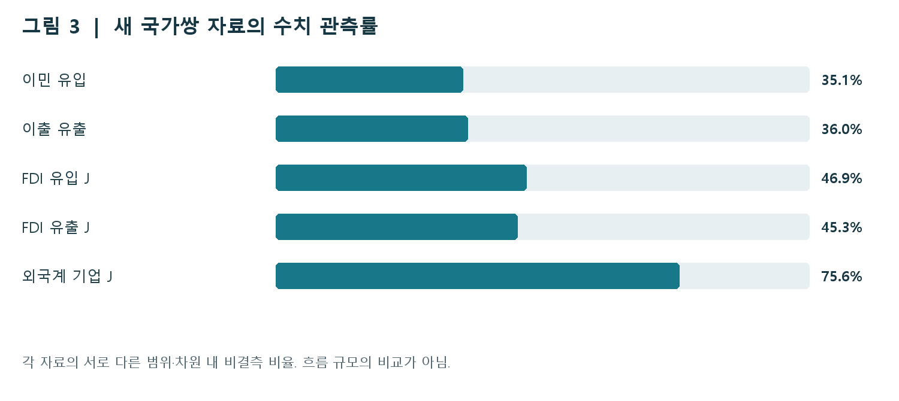

# 규범은 어디로 퍼지고, 생산요소는 어디로 이동하는가

유럽 디지털시장법(DMA)을 둘러싼 **브뤼셀 효과**와 **티부형 이동**을 구분하기 위한 공간분석·자료 구축 PoC입니다. 기존 공간회귀 결과와 추가 수집한 준수 변화·국가쌍 자료를 연결해, 현재 무엇을 관측했고 무엇을 아직 검증하지 못했는지 설명합니다.

> 자료 기준일 **2026-11-02** · 국가 패널 **32개국 × 9년 = 288행** · 지역 회귀 **218개 지역** · 그림 **23개**

## 먼저 읽을 결과

1. **공간지연 설명변수를 제한하면 공선성이 낮아집니다.** 확장형 전체 SDM의 최대 VIF는 43.29, 노출도에만 공간지연을 둔 제한형은 4.10입니다. 표준화 자체가 VIF를 낮추지는 않습니다.
2. **국가 수준에서 SDM의 일관된 우위는 확인되지 않았습니다.** 간결형에서는 OLS의 AICc가 가장 작고, 확장형 SEM의 낮은 AICc에는 공간계수 경계 추정 문제가 있습니다.
3. **지역 SDM 잔차 검정은 경계적입니다.** 부트스트랩 9,999회에서 p=0.0526입니다. 몬테카를로 구간이 0.05를 가로지르므로 “공간의존성을 완전히 제거했다”는 결론은 피합니다.
4. **규범 확산과 실제 이동은 관측 단위부터 다릅니다.** 준수 변경의 적용 시장과 기업·사업장·자본·인력의 출발지–목적지를 각각 측정합니다. 현재 자료로 DMA가 이동을 유발했다고 확정하지 않습니다.

## 분석을 따라 읽는 순서

| 질문 | 문서 |
|---|---|
| 어떻게 결합하고 검정했는가? | [전처리 → VIF → Moran → 공간회귀](analysis.html) |
| 각 그림은 어떤 코드와 결과에서 나왔는가? | [23개 plot과 코드·해석](plots.html) |
| 두 효과를 어떻게 구분해 검증할 것인가? | [추가 자료와 연구설계](mechanisms.html) |
| RStudio에서 어떻게 다시 실행하는가? | [재현과 원천자료](reproduce.html) |

## 공간지연변수 구성과 공선성

분석에서는 원래 설명변수 X와 공간지연 WX를 함께 포함한 설계행렬의 VIF를 확인했습니다. 아래는 실제 설계행렬 생성 코드입니다. `SDM_full`은 모든 X를, `SDM_exposure`는 사전 노출도만 공간지연합니다.

```r
design_matrix<-function(d,zvars,m,W){
 Z<-model.matrix(reformulate(zvars),d)
 lags<-if(m=="SDM_full")zvars else if(m=="SDM_exposure")"z_exposure" else character()
 if(length(lags)){wx<-W%*%as.matrix(d[lags]);colnames(wx)<-paste0("lag.",lags);Z<-cbind(Z,wx)}
 Z
}
```

[실제 코드 · code/03_models.R L16–L21](https://github.com/mw48795472/DMA-Rule-Data-Analysis/blob/main/code/03_models.R#L16-L21)


**제한형 SDM은 공선성을 줄이지만, 그 자체로 더 타당한 인과모형이 되지는 않는다.** 전체 X를 공간지연한 SDM의 최대 VIF는 기존 13.73, 사전 산업비중을 추가한 확장형 43.29, 노동비용을 뺀 간결형 5.89다. 노출도만 지연한 제한형은 각각 3.57, 4.10, 3.18로 낮아진다. 지역 전체 SDM의 최대 VIF는 별도 계산에서 3.96이다.

## 모형 선택과 결과의 안정성



**국가 수준에서는 SDM의 일관된 우위를 확인하지 못했다.** 기존 구성에서는 OLS의 AICc가 92.26으로 가장 작다. 확장형은 SEM 85.31이 OLS 86.85보다 작지만 공간계수가 하한 -0.999에 걸린다. 간결형은 OLS 86.83, SAR 88.62, SEM 90.38, 제한형 SDM 92.63이다. 확장형·간결형 OLS는 기존 OLS보다 적합도가 개선된다.

간결형 EU27 동일 표본의 저장 결과입니다. 다른 결과변수·표본 간 정보기준을 섞지 않습니다.

| model | n | AICc | spatial_parameter | near_boundary |
| --- | --- | --- | --- | --- |
| OLS | 27 | 86.83 | 0.000 | FALSE |
| SAR | 27 | 88.62 | 0.275 | FALSE |
| SEM | 27 | 90.38 | 0.149 | FALSE |
| SDM_full | 27 | 93.47 | -0.814 | FALSE |
| SDM_exposure | 27 | 92.63 | 0.308 | FALSE |

[결과 CSV](https://github.com/mw48795472/DMA-Rule-Data-Analysis/blob/main/outputs/all_model_comparisons.csv)

## 잔차 검정의 정밀도



**반복 증가는 모의실험 오차를 줄였고, 정책효과의 새로운 증거를 만든 것은 아니다.** 같은 218개 지역·자료·W·난수열에서 B=199의 p=0.0700이 B=9,999에서 0.0526이 된다. MC 표준오차는 0.02599→0.00320으로 약 8.1배 정밀해진다. 마지막 MC 구간은 0.04632~0.05905다. rho=0.4045와 AICc=705.8151은 변하지 않았다.

## 준수 변화와 국가 간 흐름을 별도로 측정



공식 자료에서 정리한 변경 12개와 현재 범위 스냅샷 1개입니다. 발표·회사 자기보고·확인된 시행일을 분리하며, 스냅샷을 과거로 소급하지 않습니다. 전체 게이트키퍼의 준수율을 나타내는 표본은 아닙니다.



국가쌍 자료 205,784행 중 85,278행에 수치가 있습니다. 연령·방향·산업·단위별 차원을 포함한 행 수이며, 고유 이동 사건 수가 아닙니다. 일반 이민과 ICT 인력 이동, FDI와 실물 사업장 이전도 구분합니다.

## 보고서와 자료

[연구설계 보고서 PDF · 15쪽](downloads/DMA_Mechanisms_Research_Design_20261102.pdf) · [기존 20개 그림 보고서 PDF · 30쪽](downloads/DMA_PoC_20plots_Report.pdf) · [전체 저장소](https://github.com/mw48795472/DMA-Rule-Data-Analysis)

웹 문서는 Markdown으로 관리하며, 분석 단계마다 실제 R 코드 발췌와 저장된 결과를 함께 제시합니다. 웹 게시 과정에서는 모형을 새로 추정하지 않습니다.
