# 그림을 코드와 함께 읽기

기존 공간분석 20개와 추가 자료 검토 3개를 모았습니다. 각 그림 아래에 관측 결과, 두 이론의 해석 범위, 한계와 실제 시각화 코드가 이어집니다. 발췌 코드에 사용하는 데이터 객체·공통 함수는 전체 R 파일 앞부분에서 정의합니다.

```r
# RStudio 프로젝트에서 실행: 저장 결과로 23개 그림을 차례로 Plots 창에 표시하고 figures/에 저장합니다.
source("RUN_ALL.R", encoding = "UTF-8")
# 부분 실행: 기존 20개만 RUN_PLOTS.R, 추가 자료와 그림 3개만 RUN_MECHANISMS.R
```

그림은 하나씩 `dma_register("NN_name", 폭, 높이, function(){ ggplot ... })` 블록으로 정의되어 있어 `dma_build_plot(번호)`로 개별 재생성할 수 있습니다.

## 그림 목록

- [그림 01 · 결합 자료의 변수별·연도별 가용성](#fig-01)
- [그림 02 · 지역코드와 NUTS 2024 경계의 연결 감사](#fig-02)
- [그림 03 · 국소 변수와 공간지연 변수의 다중공선성](#fig-03)
- [그림 04 · 동일 EU27 표본에서의 국가 공간회귀 비교](#fig-04)
- [그림 05 · 원변수의 전역 공간자기상관](#fig-05)
- [그림 06 · 제한형 SDM의 사전 노출도 직접·간접·총효과](#fig-06)
- [그림 07 · ICT 직업과 J산업 고용비중의 국가 분포](#fig-07)
- [그림 08 · NUTS2 지역 J산업 고용비중](#fig-08)
- [그림 09 · 모형별 혁신잔차의 공간자기상관](#fig-09)
- [그림 10 · 이웃 수 k에 대한 모형 선택 민감도](#fig-10)
- [그림 11 · 15~64세 일반 이입 강도: COMPLET](#fig-11)
- [그림 12 · 공간모수 추정 경계의 우도 민감도](#fig-12)
- [그림 13 · 지역 SDM 부트스트랩 반복 수의 확대](#fig-13)
- [그림 14 · COMPLET와 REACH 연령 정의의 분리 비교](#fig-14)
- [그림 15 · REACH 보완을 통한 EU26 이입 지도](#fig-15)
- [그림 16 · 영국을 포함한 유럽 전체 연령 이입 강도](#fig-16)
- [그림 17 · 검증된 비EU 8개국의 이입 강도 비교](#fig-17)
- [그림 18 · 국가 범위와 연령 정의에 따른 이입률 Moran 검정](#fig-18)
- [그림 19 · 포르투갈 국가자료를 이용한 별도 보완](#fig-19)
- [그림 20 · LTA 종단연구 후보 자료의 가용성](#fig-20)
- [추가 그림 M1–M3 · 준수·기업 사건·흐름 가용성](#mechanism-plots)

## 그림 01 · 결합 자료의 변수별·연도별 가용성 {#fig-01}

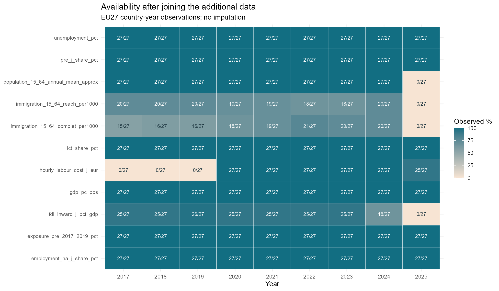

**자료가 있다는 것과 두 이론을 측정한다는 것은 다른 문제다.** 2024년 EU27의 ICT 고용, 사전 노출도, GDP, 노동비용, 실업률, 사전 J산업 비중과 인구분모는 27개국 모두 관측된다. 연령별 이입률은 COMPLET와 REACH 각각 20개국, J산업 FDI/GDP는 18개국이다. 그림은 결측을 대체하지 않은 원자료의 가용성을 보여준다.

**브뤼셀 효과 관점** · 노출도와 디지털 노동시장 결과를 연결할 분석 기반은 있다. 그러나 마켓플레이스 판매기업 비율은 지정 게이트키퍼 의존도나 해외 준수의 확산을 직접 측정하지 않는다.

**티부 효과 관점** · 이입과 FDI를 이동의 후보 지표로 사용할 여지는 있다. 다만 국가별 자료 누락이 규제·행정역량과 관련되면 완전사례 표본은 선택될 수 있다.

**해석의 한계** · 18개국의 FDI 가용성은 FDI 회귀를 수행했다는 뜻이 아니다. 현재 20개 그림은 기업·투자 이전을 직접 검정하지 않았다. 연도별 표본 변화와 원천의 단절·추정 플래그를 점검해야 한다.

### 이 그림을 만드는 핵심 코드

```r
dma_register("01_missingness",12,7,function(){
 coverage<-dma_data("coverage")
 cov<-coverage[coverage$scope=="EU27",];cov$pct<-100*cov$observed/cov$n
 cov$label<-paste0(cov$observed,"/",cov$n)
 ggplot(cov,aes(factor(year),variable,fill=pct))+geom_tile(color="white")+geom_text(aes(label=label,color=ifelse(pct>60,"white","#18313b")),size=3)+scale_color_identity()+
  scale_fill_gradient(low="#f7e4d3",high="#126e82",limits=c(0,100))+
  labs(title="Availability after joining the additional data",subtitle="EU27 country-year observations; no imputation",x="Year",y=NULL,fill="Observed %")+
  theme(axis.text.y=element_text(size=9))
})
```

[전체 시각화 코드 · L56–L64](https://github.com/mw48795472/DMA-Rule-Data-Analysis/blob/main/code/11_plot_saved_results.R#L56-L64)

**결과 원천 파일**: `combined_missingness.csv`, `country_missing_cells.csv`, `sample_quality_flags.csv`

## 그림 02 · 지역코드와 NUTS 2024 경계의 연결 감사 {#fig-02}

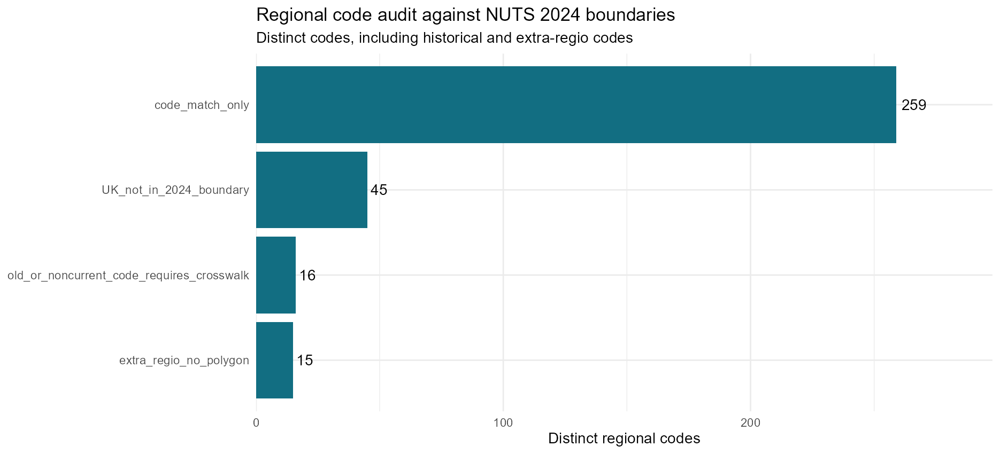

**회색 지역과 제외 코드는 경제적 부재가 아니라 자료 연결 문제일 수 있다.** 고유 지역코드 335개 중 코드 일치만 확인된 경우가 259개, 선택한 2024 경계에 없는 영국 코드가 45개, 과거·비현행 코드가 16개, 도형이 없는 extra-regio 코드가 15개다. 코드 일치 259개가 최종 회귀 표본 218개와 같은 집합은 아니다.

**브뤼셀 효과 관점** · 공간 연결 오류가 만든 공백이나 경계 불연속을 규제 확산의 단절로 해석하는 일을 막는 품질 점검이다.

**티부 효과 관점** · 영국 지역코드가 빠진 현상을 기업·인력 이탈로 읽을 수 없다. 현재 영국 보완은 국가 수준이며 영국 NUTS 지역 회귀를 복원한 것이 아니다.

**해석의 한계** · code_match_only는 문자열 연결만 뜻한다. EU 포함 여부, 지리적 분석 창, 변수 결측을 추가로 통과해야 한다. 역사적 지역의 분할·통합은 공식 대응표와 가중 집계를 통해 별도로 조정해야 한다.

### 이 그림을 만드는 핵심 코드

```r
dma_register("02_region_code_audit",11,5,function(){
 region_audit<-dma_data("region_audit")
 ra<-region_audit[!duplicated(region_audit$geo),];bar<-as.data.frame(table(ra$reason));names(bar)<-c("reason","codes")
 ggplot(bar,aes(codes,reorder(reason,codes)))+geom_col(fill="#126e82")+geom_text(aes(label=codes),hjust=-.2)+
  scale_x_continuous(expand=expansion(mult=c(0,.15)))+
  labs(title="Regional code audit against NUTS 2024 boundaries",subtitle="Distinct codes, including historical and extra-regio codes",x="Distinct regional codes",y=NULL)
})
```

[전체 시각화 코드 · L65–L71](https://github.com/mw48795472/DMA-Rule-Data-Analysis/blob/main/code/11_plot_saved_results.R#L65-L71)

**결과 원천 파일**: `region_code_audit.csv`, `regional_sample_audit_2024.csv`

## 그림 03 · 국소 변수와 공간지연 변수의 다중공선성 {#fig-03}


**제한형 SDM은 공선성을 줄이지만, 그 자체로 더 타당한 인과모형이 되지는 않는다.** 전체 X를 공간지연한 SDM의 최대 VIF는 기존 13.73, 사전 산업비중을 추가한 확장형 43.29, 노동비용을 뺀 간결형 5.89다. 노출도만 지연한 제한형은 각각 3.57, 4.10, 3.18로 낮아진다. 지역 전체 SDM의 최대 VIF는 별도 계산에서 3.96이다.

**브뤼셀 효과 관점** · 노출도와 주변 노출도의 계수를 더 안정적으로 비교할 설계 선택이다. VIF 감소는 규범 확산이라는 구성개념의 타당성을 보장하지 않는다.

**티부 효과 관점** · 노동비용을 빼면 공선성은 줄어도 입지·인력 이동의 중요한 조건이 누락될 수 있다. 제거 여부는 이론 및 측정 목적과 함께 결정해야 한다.

**해석의 한계** · VIF=5는 선별 기준이지 합격선이 아니다. 표준화는 VIF를 바꾸지 않는다. 이 검사는 X와 WX의 선형 중복이며 Wy의 내생성, 역인과, 누락변수 문제를 해결하지 않는다.

### 이 그림을 만드는 핵심 코드

```r
dma_register("03_vif_comparison",12,4.8,function(){
 vmax<-dma_data("vmax")
 vv<-vmax[vmax$group%in%c("legacy","augmented","parsimonious") & vmax$model%in%c("OLS","SDM_full","SDM_exposure"),]
 vv$group<-factor(vv$group,levels=c("legacy","augmented","parsimonious"))
 ggplot(vv,aes(max_VIF,model))+geom_vline(xintercept=5,linetype=2,color="#b77a37")+geom_point(size=3,color="#126e82")+
  geom_text(aes(label=sprintf("%.2f",max_VIF)),nudge_y=.22,size=3.3)+facet_wrap(~group,nrow=1)+
  scale_x_log10()+labs(title="Collinearity in local X and spatially lagged WX",subtitle="Log scale; standardization does not change VIF; 5 is a screening reference",x="Maximum VIF",y=NULL)
})
```

[전체 시각화 코드 · L72–L79](https://github.com/mw48795472/DMA-Rule-Data-Analysis/blob/main/code/11_plot_saved_results.R#L72-L79)

**결과 원천 파일**: `max_vif.csv`, `all_vif.csv`

## 그림 04 · 동일 EU27 표본에서의 국가 공간회귀 비교 {#fig-04}

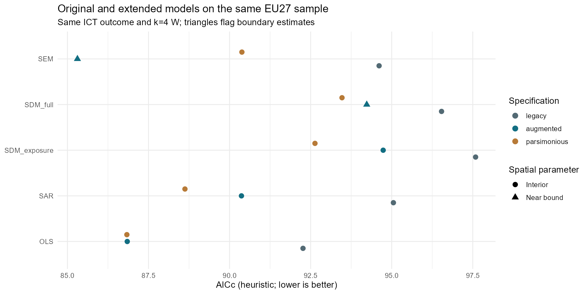

**국가 수준에서는 SDM의 일관된 우위를 확인하지 못했다.** 기존 구성에서는 OLS의 AICc가 92.26으로 가장 작다. 확장형은 SEM 85.31이 OLS 86.85보다 작지만 공간계수가 하한 -0.999에 걸린다. 간결형은 OLS 86.83, SAR 88.62, SEM 90.38, 제한형 SDM 92.63이다. 확장형·간결형 OLS는 기존 OLS보다 적합도가 개선된다.

**브뤼셀 효과 관점** · 기존 산업 구조를 고려하면 국가별 ICT 고용 분포를 더 잘 설명한다는 결과다. 특정 공간모형의 선택을 브뤼셀 효과의 채택으로 치환할 수 없다.

**티부 효과 관점** · 고용비중은 지역의 상태이며 국경을 넘은 이동량이 아니다. SEM의 낮은 정보기준이나 음의 계수로 규제 회피를 입증할 수 없다.

**해석의 한계** · AICc는 같은 결과변수·표본·우도 척도 안에서 비교한다. 작은 n=27과 경계 추정의 영향을 받으며 예측 검증도 아니다. 확장형 SEM의 경계 문제는 그림 12에서 별도로 다룬다.

### 이 그림을 만드는 핵심 코드

```r
dma_register("04_national_model_comparison",11,5.5,function(){
 comparison<-dma_data("comparison")
 cc<-comparison[comparison$group%in%c("legacy","augmented","parsimonious"),]
 cc$group<-factor(cc$group,levels=c("legacy","augmented","parsimonious"))
 ggplot(cc,aes(AICc,model,color=group,shape=near_boundary,group=group))+geom_point(position=position_dodge(width=.45),size=3)+
  scale_color_manual(values=c(legacy="#536a74",augmented="#126e82",parsimonious="#b77a37"))+
  scale_shape_manual(values=c(`FALSE`=16,`TRUE`=17),labels=c(`FALSE`="Interior",`TRUE`="Near bound"))+
  labs(title="Original and extended models on the same EU27 sample",subtitle="Same ICT outcome and k=4 W; triangles flag boundary estimates",x="AICc (heuristic; lower is better)",y=NULL,color="Specification",shape="Spatial parameter")
})
```

[전체 시각화 코드 · L80–L88](https://github.com/mw48795472/DMA-Rule-Data-Analysis/blob/main/code/11_plot_saved_results.R#L80-L88)

**결과 원천 파일**: `all_model_comparisons.csv`, `boundary_constraint_sensitivity.csv`

## 그림 05 · 원변수의 전역 공간자기상관 {#fig-05}

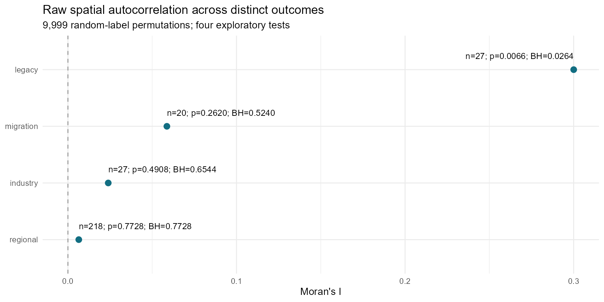

**ICT 직업 고용비중의 군집과 일반 이입의 군집은 같은 결과가 아니다.** 국가 ICT 고용비중은 I=0.3000, p=0.0066으로 양의 군집 신호를 보인다. 4개 탐색 검정의 BH 보정 p=0.0264, 더 보수적인 BY 보정은 0.0550이다. 국가 J산업 비중은 I=0.0239, p=0.4908, 이입 강도는 I=0.0587, p=0.2620, 지역 J산업 비중은 I=0.0064, p=0.7728이다.

**브뤼셀 효과 관점** · ICT 역량이 유사한 국가들이 지리적으로 모여 있다는 기술적 증거다. EU 규범이 비EU 시장으로 이전되었다는 관측은 포함하지 않는다.

**티부 효과 관점** · 이입률의 전역 군집을 지지하는 증거는 약하다. 그러나 비인접 국가 간 이동, 특정 산업의 이동 또는 반대 방향 흐름은 전역 I에서 드러나지 않을 수 있다.

**해석의 한계** · 9,999회 순열과 해당 W에 조건부인 결과다. 무작위배치 귀무가설의 비기각은 이동 부재의 증명이 아니다. 서로 다른 n과 결과변수의 I를 효과 크기 순위로 해석하지 않는다.

### 이 그림을 만드는 핵심 코드

```r
dma_register("05_raw_moran",10,5,function(){
 raw_family<-dma_data("raw_family")
 ggplot(raw_family,aes(I,reorder(group,I)))+geom_vline(xintercept=0,linetype=2,color="grey60")+
  geom_point(size=3,color="#126e82")+geom_text(aes(label=sprintf("n=%d; p=%.4f; BH=%.4f",n,p,p_BH),hjust=ifelse(I>.15,1,0)),nudge_y=.24,size=3.6)+
  labs(title="Raw spatial autocorrelation across distinct outcomes",subtitle="9,999 random-label permutations; four exploratory tests",x="Moran's I",y=NULL)
})
```

[전체 시각화 코드 · L89–L94](https://github.com/mw48795472/DMA-Rule-Data-Analysis/blob/main/code/11_plot_saved_results.R#L89-L94)

**결과 원천 파일**: `raw_moran_multiple_testing.csv`, `all_moran.csv`

## 그림 06 · 제한형 SDM의 사전 노출도 직접·간접·총효과 {#fig-06}

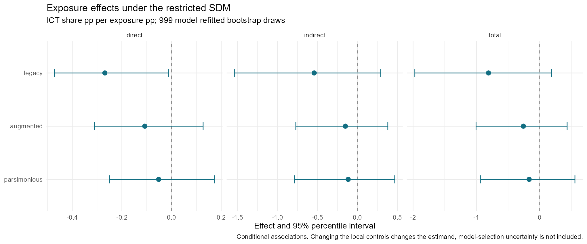

**기존의 음의 직접 연관성은 통제변수 구성을 바꾸면 약해진다.** 노출도 1%p에 대한 ICT 고용비중의 직접효과는 기존 -0.269%p(95% 구간 -0.472~-0.013), 확장형 -0.108(-0.311~0.127), 간결형 -0.052(-0.250~0.173)다. 세 구성의 간접·총효과 구간은 모두 0을 포함한다. 국가별 구간은 999회 모형 재적합 부트스트랩이다.

**브뤼셀 효과 관점** · 지역 간 연결을 고려한 조건부 연관성을 분해한 결과다. 간접효과는 규범 확산의 관측치가 아니며, 현재 수치로 해외 준수 확대를 지지한다고 말할 수 없다.

**티부 효과 관점** · 음의 직접효과는 인력 유출의 직접 증거가 아니다. 분모인 전체 고용의 변화, 산업구성, 과거 디지털화와 미관측 조건으로도 같은 패턴이 생길 수 있다.

**해석의 한계** · 2017~2019 조사연도 마켓플레이스 판매 비율은 DMA 처치량으로 확정되지 않았다. 공간승수로 계산한 효과도 인과 식별이 없으면 연관성이다. 구간은 모형 선택의 불확실성을 포함하지 않는다. [5]

### 이 그림을 만드는 핵심 코드

```r
dma_register("06_exposure_impacts",12,5,function(){
 effects<-dma_data("effects")
 ee<-effects[effects$group%in%c("legacy","augmented","parsimonious") & effects$model=="SDM_exposure" & effects$term=="z_exposure",]
 ee$effect<-factor(ee$effect,levels=c("direct","indirect","total"))
 ee$group<-factor(ee$group,levels=c("parsimonious","augmented","legacy"))
 ggplot(ee,aes(estimate,group))+geom_vline(xintercept=0,linetype=2,color="grey55")+
  geom_errorbar(aes(xmin=lower,xmax=upper),orientation="y",width=.15,color="#126e82")+geom_point(color="#126e82",size=2.8)+facet_wrap(~effect,scales="free_x",nrow=1)+
  labs(title="Exposure effects under the restricted SDM",subtitle="ICT share pp per exposure pp; 999 model-refitted bootstrap draws",caption="Conditional associations. Changing the local controls changes the estimand; model-selection uncertainty is not included.",x="Effect and 95% percentile interval",y=NULL)
})
```

[전체 시각화 코드 · L95–L103](https://github.com/mw48795472/DMA-Rule-Data-Analysis/blob/main/code/11_plot_saved_results.R#L95-L103)

**결과 원천 파일**: `all_impacts.csv`, `ANALYSIS_VARIABLES.csv`

## 그림 07 · ICT 직업과 J산업 고용비중의 국가 분포 {#fig-07}

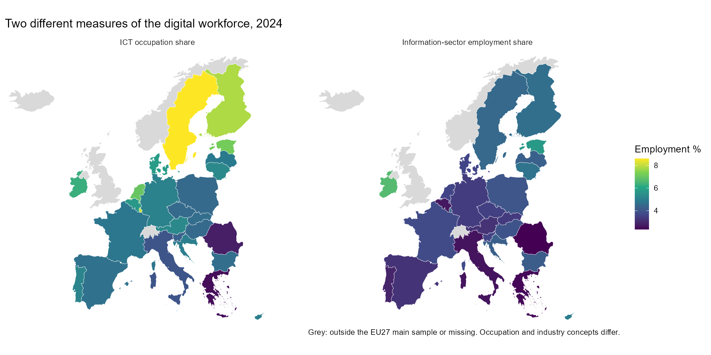

**직업 기준과 산업 기준을 바꾸면 디지털 인력의 지도가 달라진다.** 2024년 ICT 직업 비중은 스웨덴 8.6%, 룩셈부르크 8.0%, 핀란드 7.8%가 높고 그리스는 2.5%다. J산업 비중은 아일랜드 6.66%, 에스토니아 5.73%가 높고 루마니아는 2.36%다. 두 지표는 같은 노동자를 같은 방식으로 세지 않는다.

**브뤼셀 효과 관점** · 디지털 생태계의 이질성을 파악하고 후속 노출도 상호작용을 설계하는 배경 자료다. 높은 고용비중을 DMA 준수 수준이나 규범 수출 정도로 해석하지 않는다.

**티부 효과 관점** · 디지털 일자리의 상대적 집중을 보여주지만 기업·인력이 언제 어디서 왔는지는 알 수 없다. 국내 교육, 산업 성장, 전체 고용 감소도 비중을 높일 수 있다.

**해석의 한계** · 국가 J산업은 국민계정의 국내개념이며 ICT 직업 통계와 모집단·분류가 다르다. 그림 8의 지역 통계와도 산출 체계가 다르다. 이번 그림 7은 고용 지도이며, 이전 보고서의 이입 그림 7은 이번 그림 11에 대응한다.

### 이 그림을 만드는 핵심 코드

```r
dma_register("07_country_outcomes",12,6,function(){
 national<-dma_data("national")
 mapdata<-rbind(transform(national,value=ict_share_pct,measure="ICT occupation share"),transform(national,value=employment_na_j_share_pct,measure="Information-sector employment share"))
 ggplot(mapdata)+geom_sf(aes(fill=value),color="white",linewidth=.15)+coord_sf(xlim=c(-25,45),ylim=c(34,72),expand=FALSE)+
  scale_fill_viridis_c(na.value="grey85")+facet_wrap(~measure,nrow=1)+labs(title="Two different measures of the digital workforce, 2024",fill="Employment %",caption="Grey: outside the EU27 main sample or missing. Occupation and industry concepts differ.")+maptheme
})
```

[전체 시각화 코드 · L104–L109](https://github.com/mw48795472/DMA-Rule-Data-Analysis/blob/main/code/11_plot_saved_results.R#L104-L109)

**결과 원천 파일**: `combined_country_year.csv`, `ANALYSIS_VARIABLES.csv`

## 그림 08 · NUTS2 지역 J산업 고용비중 {#fig-08}

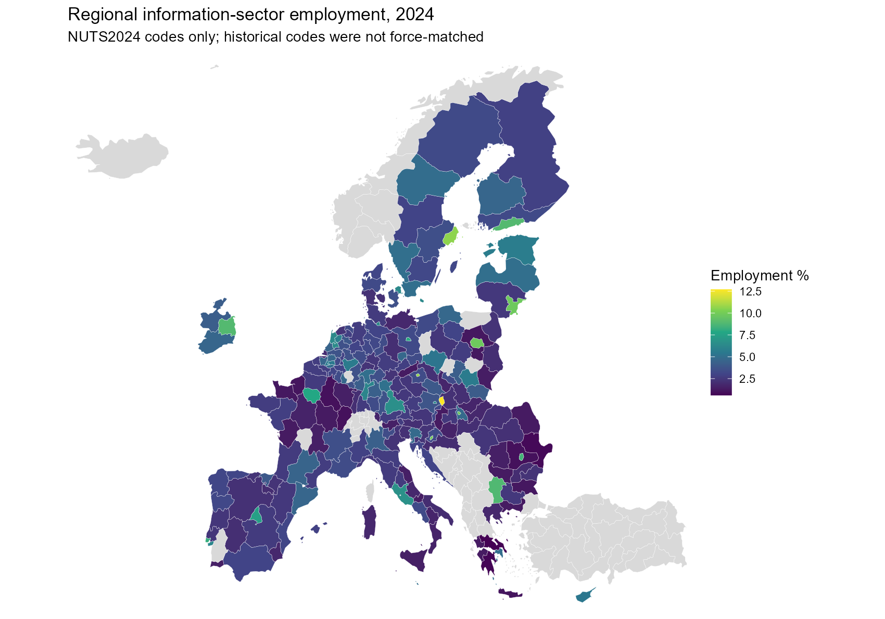

**국가 평균 아래의 지역 격차가 크지만 이것이 이동의 원인을 알려주지는 않는다.** 회귀 표본 218개 지역에서 J산업 비중은 EL64 0.6%부터 SK01 12.7%까지 분포한다. CZ01은 10.7%, SE11은 10.6%다. 높은 도시 지역들이 서로 인접하지 않으면 눈에 띄는 중심지 집중과 낮은 전역 Moran I가 동시에 나타날 수 있다.

**브뤼셀 효과 관점** · 규범 변화에 대한 반응이 산업 기반에 따라 다를 수 있다는 연구 가설을 제시한다. 현재 지역 모형에는 DMA 준수·노출을 직접 나타내는 지역 변수가 없다.

**티부 효과 관점** · 인력·기업이 집중된 목적지 후보를 찾는 지도다. 이 분포가 기존 집적, 신규 진입, 국내 이전, 국제 이동 중 무엇 때문인지 구분하지 못한다.

**해석의 한계** · 회색은 표본 밖 또는 결측이다. NUTS 경계, 표시 범위, 완전사례 선택에 따른 결과이며 MAUP와 생태학적 오류에 유의한다. 국가 간 규제 차이와 국내 지역 간 차이를 혼동하지 않는다.

### 이 그림을 만드는 핵심 코드

```r
dma_register("08_regional_outcome",10,7,function(){
 regional_map<-merge(dma_data("nuts2"),dma_data("rr"),by.x="NUTS_ID",by.y="geo",all.x=TRUE)
 regional_map$plot_value<-ifelse(regional_map$NUTS_ID%in%read_plot_csv("regional/sample.csv")$id,regional_map$regional_j_share_pct,NA_real_)
 ggplot(regional_map)+geom_sf(aes(fill=plot_value),color="white",linewidth=.08)+coord_sf(xlim=c(-25,45),ylim=c(34,72),expand=FALSE)+
  scale_fill_viridis_c(na.value="grey85")+labs(title="Regional information-sector employment, 2024",subtitle="NUTS2024 codes only; historical codes were not force-matched",fill="Employment %")+maptheme
})
```

[전체 시각화 코드 · L110–L115](https://github.com/mw48795472/DMA-Rule-Data-Analysis/blob/main/code/11_plot_saved_results.R#L110-L115)

**결과 원천 파일**: `combined_region_year.csv`, `regional/sample.csv`, `regional_sample_audit_2024.csv`

## 그림 09 · 모형별 혁신잔차의 공간자기상관 {#fig-09}

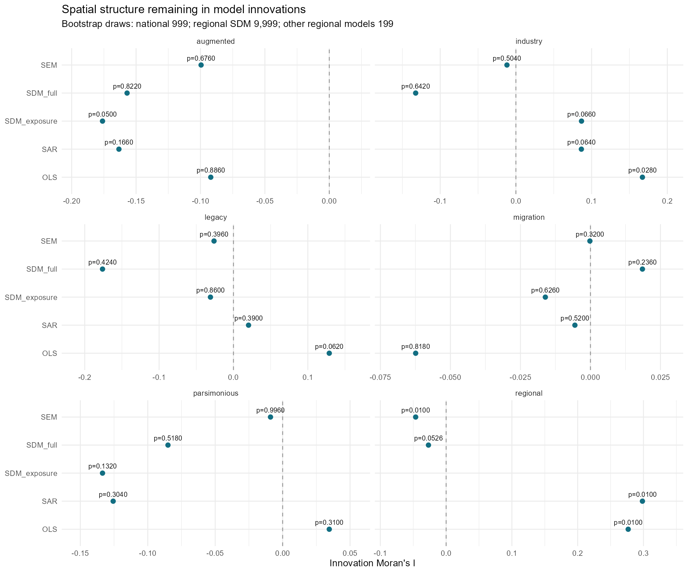

**지역 SDM은 잔차 공간구조를 크게 줄였지만 검증을 완전히 마친 모형은 아니다.** 지역 OLS·SAR의 잔차 I는 0.2768·0.2984이며, SEM은 -0.0463이다. 세 모형의 부트스트랩 p는 모두 0.0100(B=199)이다. 지역 SDM은 I=-0.02689, p=0.0526(B=9,999)이다. 국가 산업 OLS는 p=0.0280, 확장형 제한 SDM은 p=0.0500(B=999)으로 주의가 필요하다.

**브뤼셀 효과 관점** · 공간적으로 구조화된 누락 요인을 얼마나 남기는지 확인하는 모형 진단이다. 잔차가 줄었다고 규범 확산 경로가 확인되는 것은 아니다.

**티부 효과 관점** · 잔차 진단을 통과해도 이동의 방향·주체·동기는 식별되지 않는다. 이동 자료의 부재를 모형의 좋은 잔차로 보완할 수 없다.

**해석의 한계** · SEM에서는 필터링된 혁신잔차를 비교한다. p는 모형별 재적합 분포에 대한 값이므로 I의 절대값과 단순 대응하지 않는다. B=199의 양측 최소 p는 0.01이며 정밀도가 낮다. 표의 여러 p값은 미보정 탐색 결과다.

### 이 그림을 만드는 핵심 코드

```r
dma_register("09_residual_diagnostics",12,10,function(){
 bb<-dma_data("residual_bootstrap")
 ggplot(bb,aes(I,model))+geom_vline(xintercept=0,linetype=2,color="grey60")+geom_point(color="#126e82",size=2.4)+
  geom_text(aes(label=sprintf("p=%.4f",p_bootstrap)),nudge_y=.25,size=3)+facet_wrap(~group,ncol=2,scales="free_x")+
  scale_x_continuous(expand=expansion(mult=.18))+
  labs(title="Spatial structure remaining in model innovations",subtitle="Bootstrap draws: national 999; regional SDM 9,999; other regional models 199",x="Innovation Moran's I",y=NULL)
})
```

[전체 시각화 코드 · L116–L122](https://github.com/mw48795472/DMA-Rule-Data-Analysis/blob/main/code/11_plot_saved_results.R#L116-L122)

**결과 원천 파일**: `legacy/residual_bootstrap.csv`, `augmented/residual_bootstrap.csv`, `industry/residual_bootstrap.csv`, `regional/residual_bootstrap.csv`

## 그림 10 · 이웃 수 k에 대한 모형 선택 민감도 {#fig-10}

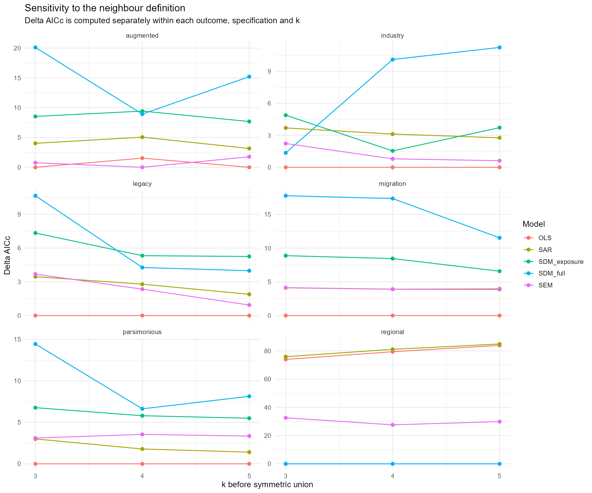

**지역 SDM의 적합도 순위는 비교적 안정적이지만 국가 모형은 다르다.** k=3·4·5에서 지역 SDM은 모두 각 비교군의 최저 AICc를 기록한다. 해당 rho는 약 0.365·0.405·0.403이다. 기존·간결형·산업·이입의 국가 구성은 세 k 모두 OLS가 최저다. 확장형은 k=4의 경계 SEM에서만 최저이며 k=3·5에서는 OLS가 최저다.

**브뤼셀 효과 관점** · 지역 결과가 최근접 이웃 수의 작은 변화에 얼마나 민감한지 보여준다. 지리적 W의 안정성은 글로벌 플랫폼 관계망을 제대로 측정했다는 검증이 아니다.

**티부 효과 관점** · 실제 이동은 언어, 기존 이민망, 기업 소유관계에 따라 비인접 국가로 향할 수 있다. 거리 W만으로 규제에 따른 이동 경로를 대표하기 어렵다.

**해석의 한계** · 그림의 delta AICc는 각 결과변수·구성·k 안에서 새로 0을 잡는다. 서로 다른 패널의 0을 적합도 동등성으로 읽지 않는다. k=3~5 검토는 제한된 강건성 점검이며 결과를 보고 k를 최적화하지 않는다.

### 이 그림을 만드는 핵심 코드

```r
dma_register("10_k_sensitivity",12,10,function(){
 ss<-dma_data("k_sensitivity")
 ggplot(ss,aes(k,delta_AICc,color=model,group=model))+geom_line(linewidth=.6)+geom_point(size=2)+
  facet_wrap(~group,ncol=2,scales="free_y")+scale_x_continuous(breaks=3:5)+
  labs(title="Sensitivity to the neighbour definition",subtitle="Delta AICc is computed separately within each outcome, specification and k",x="k before symmetric union",y="Delta AICc",color="Model")
})
```

[전체 시각화 코드 · L123–L128](https://github.com/mw48795472/DMA-Rule-Data-Analysis/blob/main/code/11_plot_saved_results.R#L123-L128)

**결과 원천 파일**: `legacy/k_sensitivity.csv`, `augmented/k_sensitivity.csv`, `regional/k_sensitivity.csv`

## 그림 11 · 15~64세 일반 이입 강도: COMPLET {#fig-11}

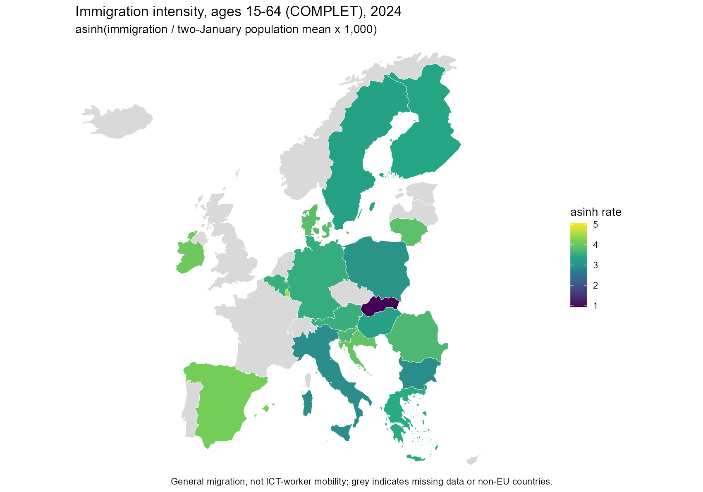

**연령별 인구분모를 적용한 이입 강도이며 ICT 인력 이동률은 아니다.** 관측 EU20에서 15~64세 인구 천명당 이입은 몰타 79.73명, 룩셈부르크 45.13명, 스페인 32.01명이며 슬로바키아는 1.06명이다. 지도 색은 이 비율의 asinh 값이다. 분모는 2024·2025년 1월 1일의 같은 연령 인구 평균이다.

**브뤼셀 효과 관점** · 일반 인구 이동의 배경을 통제하거나 후속 자료 수집 대상을 정하는 데 쓸 수 있다. 제도의 해외 확산이나 플랫폼 준수와 직접 연결된 측정은 아니다.

**티부 효과 관점** · 노동연령대의 유입 목적지 분포를 보여주므로 이동 연구의 출발점이다. 다만 구직·유학·가족·귀환 등 원인이 섞이며 직업과 이전 거주지를 이 지도에서 구분하지 않는다.

**해석의 한계** · 유입은 순이동이 아니며 취업자 수도 아니다. 7개 EU국의 결측을 0으로 취급하지 않았다. 소국의 높은 비율, 연령 정의, 체류 개념 차이 때문에 순위를 규제 선호의 순위로 읽을 수 없다. [6]

### 이 그림을 만드는 핵심 코드

```r
dma_register("11_migration_outcome",10,7,function(){
 # Explicit migration map on the full EU27 frame, missing countries remain grey.
 ggplot(dma_data("national"))+geom_sf(aes(fill=asinh_immigration_15_64_complet_per1000),color="white",linewidth=.15)+
  coord_sf(xlim=c(-25,45),ylim=c(34,72),expand=FALSE)+scale_fill_viridis_c(na.value="grey85")+
  labs(title="Immigration intensity, ages 15-64 (COMPLET), 2024",subtitle="asinh(immigration / two-January population mean x 1,000)",fill="asinh rate",caption="General migration, not ICT-worker mobility; grey indicates missing data or non-EU countries.")+
  maptheme
})
```

[전체 시각화 코드 · L129–L135](https://github.com/mw48795472/DMA-Rule-Data-Analysis/blob/main/code/11_plot_saved_results.R#L129-L135)

**결과 원천 파일**: `combined_country_year.csv`, `migration/sample.csv`

## 그림 12 · 공간모수 추정 경계의 우도 민감도 {#fig-12}

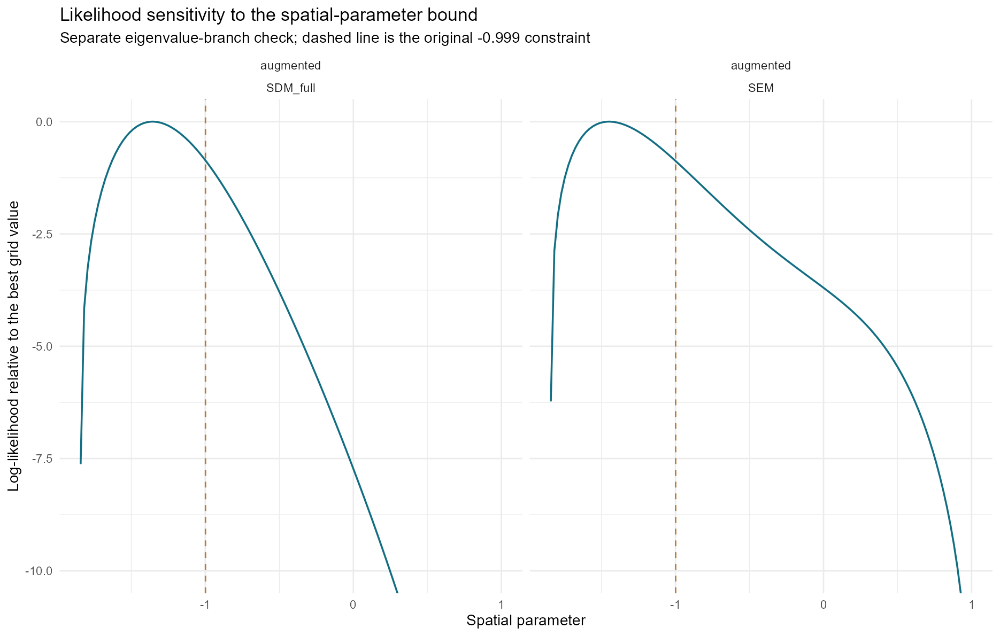

**하한에 걸린 공간계수는 강한 실질적 관계보다 추정 제약을 먼저 의심해야 한다.** 확장형 SEM과 전체 SDM은 원래 모수 하한 -0.999에 걸린다. 고유값이 허용하는 별도 구간을 점검하면 각각 -1.449, -1.356 부근으로 이동하고 AICc는 85.31→83.55, 94.23→92.50으로 달라진다. 이는 기본 결과를 교체한 추정이 아니라 별도 민감도다.

**브뤼셀 효과 관점** · 음의 공간계수를 규제 확산에 대한 반발이나 역확산으로 이름 붙일 근거가 없다. 제약 범위에 민감한 추정이라는 설명이 우선이다.

**티부 효과 관점** · 음의 계수를 국가 간 일자리 빼앗기나 규제 회피 경쟁의 증거로 읽을 수 없다. 직접 이동량 없이 그런 메커니즘은 확인되지 않는다.

**해석의 한계** · |공간모수|<1을 넘는 고유값 구간 계산은 통상적인 수렴형 공간승수 해석과 같지 않다. 우도 개선만으로 해당 범위를 최종 채택하지 않는다. 작은 표본과 높은 X·WX 공선성도 함께 고려해야 한다.

### 이 그림을 만드는 핵심 코드

```r
dma_register("12_boundary_profiles",11,7,function(){
 profiles<-dma_data("profiles")
 ggplot(profiles,aes(parameter,relative_logLik))+geom_line(color="#126e82",linewidth=.7)+
  geom_vline(xintercept=-.999,linetype=2,color="#b77a37")+facet_wrap(~group+model,scales="free_x")+
  coord_cartesian(ylim=c(-10,0))+labs(title="Likelihood sensitivity to the spatial-parameter bound",
   subtitle="Separate eigenvalue-branch check; dashed line is the original -0.999 constraint",
   x="Spatial parameter",y="Log-likelihood relative to the best grid value")
})
```

[전체 시각화 코드 · L138–L145](https://github.com/mw48795472/DMA-Rule-Data-Analysis/blob/main/code/11_plot_saved_results.R#L138-L145)

**결과 원천 파일**: `boundary_profile.csv`, `boundary_constraint_sensitivity.csv`

## 그림 13 · 지역 SDM 부트스트랩 반복 수의 확대 {#fig-13}

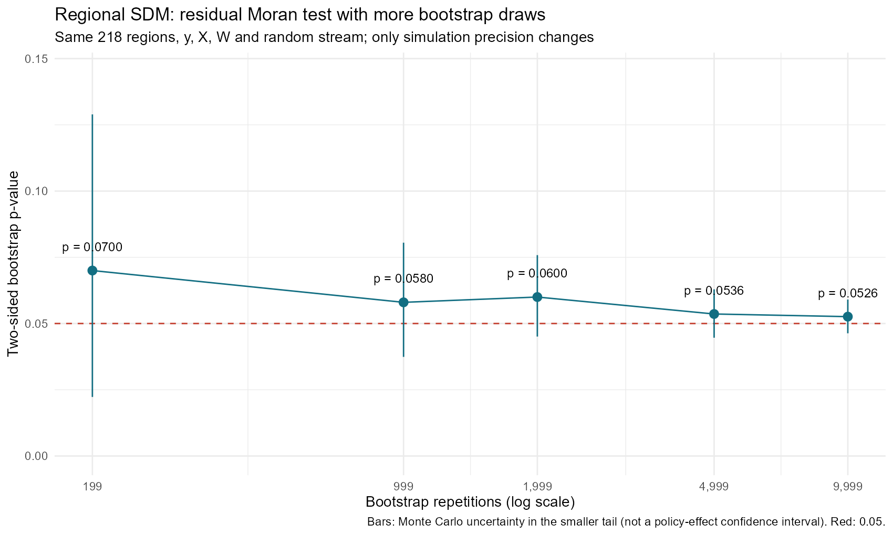

**반복 증가는 모의실험 오차를 줄였고, 정책효과의 새로운 증거를 만든 것은 아니다.** 같은 218개 지역·자료·W·난수열에서 B=199의 p=0.0700이 B=9,999에서 0.0526이 된다. MC 표준오차는 0.02599→0.00320으로 약 8.1배 정밀해진다. 마지막 MC 구간은 0.04632~0.05905다. rho=0.4045와 AICc=705.8151은 변하지 않았다.

**브뤼셀 효과 관점** · 규범 확산에 대한 유의성이 아니라 혁신잔차 검정의 계산 정밀도를 보완한 것이다. 이 구간을 브뤼셀 효과의 신뢰구간으로 제시할 수 없다.

**티부 효과 관점** · 이동을 측정하는 추가 관측치가 늘어난 것이 아니므로 규제 유발 이동에 대한 식별력 증가로 볼 수 없다.

**해석의 한계** · 관측 p는 0.05보다 크지만 MC 구간은 0.05를 가로지른다. 무상관을 확정하거나 유의성이 나올 때까지 반복하지 않는다. 정규·등분산 혁신 가정은 남는다. 다른 지역 모형 잔차와 지역 효과 구간은 여전히 B=199다.

### 이 그림을 만드는 핵심 코드

```r
dma_register("13_regional_bootstrap_precision",10,6,function(){
 bs<-dma_data("bootstrap_precision")
 ggplot(bs,aes(simulations,p_bootstrap))+geom_hline(yintercept=.05,linetype=2,color="#c43e2e")+
  geom_errorbar(aes(ymin=MC_lower,ymax=MC_upper),width=0,color="#126e82")+geom_line(color="#126e82")+geom_point(size=3,color="#126e82")+
  geom_text(aes(label=sprintf("p = %.4f",p_bootstrap)),nudge_y=.009,size=3.6)+
  scale_x_log10(breaks=bs$simulations,labels=format(bs$simulations,big.mark=",",trim=TRUE))+
  scale_y_continuous(limits=c(0,.145))+theme_minimal(base_size=12)+
  labs(title="Regional SDM: residual Moran test with more bootstrap draws",subtitle="Same 218 regions, y, X, W and random stream; only simulation precision changes",
  x="Bootstrap repetitions (log scale)",y="Two-sided bootstrap p-value",caption="Bars: Monte Carlo uncertainty in the smaller tail (not a policy-effect confidence interval). Red: 0.05.")
})
```

[전체 시각화 코드 · L148–L157](https://github.com/mw48795472/DMA-Rule-Data-Analysis/blob/main/code/11_plot_saved_results.R#L148-L157)

**결과 원천 파일**: `regional_sdm_bootstrap_comparison.csv`, `regional_sdm_bootstrap_extended_draws.csv`

## 그림 14 · COMPLET와 REACH 연령 정의의 분리 비교 {#fig-14}

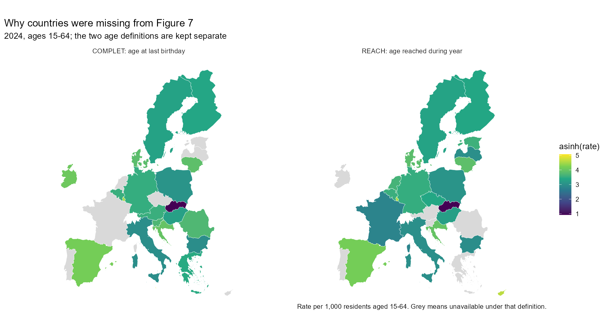

**누락 국가의 상당 부분은 연령 정의를 선택한 결과다.** 15~64세 COMPLET와 REACH는 각각 EU20에서 관측되지만 국가 구성이 다르다. 기존 COMPLET 결측 7개국 중 CY·CZ·EE·FR·LV·NL의 6개국은 REACH에 값이 있고, PT는 해당 Eurostat 수집 자료에서 비어 있다. 두 지도의 합집합은 26개국이다.

**브뤼셀 효과 관점** · 통계 정의로 생긴 공간 공백을 규제 확산의 차이로 오인하지 않도록 한다. 그림은 법률 수렴이나 플랫폼 준수 지도가 아니다.

**티부 효과 관점** · 정의 변경만으로 이동 목적지 지도가 달라질 수 있음을 보여준다. 포함 국가가 늘었다는 사실이 새 이동이 발생했다는 의미는 아니다.

**해석의 한계** · COMPLET는 마지막 생일 기준, REACH는 해당 연도에 도달하는 연령이다. 15세·64세 경계에서 포함 인원이 달라질 수 있다. 그림 제목의 옛 Figure 7은 이번 그림 11을 뜻한다. [6]

### 이 그림을 만드는 핵심 코드

```r
dma_register("14_age_definition_maps",12,6.5,function(){
 maps<-dma_data("maps");eu_map<-maps[maps$eu27,]
 dual<-rbind(transform(eu_map,value=asinh(rate_complet),definition="COMPLET: age at last birthday"),transform(eu_map,value=asinh(rate_reach),definition="REACH: age reached during year"))
 ggplot(dual)+geom_sf(aes(fill=value),color="white",linewidth=.15)+facet_wrap(~definition,nrow=1)+coord_sf(xlim=c(-25,45),ylim=c(34,72),expand=FALSE)+scale_fill_viridis_c(na.value="grey85")+maptheme+
  labs(title="Why countries were missing from Figure 7",subtitle="2024, ages 15-64; the two age definitions are kept separate",fill="asinh(rate)",caption="Rate per 1,000 residents aged 15-64. Grey means unavailable under that definition.")
})
```

[전체 시각화 코드 · L160–L165](https://github.com/mw48795472/DMA-Rule-Data-Analysis/blob/main/code/11_plot_saved_results.R#L160-L165)

**결과 원천 파일**: `migration_extension/figure7_missing_country_audit.csv`, `migration_extension/migration_europe_2024.csv`

## 그림 15 · REACH 보완을 통한 EU26 이입 지도 {#fig-15}

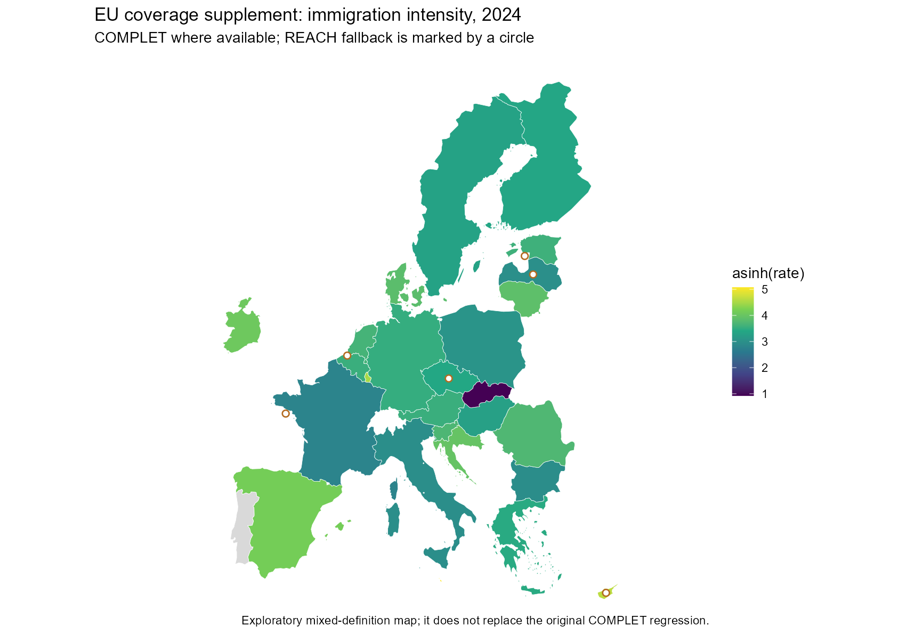

**지도 범위를 넓혔지만 동일 정의의 회귀 표본을 새로 만든 것은 아니다.** COMPLET를 우선하고 6개국에 REACH를 대입하면 EU26의 비율을 표시할 수 있다. 원 표시는 REACH 보완국이다. 예를 들어 키프로스의 보완 이입 강도는 15~64세 인구 천명당 51.38명이다. 포르투갈은 아직 회색으로 남는다.

**브뤼셀 효과 관점** · 분석 대상에서 빠졌던 국가의 경제·인구 맥락을 더 넓게 확인할 수 있다. 보완 자체는 규범 확산의 증거를 추가하지 않는다.

**티부 효과 관점** · 후속 이동 연구에서 표본 선택 민감도를 점검할 탐색 지도다. 표시된 차이가 연령 정의와 실제 이동 중 어느 부분에서 왔는지 분해해야 한다.

**해석의 한계** · 혼합 정의이므로 기존 EU20 COMPLET 회귀의 대체 추정치가 아니다. 현재 국가 SAR·SEM·SDM에 6개국을 자동 편입하지 않았다. 정의별 분리 분석과 공통표본 비교를 우선한다.

### 이 그림을 만드는 핵심 코드

```r
dma_register("15_eu_coverage_supplement",10,7,function(){
 dat<-dma_data("migration");maps<-dma_data("maps");eu_map<-maps[maps$eu27,];eu<-dat$country[dat$eu27]
 eu_labels<-merge(sf::st_transform(dma_data("centroids"),4326),dat[c("country","age_definition_selected")],by="country")
 ggplot(eu_map)+geom_sf(aes(fill=asinh(rate_15_64_coverage)),color="white",linewidth=.15)+
  geom_sf(data=eu_labels[eu_labels$country%in%eu & !is.na(eu_labels$age_definition_selected) & eu_labels$age_definition_selected=="REACH",],shape=21,fill="white",color="#b36b21",size=2,stroke=.8)+
  coord_sf(xlim=c(-25,45),ylim=c(34,72),expand=FALSE)+scale_fill_viridis_c(na.value="grey85")+maptheme+
  labs(title="EU coverage supplement: immigration intensity, 2024",subtitle="COMPLET where available; REACH fallback is marked by a circle",fill="asinh(rate)",caption="Exploratory mixed-definition map; it does not replace the original COMPLET regression.")
})
```

[전체 시각화 코드 · L166–L173](https://github.com/mw48795472/DMA-Rule-Data-Analysis/blob/main/code/11_plot_saved_results.R#L166-L173)

**결과 원천 파일**: `migration_extension/migration_europe_2024.csv`, `migration_extension/figure7_missing_country_audit.csv`

## 그림 16 · 영국을 포함한 유럽 전체 연령 이입 강도 {#fig-16}

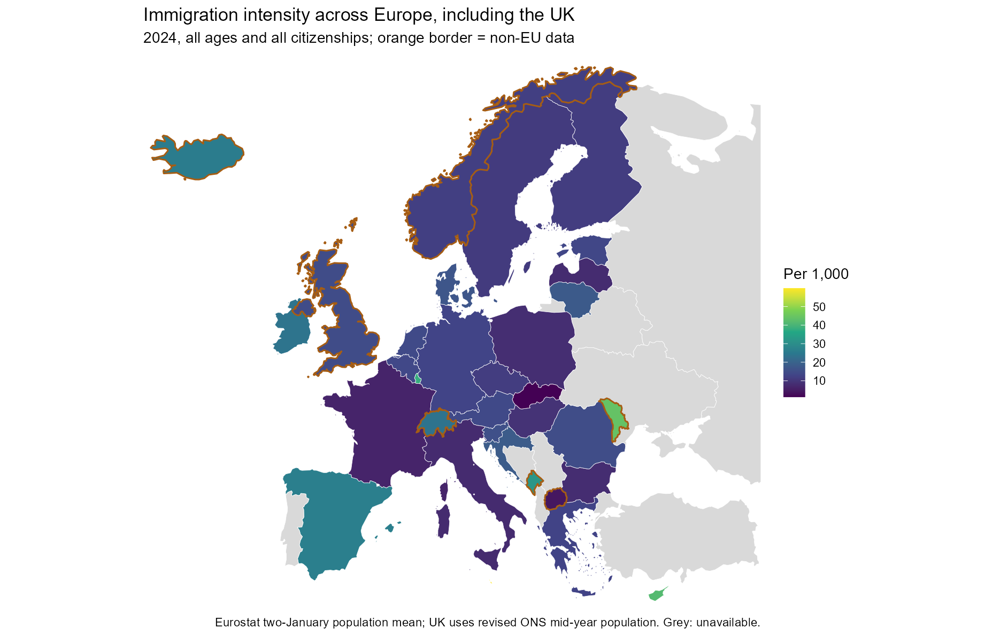

**비EU국을 포함해 비교 범위는 확대됐지만 처리군·대조군 설계는 아니다.** 조사 범위는 EU27과 비EU16의 43개국이며 기본 전체 연령 비율은 34개국에서 계산된다. GISCO 도형은 42개국에 연결된다. 관측된 비EU국은 주황 경계로 표시한다. 이 그림에는 포르투갈 INE 보완값이 들어가지 않으며 그림 19에서 별도로 다룬다.

**브뤼셀 효과 관점** · EU 밖의 비교 대상을 제시하는 배경 지도다. 비EU라는 분류는 DMA 비노출을 뜻하지 않으며 국외 서비스 제공자의 EU시장 준수와도 구분해야 한다. [1]

**티부 효과 관점** · 국경 간 인구 유입의 목적지 강도를 비교할 수 있다. 그러나 출발지가 EU인지, 규제를 피한 이동인지, ICT 종사자인지는 알 수 없다.

**해석의 한계** · 모든 유럽 국가를 망라하지 않는다. UK는 ONS 중간인구, 다른 기본값은 Eurostat 두 연초 인구 평균을 사용한다. 15~64세 지도와 전체 연령 지도의 수치를 직접 비교하지 않는다. XK는 별도 도형이 없다.

### 이 그림을 만드는 핵심 코드

```r
dma_register("16_europe_all_age_migration",11,7,function(){
 maps<-dma_data("maps")
 ggplot(maps)+geom_sf(aes(fill=rate_all_ages),color="white",linewidth=.16)+
  geom_sf(data=maps[!maps$eu27 & is.finite(maps$rate_all_ages),],fill=NA,color="#a65d13",linewidth=.6)+
  coord_sf(xlim=c(-25,45),ylim=c(34,72),expand=FALSE)+scale_fill_viridis_c(na.value="grey85")+maptheme+
  labs(title="Immigration intensity across Europe, including the UK",subtitle="2024, all ages and all citizenships; orange border = non-EU data",fill="Per 1,000",caption="Eurostat two-January population mean; UK uses revised ONS mid-year population. Grey: unavailable.")
})
```

[전체 시각화 코드 · L174–L180](https://github.com/mw48795472/DMA-Rule-Data-Analysis/blob/main/code/11_plot_saved_results.R#L174-L180)

**결과 원천 파일**: `migration_extension/migration_europe_2024.csv`, `migration_extension/geometry_audit.csv`

## 그림 17 · 검증된 비EU 8개국의 이입 강도 비교 {#fig-17}

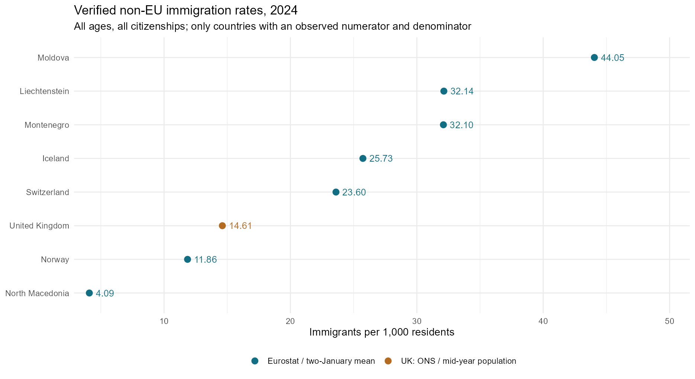

**영국의 관측 유입 강도는 14.61명/천명이며 규제 회피의 규모가 아니다.** 전체 연령 이입률은 몰도바 44.05, 리히텐슈타인 32.14, 몬테네그로 32.10, 아이슬란드 25.73, 스위스 23.60, 영국 14.61, 노르웨이 11.86, 북마케도니아 4.09명/천명이다. 영국은 장기 이입 1,012,000명/개정 중간인구 69,256,300명으로 계산한다.

**브뤼셀 효과 관점** · 국외 인구 통계의 순위를 EU 규범에 대한 순응 순위로 읽을 수 없다. 국외에서 EU 기준을 채택했는지 확인하려면 제품·서비스·법제 자료가 필요하다.

**티부 효과 관점** · 분자·분모를 확인한 유입 규모 비교는 가능하다. 하지만 국적 전체의 총유입이며 기업·투자 이전, EU 출발 이입, ICT 직업별 이동은 따로 측정해야 한다.

**해석의 한계** · 순이동률이 아니고 국가별 체류·등록·추계 방식과 인구 규모가 다르다. 거시 충격, 임금, 비자, 귀환 이주 등 대안 설명을 통제하지 않았다. ONS 값은 발표문 반올림 수치다. [9][10]

### 이 그림을 만드는 핵심 코드

```r
dma_register("17_non_eu_migration_rates",11,6,function(){
 dat<-dma_data("migration")
 nd<-dat[!dat$eu27 & is.finite(dat$rate_all_ages),];nd$source_group<-ifelse(nd$country=="UK","UK: ONS / mid-year population","Eurostat / two-January mean")
 ggplot(nd,aes(rate_all_ages,reorder(country_name,rate_all_ages),color=source_group))+geom_point(size=3)+
  geom_text(aes(label=sprintf(" %.2f",rate_all_ages)),hjust=0,nudge_x=.3,size=3.8,show.legend=FALSE)+scale_x_continuous(expand=expansion(mult=c(.03,.18)))+
  scale_color_manual(values=c("#126e82","#b36b21"))+theme(legend.position="bottom")+
  labs(title="Verified non-EU immigration rates, 2024",subtitle="All ages, all citizenships; only countries with an observed numerator and denominator",x="Immigrants per 1,000 residents",y=NULL,color=NULL)
})
```

[전체 시각화 코드 · L181–L188](https://github.com/mw48795472/DMA-Rule-Data-Analysis/blob/main/code/11_plot_saved_results.R#L181-L188)

**결과 원천 파일**: `migration_extension/migration_europe_2024.csv`

## 그림 18 · 국가 범위와 연령 정의에 따른 이입률 Moran 검정 {#fig-18}

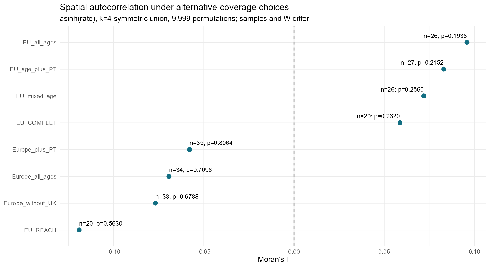

**검토한 k=4의 8개 대안 모두 뚜렷한 전역 군집 증거를 제시하지 않는다.** EU20 COMPLET는 I=0.05871, p=0.2620이다. 유럽34 전체 연령은 I=-0.06932, p=0.7096, 영국 제외33은 -0.07683, 0.6788, 포르투갈 포함35는 -0.05786, 0.8064다. 8개 기본 대안의 가장 작은 p도 0.1938이며 BH 보정 후 최소값은 0.5240이다.

**브뤼셀 효과 관점** · 이 검정은 인구 이입률의 지리적 군집을 검사한다. EU 규범이 비지리적 플랫폼 네트워크를 통해 확산되는지에 대한 반증 검정은 아니다.

**티부 효과 관점** · 현재 W에서 총이입률이 유사한 나라끼리 모인다는 증거는 약하다. 규제에 반응한 특정 흐름이 없다는 결론이나 비EU 유출이 없다는 결론으로 확장할 수 없다.

**해석의 한계** · 국가·연령 정의를 바꿀 때마다 표본과 W를 재구성한다. I 차이를 포르투갈·영국의 인과효과로 해석하지 않는다. 모두 asinh 비율의 양측 9,999회 순열이며 작은 표본과 결측의 영향을 받는다.

### 이 그림을 만드는 핵심 코드

```r
dma_register("18_migration_moran_comparison",11,6,function(){
 mor<-dma_data("migration_moran");mr<-mor[mor$k==4,]
 ggplot(mr,aes(I,reorder(sample,I)))+geom_vline(xintercept=0,linetype=2,color="grey60")+geom_point(size=3,color="#126e82")+
  geom_text(aes(label=sprintf("n=%d; p=%.4f",n,p),hjust=ifelse(I>mean(range(I)),1,0)),nudge_y=.25,size=3.5)+
  labs(title="Spatial autocorrelation under alternative coverage choices",subtitle="asinh(rate), k=4 symmetric union, 9,999 permutations; samples and W differ",x="Moran's I",y=NULL)
})
```

[전체 시각화 코드 · L189–L194](https://github.com/mw48795472/DMA-Rule-Data-Analysis/blob/main/code/11_plot_saved_results.R#L189-L194)

**결과 원천 파일**: `migration_extension/migration_moran_tests.csv`

## 그림 19 · 포르투갈 국가자료를 이용한 별도 보완 {#fig-19}

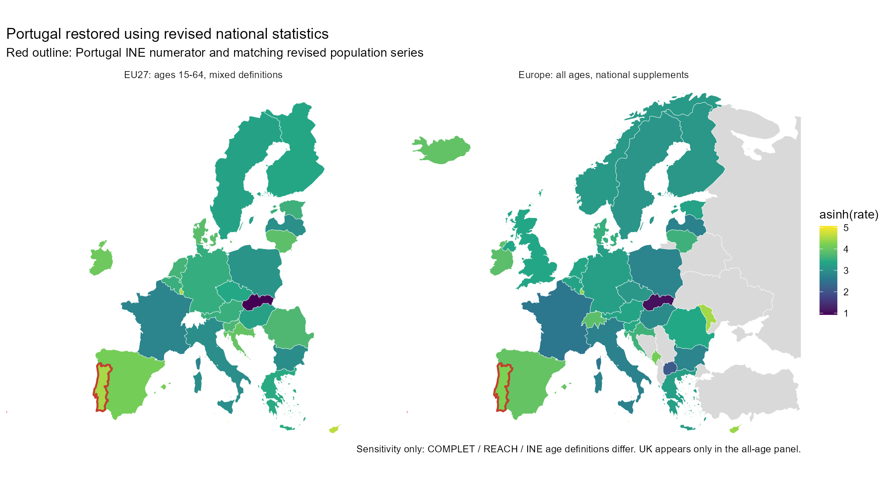

**비교 가능한 분자와 개정 분모를 함께 맞춰야 비율의 의미가 유지된다.** INE의 2024년 이입은 전체 394,904명, 15~64세 324,243명이다. 같은 INE 개정 인구의 전년 말·당년 말 평균을 쓰면 전체 연령 34.96명/천명, 15~64세 44.63명/천명이다. 이 보완으로 연령별 혼합 지도는 EU27, 전체 연령 지도는 유럽35가 된다.

**브뤼셀 효과 관점** · 통계기관의 자료 보완을 통해 지도의 포괄성이 높아진 것이다. 이것을 정책 규범의 국제 확산과 동일시할 수 없다.

**티부 효과 관점** · 포르투갈의 일반 이입 목적지 강도를 추가로 관측했다. 하지만 규제에 따른 유입 시점이나 주체를 특정하지 못한다.

**해석의 한계** · INE의 연령 정의를 COMPLET/REACH로 임의 분류하지 않았다. 원래 Eurostat 열의 결측은 유지하고 plus_PT 열에만 추가했다. 이입 표 2026-09-30, 인구 표 2026-06-22 개정본에 조건부인 민감도 결과다. [11]

### 이 그림을 만드는 핵심 코드

```r
dma_register("19_portugal_national_supplement",12,6.5,function(){
 maps<-dma_data("maps")
 supp<-rbind(transform(maps[maps$eu27,],value=asinh(rate_15_64_plus_PT),scope="EU27: ages 15-64, mixed definitions"),
  transform(maps,value=asinh(rate_all_ages_plus_PT),scope="Europe: all ages, national supplements"))
 ggplot(supp)+geom_sf(aes(fill=value),color="white",linewidth=.15)+
  geom_sf(data=supp[supp$country=="PT",],fill=NA,color="#c43e2e",linewidth=.9)+facet_wrap(~scope,nrow=1)+
  coord_sf(xlim=c(-25,45),ylim=c(34,72),expand=FALSE)+scale_fill_viridis_c(na.value="grey85")+maptheme+
  labs(title="Portugal restored using revised national statistics",subtitle="Red outline: Portugal INE numerator and matching revised population series",fill="asinh(rate)",
  caption="Sensitivity only: COMPLET / REACH / INE age definitions differ. UK appears only in the all-age panel.")
})
```

[전체 시각화 코드 · L195–L204](https://github.com/mw48795472/DMA-Rule-Data-Analysis/blob/main/code/11_plot_saved_results.R#L195-L204)

**결과 원천 파일**: `migration_extension/portugal_revision_audit.csv`, `migration_extension/migration_europe_2024.csv`

## 그림 20 · LTA 종단연구 후보 자료의 가용성 {#fig-20}

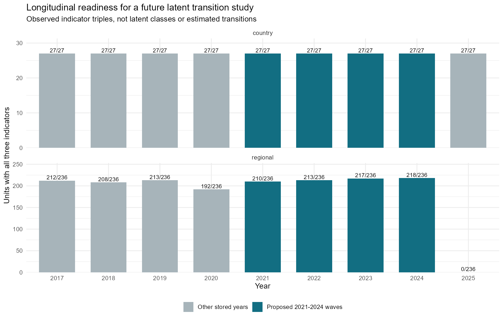

**잠재상태와 전이를 추정한 결과가 아니라 종단연구의 준비 상태다.** 2021~2024년 국가 표는 27×4=108행 모두 세 지표가 완전하다. 지역 표는 236×4=944행 중 858행이 완전하고, 네 시점 모두 완전한 지역은 205개다. 지역 완전관측 수는 210→213→217→218개이며, 2025년에는 지역 GDP 부재로 세 지표 완전행이 0개다.

**브뤼셀 효과 관점** · 디지털 노동시장·지역 경제구조 상태의 변화를 후속 분석할 수 있다. 지금 지표로 잠재상태에 ‘브뤼셀 확산형’이라는 이름을 붙일 측정 근거는 없다.

**티부 효과 관점** · 상태 전환이 나타나도 지역 내 산업 변화인지 국경 간 이동인지 구분해야 한다. 실제 이동 흐름을 외부 결과 또는 공변량으로 결합해야 한다.

**해석의 한계** · 108행은 독립 국가 108개가 아니다. 연속형 지표이므로 잠재프로파일 전이를 검토하고 시점 간 측정동일성, 공간·국가 의존성, 결측, 분류오차를 다뤄야 한다. 현재 상태 수·전이확률·BIC·entropy는 추정하지 않았다. [7]

### 이 그림을 만드는 핵심 코드

```r
dma_register("20_lta_longitudinal_coverage",11,7,function(){
 cover<-dma_data("lta_coverage")
 ggplot(cover,aes(factor(year),complete_three,fill=selected_wave))+geom_col(width=.7)+
  geom_text(aes(label=paste0(complete_three,"/",units)),vjust=-.3,size=3.2)+facet_wrap(~scope,ncol=1,scales="free_y")+
  scale_fill_manual(values=c("FALSE"="#a7b4ba","TRUE"="#126e82"),labels=c("Other stored years","Proposed 2021-2024 waves"))+
  scale_y_continuous(expand=expansion(mult=c(0,.16)))+theme_minimal(base_size=12)+theme(legend.position="bottom")+
  labs(title="Longitudinal readiness for a future latent transition study",subtitle="Observed indicator triples, not latent classes or estimated transitions",x="Year",y="Units with all three indicators",fill=NULL)
})
```

[전체 시각화 코드 · L207–L214](https://github.com/mw48795472/DMA-Rule-Data-Analysis/blob/main/code/11_plot_saved_results.R#L207-L214)

**결과 원천 파일**: `lta_design/panel_summary.csv`, `lta_design/wave_coverage.csv`, `lta_design/indicator_dictionary.csv`

## 추가 그림 M1–M3 {#mechanism-plots}

[추가 자료와 연구설계](mechanisms.html)에는 세 그림의 자료 로딩·결합 검사 코드와 두 메커니즘의 구분 기준이 함께 있습니다.

### M1 · 준수 기록의 적용범위

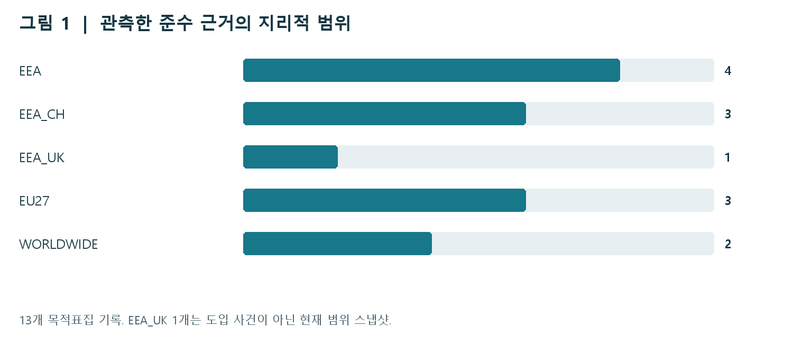

13개 목적표집 기록은 전체 게이트키퍼의 준수율이 아닙니다.

### M2 · 기업 사건의 유형


11개 사건은 공개 사례입니다. 실제 이전 완료·목적지별 인력 이동과 발표를 구분합니다.

### M3 · 국가쌍 자료의 관측률

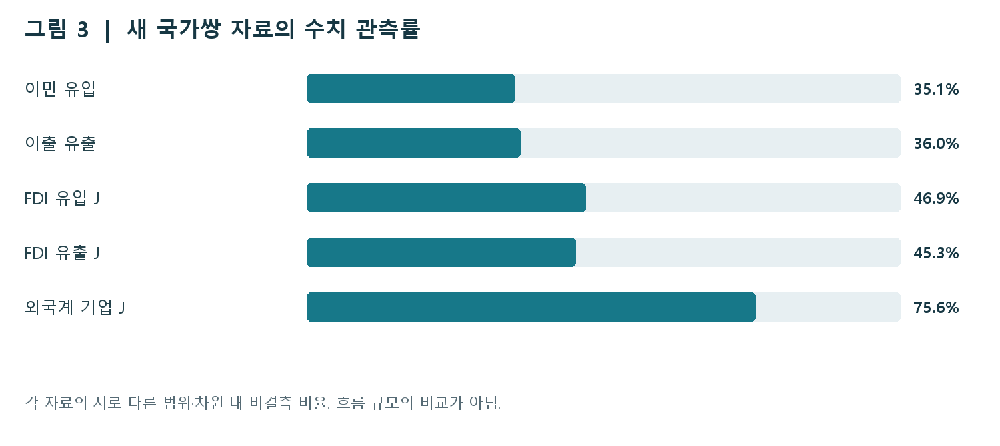

205,784개 다차원 셀 중 수치 관측 85,278개입니다. 경제 흐름의 크기가 아니라 자료 가용성을 나타냅니다.

```r
mechanism_plots <- list(
  compliance_scope = ggplot(scope,aes(x=geographic_scope_code,y=count,fill=record_kind)) + geom_col() + coord_flip() + labs(title='Observed compliance evidence by geographic scope',subtitle='13 selected records; a scope snapshot is not an adoption event',x=NULL,y='Records',fill='Evidence type') + base_theme,
  firm_case_types = ggplot(cases,aes(x=reorder(event_kind,count),y=count)) + geom_col(fill='#176b79') + geom_text(aes(label=count),hjust=-.2) + coord_flip() + scale_y_continuous(expand=expansion(mult=c(0,.15))) + labs(title='Selected firm cases by event type',subtitle='11 cases; no sampling denominator or verified physical completion',x=NULL,y='Cases') + base_theme,
  flow_coverage = ggplot(coverage,aes(x=reorder(label,observed_pct),y=observed_pct)) + geom_col(fill='#176b79') + geom_text(aes(label=sprintf('%.1f%%',observed_pct)),hjust=-.1) + coord_flip() + scale_y_continuous(limits=c(0,105)) + labs(title='Observed values within each source-specific dyad frame',subtitle='Different units and dimensions; this is data availability, not flow volume',x=NULL,y='Observed values (%)') + base_theme
)
# 기존 20개와 같은 목록에 번호 21~23으로 등록합니다. show_dma_plot(21) 등으로 선택할 수 있습니다.
for (i in seq_along(mechanism_plots)) local({
  nm <- names(mechanism_plots)[i]
  dma_register(sprintf('%02d_%s',20L+i,nm),width=10,height=5.5,dpi=160,build=function() mechanism_plots[[nm]])
})
# figures/에 저장된 21–23 PNG를 integration/r_figures/ 에도 복사합니다(기존 산출 위치 유지).
dma_export_mechanism_copies <- function() {
```

[실제 코드 · code/mechanism_plots.R L33–L44](https://github.com/mw48795472/DMA-Rule-Data-Analysis/blob/main/code/mechanism_plots.R#L33-L44)
