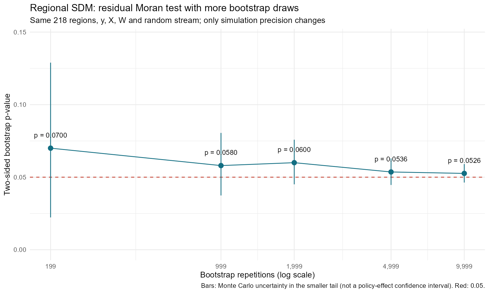
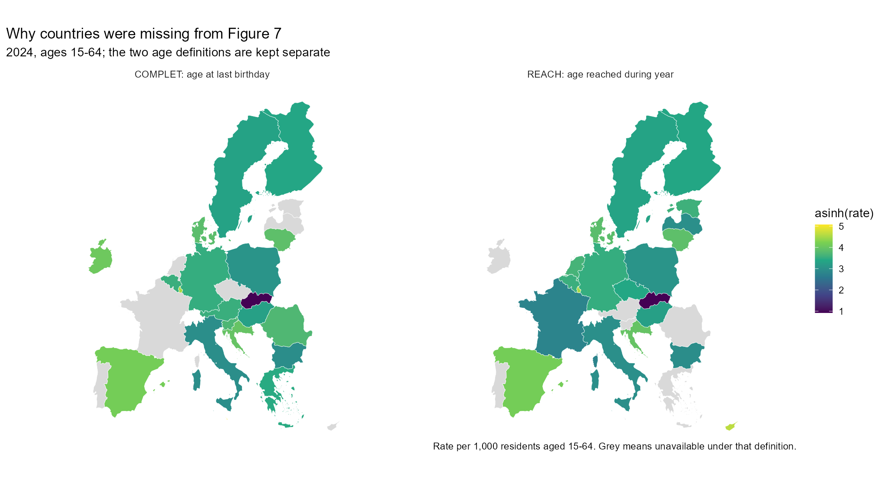
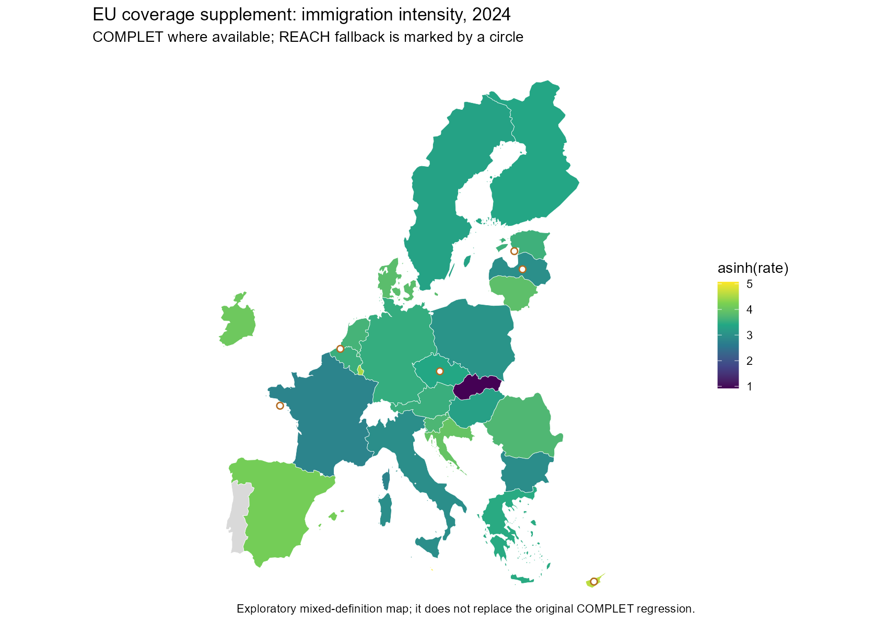
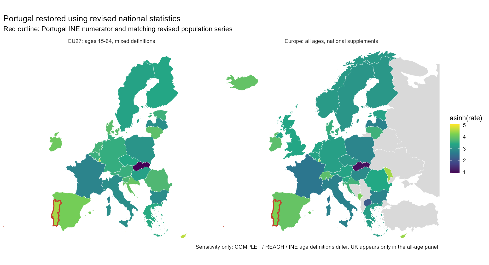
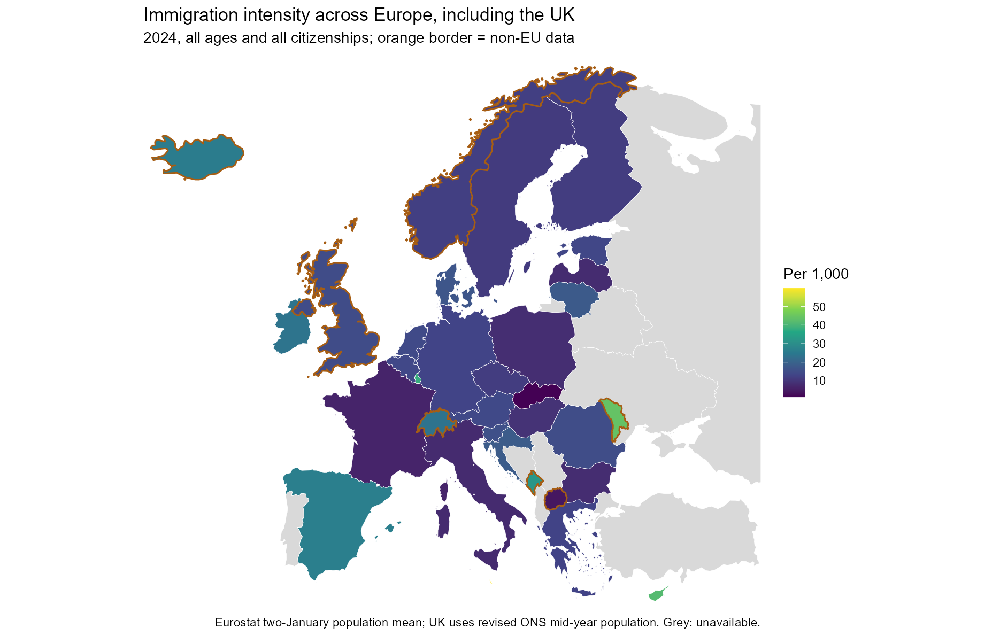
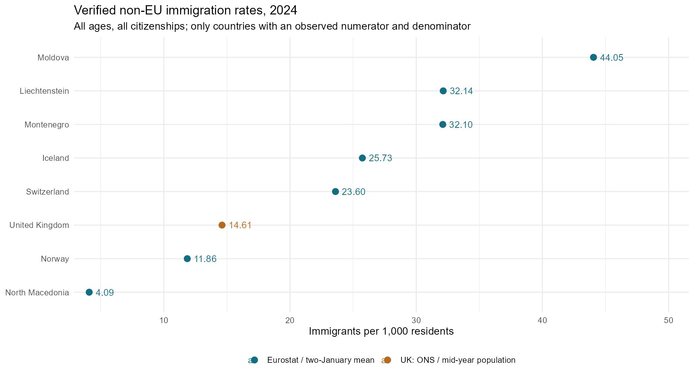
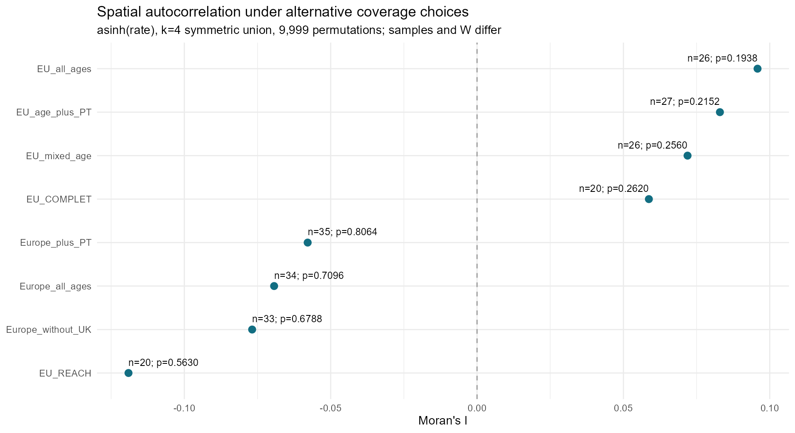
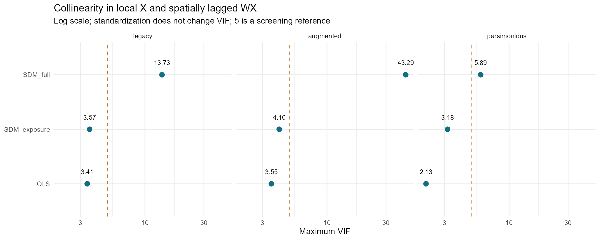
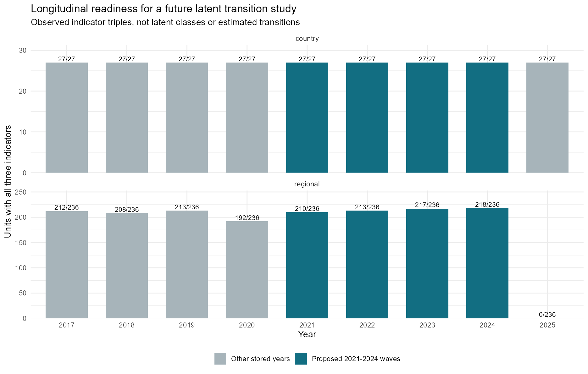

> 초기 연구기획 · 재현 가능한 실증 PoC · v4 · 2026-11-02

# DMA와 유럽의 공간적 분포 — 잔차 검정 정밀화와 이입 자료의 국가 범위 확장

> 보존용 문서. 원본은 그림을 내장한 단독 HTML 보고서(`DMA_PoC_v4_Report.html`)였으며 2026-11-03에 Markdown으로 변환했다. 본문·표·그림 설명은 그대로 두었고, 그림은 `figures/`의 동일 PNG를 참조한다(바이트가 다른 옛 렌더링은 같은 폴더의 `figures/`에 추출). 수치는 당시 분석 스냅샷이며 현재 결과는 `outputs/`와 `reports/`를 기준으로 한다.

> **지역 SDM의 잔차 검정을 199회에서 9,999회로 확대했습니다.** p값은 0.0700 → 0.0526입니다. 5% 기준에서 기각하지 않지만, 경계에 가까우므로 잔차 공간상관이 충분히 제거됐다고 단정하지 않습니다. 그림 7의 누락 EU 7개국은 6개국의 REACH 자료와 포르투갈 INE 자료로 보완 지도를 만들었습니다. 영국을 포함한 비EU 8개국은 별도 전체 연령 비교에 포함했습니다.

## 1. 연구 질문과 이번 수정의 범위
목표는 DMA의 규범 확산인 브뤼셀 효과와 기업·투자·인력의 국가 간 이동인 티부 메커니즘을 비교하기 위한 자료·공간모형의 실행 가능성을 점검하는 것입니다. 현재 자료는 2024년 단면의 분포 및 연관성을 보여줍니다. 이입자 총수는 ICT 인력 이동이나 규제 회피를 직접 측정하지 않으며, 국가별 이입률로 기업·투자의 이전까지 검증할 수 없습니다.

이번 버전은 ① 기존 218개 지역 SDM의 모수적 부트스트랩 잔차 검정만 정밀화하고 ② 그림 7의 국가 누락을 출처·연령 정의·개정 시점 수준에서 추적하며 ③ 영국과 주변 비EU국의 별도 기술통계와 Moran 검정을 제공합니다. 국가 SAR·SEM·SDM의 표본을 자동 확대하거나 인과효과를 새로 추정하지 않았습니다.

## 2. 지역 SDM: 199회와 9,999회의 비교
같은 종속변수, 설명변수, 218개 지역, 행 표준화 W, 추정계수를 사용했습니다. 적합 SDM에서 정규 혁신오차를 생성하고 y*=(I−ρW)⁻¹(Xβ+WXθ+ε*)를 만든 뒤 매회 SDM을 재추정했습니다. 검정 대상은 구조적 혁신잔차 ε̂=y−ρ̂Wy−Xβ̂−WXθ̂의 Moran’s I입니다. 잔차를 단순 무작위 재배열하는 방법과 다릅니다.

양측 p=min[1, 2×(작은 꼬리의 횟수+1)/(B+1)]입니다. seed=20262032로 기존 난수열을 연장했습니다. 첫 199개 잔차 I의 최대 수치 차이는 약 2.53×10⁻⁸이며 기존 p=0.0700이 재현됐습니다. 9,999회 모두 적합에 성공했고 경계 추정 비율은 0입니다. 지정한 4개 반복의 빠른 ML 적합을 spatialreg 결과와 대조했습니다.

| 반복 수 | 잔차 I | 양측 p | MC 표준오차 | MC 하한 | MC 상한 |
| --- | --- | --- | --- | --- | --- |
| 199 | -0.0269 | 0.0700 | 0.0260 | 0.0223 | 0.1289 |
| 999 | -0.0269 | 0.0580 | 0.0106 | 0.0374 | 0.0805 |
| 1,999 | -0.0269 | 0.0600 | 0.0076 | 0.0451 | 0.0758 |
| 4,999 | -0.0269 | 0.0536 | 0.0046 | 0.0446 | 0.0629 |
| 9,999 | -0.0269 | 0.0526 | 0.0032 | 0.0463 | 0.0590 |

*그림 13. 반복 횟수별 지역 SDM 잔차 검정. 오차막대는 모의실험 오차이며 정책효과의 신뢰구간이 아니다.*

**해석:** p=0.0526의 Monte Carlo 표준오차는 약 0.0032이고, 작은 꼬리 이항구간을 두 배 한 범위는 약 0.0463–0.0590입니다. 199회보다 약 8배 정밀해졌지만 0.05 주변의 판단은 여전히 민감합니다. B=9,999는 결과 확인 전에 정했으며 유의성을 얻기 위해 반복을 추가하지 않았습니다. 비유의는 무상관의 증명이 아닙니다. 정규·등분산 혁신오차를 전제한 검정이므로 반복 증가가 이분산이나 모형 누락의 문제까지 해결하지는 않습니다.

| 모형 | n | AICc | rho 또는 lambda | 혁신잔차 I | 잔차 p | 잔차 반복 | 효과 반복 |
| --- | --- | --- | --- | --- | --- | --- | --- |
| OLS | 218 | 785.1839 | 0.0000 | 0.2768 | 0.0100 | 199 | 199 |
| SAR | 218 | 786.8901 | -0.0513 | 0.2984 | 0.0100 | 199 | 199 |
| SEM | 218 | 733.4440 | 0.6343 | -0.0463 | 0.0100 | 199 | 199 |
| SDM_full | 218 | 705.8151 | 0.4045 | -0.0269 | 0.0526 | 9,999 | 199 |

지역 SDM의 ρ=0.4045, AICc=705.8151, 혁신잔차 I=−0.02689, 최대 설계행렬 VIF≈3.96은 v3와 같습니다. 비교모형의 AICc도 바뀌지 않았습니다. SDM은 이 표본에서 적합도 우위가 있으나, 작은 잔차 I만으로 모형 적합성을 확정하지 않습니다. **직접·간접·총효과의 구간은 기존 199회 그대로**입니다. SAR·SEM·OLS 지역 잔차 검정도 199회이며, 국가 검정은 999회입니다. 서로 다른 반복 수를 표에 함께 표시했습니다.

## 3. 기존 그림 7에서 보이지 않았던 국가
원래 그림 7은 15–64세 이입자 중 COMPLET 정의가 있는 EU 20개국을 그렸습니다. COMPLET는 마지막 생일 기준 연령이고 REACH는 해당 연도에 도달하는 연령입니다. 두 정의가 같은 사람들을 같은 연령대에 배치하지 않을 수 있어 무표시 혼합은 부적절합니다. 누락은 영토 경계 누락이 아니라 주로 연령 정의 선택에서 발생했습니다. 43개국 중 42개국은 GISCO 경계와 연결됐습니다. XK(코소보)는 내려받은 국가 레이어에 독립 도형이 없어 감사표에 남겼습니다. 관측 이입률이 있는 35개국은 모두 경계가 있습니다.

| 국가 | 기존_COMPLET | REACH_이입자 | REACH_천명당 | 보완 |
| --- | --- | --- | --- | --- |
| 키프로스 CY | 결측 | 33,439 | 51.3751 | REACH 자료 확보; COMPLET와 구분 |
| 체코 CZ | 결측 | 103,358 | 14.8735 | REACH 자료 확보; COMPLET와 구분 |
| 에스토니아 EE | 결측 | 15,654 | 17.9650 | REACH 자료 확보; COMPLET와 구분 |
| 프랑스 FR | 결측 | 346,724 | 8.1886 | REACH 자료 확보; COMPLET와 구분 |
| 라트비아 LV | 결측 | 11,577 | 9.8099 | REACH 자료 확보; COMPLET와 구분 |
| 네덜란드 NL | 결측 | 218,747 | 18.9052 | REACH 자료 확보; COMPLET와 구분 |
| 포르투갈 PT | 결측 | — | — | INE 국가자료 + 개정 인구, 별도 민감도 |

*그림 14. COMPLET와 REACH를 분리한 EU 지도. 동일 색척도, 회색은 해당 정의의 결측.*

*그림 15. COMPLET 우선, REACH 보완 지도(EU 26개국). 원은 REACH 대체 국가이며 기존 회귀의 대체 결과가 아니다.*

15–64세 분자는 10개 5세 구간을 완전 합산하고 단일연령 자료와 교차 대조했습니다. 분모는 2024·2025년 1월 1일의 15–64세 인구 평균입니다. 필요한 연령 셀 하나라도 없으면 결측으로 남깁니다. 결측을 0으로 만들거나 전체 연령 이입자를 15–64세 분모로 나누지 않았습니다. 새로 받은 Eurostat 자료와 v3가 겹치는 값은 모두 동일했습니다.

## 4. 포르투갈: 국가 통계청의 개정 자료로 별도 보완
현재 Eurostat의 2024년 포르투갈 이입 값은 비어 있습니다. INE 0006055에서 2024년 전체 이입자 394,904명, 15–64세 324,243명을 확보했습니다. 단일연령 50개 합계와 5세 구간 10개 합계를 대조했습니다. INE의 정의는 국적에 관계없이 이전에 해외에 1년 이상 거주하고 포르투갈에 1년 이상 거주하려는 이입자입니다.

분모도 INE 0012905의 개정된 2023년 말·2024년 말 인구 평균을 사용했습니다. 전체 인구 평균은 11,295,785, 전체 연령 이입 강도는 34.96명/천명입니다. 15–64세는 44.63명/천명입니다. 이입표의 최종 갱신일은 2026-09-30, 인구표는 2026-06-22입니다. Eurostat 분모를 그대로 붙이지 않았습니다.

INE 메타데이터가 말하는 기준일의 만 나이를 Eurostat COMPLET/REACH 중 하나로 임의 분류하지 않았습니다. 따라서 기본 Eurostat 열은 결측으로 보존하고 `rate_15_64_plus_PT`, `rate_all_ages_plus_PT`에만 별도 보완했습니다. 포르투갈 추가 전후 Moran 검정을 모두 제공합니다.

| immigration_15_64 | immigration_all_ages | population_15_64_mean | population_total_mean | eurostat_population_15_64_mean | eurostat_population_total_mean |
| --- | --- | --- | --- | --- | --- |
| 324,243 | 394,904 | 7,264,328 | 11,295,784.5 | 6,743,092.5 | 10,694,680.5 |

*그림 19. 포르투갈 국가자료 보완 지도. 왼쪽 EU 27개국의 연령별 혼합 정의, 오른쪽 영국 포함 35개국 전체 연령. 빨간 경계는 INE 보완이다.*

## 5. 영국 및 주변 비EU국의 검증된 별도 비교
확인 범위는 EU27과 UK·IS·LI·NO·CH·AL·BA·ME·MK·RS·XK·MD·UA·TR·BY·RU의 비EU 16개국, 총 43개국입니다. 모든 유럽 국가를 망라한 목록은 아닙니다. Eurostat와 ONS 기준으로 34개국, 포르투갈 국가자료를 더하면 35개국에서 전체 연령 비율을 계산했습니다. 아래 8개 비EU국은 분자·분모가 모두 있습니다.

| 코드 | 국가 | 2024 이입자 | 인구분모 | 천명당 이입 |
| --- | --- | --- | --- | --- |
| UK | United Kingdom | 1,012,000 | 69,256,300.0 | 14.6124 |
| IS | Iceland | 9,946 | 386,505.5 | 25.7331 |
| LI | Liechtenstein | 1,300 | 40,450.5 | 32.1380 |
| NO | Norway | 66,077 | 5,572,271.5 | 11.8582 |
| CH | Switzerland | 212,578 | 9,006,643.5 | 23.6024 |
| ME | Montenegro | 20,016 | 623,503.5 | 32.1025 |
| MK | North Macedonia | 7,458 | 1,824,429.5 | 4.0879 |
| MD | Moldova | 105,804 | 2,402,060.0 | 44.0472 |

*그림 16. 영국 포함 유럽 전체 연령 이입 강도(34개국 관측). 주황 경계는 관측된 비EU 국가이다.*

*그림 17. 자료가 검증된 비EU 8개국 비교. 인구 천명당 이입자 수이며 순이동률이 아니다.*

영국은 ONS의 2026-05-21 발표에 있는 2024년 장기 이입 1,012,000명과 2026-10-01 발표의 개정된 2024년 중간인구 69,256,300명을 사용했습니다. 결과는 14.61명/천명입니다. 발표문 수치는 각각 천명·백명 단위로 반올림돼 있습니다. 분모 관행과 추계 방법이 Eurostat와 달라 영국 제외 민감도도 보고합니다. 영국의 15–64세 비교 가능 분자를 확보하지 못했으므로 연령별 지도에 억지로 채우지 않았습니다.

이번 수집에서 동일한 2024년 분자·분모 쌍을 확보하지 못한 국가는 AL, BA, RS, UA, TR, BY, RU, XK입니다. 회색은 미확보이지 이동이 없다는 의미가 아닙니다. 세르비아의 외국인 이동만을 집계한 표, 알바니아의 외국인 체류허가·재고 자료는 전체 국적의 연간 이입 흐름과 다르므로 대체하지 않았습니다. 국가 통계의 전수 수집을 완료했다는 주장은 하지 않습니다.

## 6. 국가 범위 확장에 따른 Moran’s I
국가별 비율을 asinh 변환하고, 유럽 표시 창 안의 최대 면적 폴리곤 중심점을 EPSG:3035로 투영했습니다. 각 완전관측 표본에서 k=4 최근접 이웃을 대칭 합집합으로 만든 뒤 행 표준화했습니다. k=3·5도 검토했습니다. 각 검정은 양측 순열 9,999회이며 기본 k=4의 8개 탐색적 검정에 BH 보정을 병기했습니다. 표본이 바뀌면 W도 바뀌므로 I 차이는 규제효과 차이가 아닙니다.

| 표본 정의 | n | Moran I | 순열 p | BH p |
| --- | --- | --- | --- | --- |
| EU_COMPLET | 20 | 0.0587 | 0.2620 | 0.5240 |
| EU_REACH | 20 | -0.1191 | 0.5630 | 0.8064 |
| EU_mixed_age | 26 | 0.0719 | 0.2560 | 0.5240 |
| EU_all_ages | 26 | 0.0958 | 0.1938 | 0.5240 |
| Europe_all_ages | 34 | -0.0693 | 0.7096 | 0.8064 |
| Europe_without_UK | 33 | -0.0768 | 0.6788 | 0.8064 |
| EU_age_plus_PT | 27 | 0.0830 | 0.2152 | 0.5240 |
| Europe_plus_PT | 35 | -0.0579 | 0.8064 | 0.8064 |

*그림 18. 국가 범위·연령 정의·국가자료 보완에 따른 Moran’s I. 기본 k=4, 표본별 W 재구성.*

기존 COMPLET 20개국은 I=0.0587066, p=0.2620으로 정확히 재현됐습니다. 포르투갈 추가 전 유럽 34개국의 전체 연령 I=−0.06932, p=0.7096, 영국 제외 33개국은 I=−0.07683, p=0.6788입니다. 포르투갈을 더한 35개국도 I=−0.05786, p=0.8064입니다. 이 결과는 뚜렷한 전역적 군집 증거를 보이지 않지만 표본 크기·누락·지리적 W 선택의 영향을 받습니다. 지역 SDM의 잔차 검정과 국가 이입률의 원자료 검정은 분석 단위와 귀무가설이 다릅니다.

## 7. 기존 변수 구성 및 후속 연구의 우선순위
국가 모형의 기존 결론은 유지합니다. 산업의 과거 비중까지 모두 공간지연하면 최대 VIF가 약 43.29로 상승했고, 노출 변수만 지연한 구성은 약 4.10이었습니다. 노동비용을 제외한 간결한 구성의 제한 SDM은 약 3.18입니다. 표준화는 수치 크기를 조정할 뿐 다중공선성을 제거하지 않습니다. 변수 선정은 이론·측정과 X 및 WX의 VIF를 함께 보며, 지역 SDM의 최대 VIF≈3.96은 이번 잔차 반복 증가로 달라지지 않습니다.

*그림 3. v3에서 확정한 국가별 변수 구성의 VIF 비교. 이번 버전의 변수·표본 변경은 없다.*

다음 단계는 ① 국가·지역별 ICT 직종의 실제 출발지–도착지 이동, ② 기업 단위 투자·설립·폐업·이전의 시점과 위치, ③ DMA 노출 및 준수의 기업별 측정, ④ 시행 이전부터 이어지는 시계열을 결합하는 것입니다. 지역 단면 SDM의 간접효과나 전체 인구 이입률만으로 브뤼셀 효과와 티부 효과를 구별할 수 없습니다. 국가 규모 지도와 NUTS 지역 모형 간 생태학적 해석도 분리해야 합니다.

## 8. 원천자료와 재현 파일
추가 수집은 모두 무료이며 API 키가 필요 없습니다. 웹/API 주소와 원문 SHA-256, 자료 갱신일은 `inputs/extension_20261102/SOURCE_MANIFEST.csv`에 있습니다. 원문 JSON/HTML과 변환 CSV를 함께 보존했습니다. 아래 링크는 공식 원천입니다.

- [Eurostat migr_imm5prv](https://ec.europa.eu/eurostat/databrowser/view/migr_imm5prv/default/table?lang=en)
- [Eurostat migr_imm8](https://ec.europa.eu/eurostat/databrowser/view/migr_imm8/default/table?lang=en)
- [Eurostat migr_imm1ctz](https://ec.europa.eu/eurostat/databrowser/view/migr_imm1ctz/default/table?lang=en)
- [Eurostat demo_pjan](https://ec.europa.eu/eurostat/databrowser/view/demo_pjan/default/table?lang=en)
- [Eurostat 이입 통계 메타데이터](https://ec.europa.eu/eurostat/cache/metadata/en/migr_immi_esms.htm)
- [ONS 장기 국제이동, 2026-05-21 발표](https://www.ons.gov.uk/peoplepopulationandcommunity/populationandmigration/internationalmigration/bulletins/longterminternationalmigrationprovisional/yearendingdecember2025)
- [ONS 인구추계, 2026-10-01 발표](https://www.ons.gov.uk/peoplepopulationandcommunity/populationandmigration/populationestimates/bulletins/annualmidyearpopulationestimates/mid2025)
- [INE 0006055 이입자 메타데이터](https://www.ine.pt/bddXplorer/htdocs/minfo.jsp?var_cd=0006055&lingua=EN)
- [INE 0012905 인구 메타데이터](https://www.ine.pt/bddXplorer/htdocs/minfo.jsp?var_cd=0012905&lingua=EN)
- [GISCO 2024 국가 경계](https://gisco-services.ec.europa.eu/distribution/v2/countries/download/)

**RStudio:** ZIP을 풀고 `DMA_PoC_v4.Rproj`를 열어 `START_HERE.R`를 Source 하면 이번 갱신을 재실행합니다. `REFRESH_OUTPUTS.R`는 저장된 결과로 보고서·정밀도 그림만 빠르게 생성합니다. `RUN_FULL_ANALYSIS.R`는 원자료 전처리부터 기존 국가·지역 모형을 모두 다시 적합한 후 v4 갱신까지 실행하며 더 오래 걸립니다. `config.json`에서 반복 수·seed·k를 확인할 수 있습니다.

핵심 CSV: `outputs/regional_sdm_bootstrap_comparison.csv`, `outputs/regional_sdm_bootstrap_extended_draws.csv`, `outputs/migration_extension/migration_europe_2024.csv`, `figure7_missing_country_audit.csv`, `portugal_revision_audit.csv`, `migration_moran_tests.csv`. 국가 경계는 같은 출력 폴더의 GPKG와 `shapefile/EUROPE42_2024.shp`이며 `country`로 CSV와 결합합니다. PNG와 PDF 그림은 `figures`에 있습니다.

v3 원본 보고서와 비교 CSV·모형 RDS는 `reference/v3`에 별도 보존했습니다. 본 문서와 그림 13–20이 v4의 신규 결과입니다. 수치 검증 기록은 `outputs/v4_validation.json`, R 실행 환경은 `outputs/regional_refinement_session.txt`에 있습니다.

## 9. 추가 기획: LTA 기반 종단연구 테이블
**실제 패널을 이용한 연구 준비표이며 LTA 적합 결과는 아닙니다.** 현재 지표는 연속형이므로 연속형 지표 LTA, 즉 잠재프로파일 전이(LPTA)를 우선 검토합니다. 이분화로 정보와 절단점 민감성을 추가하지 않도록 원척도와 2021년 고정 기준 표준화 값을 함께 제공합니다. LTA는 관측되지 않는 상태와 시간 간 전이확률을 추정하며, 여기의 관측쌍 개수는 전이확률이나 상태 분류 결과가 아닙니다. [Muthén·Asparouhov의 LTA 방법 설명](https://www.statmodel.com/examples/LTAwebnote.pdf).

| 분석수준 | 고유단위 | 포함국가 | 선택연도 | 전체행 | 세지표완전행 | 네시점완전단위 | 불완전행 |
| --- | --- | --- | --- | --- | --- | --- | --- |
| EU 국가 | 27 | 27 | 2021,2022,2023,2024 | 108 | 108 | 27 | 0 |
| NUTS 지역 | 236 | 27 | 2021,2022,2023,2024 | 944 | 858 | 205 | 86 |

2021–2024년 국가 표는 27개국×4시점=108행으로 세 지표가 모두 있습니다. 지역 표는 236개 지역×4시점=944행 중 858행이 완전하고, 네 시점 모두 완전한 지역은 205개입니다. 국가 표의 독립 단위 수가 108개로 늘어난 것은 아닙니다. 지역 자료도 같은 국가에 묶이고 공간적으로 의존하므로 236개를 모두 독립 지역처럼 취급하는 정밀도 평가를 경계해야 합니다. 2024년 공간회귀의 218개 지역은 단면 완전사례이고, 여기의 236/205개와 표본 정의가 다릅니다.

*그림 20. 종단 LTA 후보 지표 3개가 모두 있는 국가·지역 수. 막대는 상태 비중이나 전이확률이 아니다.*

| 항목 | 계획 |
| --- | --- |
| 연구질문 | 지역의 디지털 고용·인적자본·소득 구성 유형이 시간에 따라 유지/전환되는가 |
| 단위 | 국가 EU27은 보조적 기술분석; 동일 NUTS2024 코드 지역은 확장 후보. 같은 코드라도 영토 변경 가능성이 있어 공식 변환표 검토 필요. 국가·연도 행을 독립 표본으로 계산하지 않음 |
| 연도 | 원자료 2017–2025 보존; 우선 동간격 2021–2024 네 시점. 2025 지역 GDP 미확보로 주 파동에서 제외 |
| 상태 의미 | 낮음/높음은 가설적 이름; 결과를 본 뒤 지표 프로파일로 명명. 규제 수용형/회피형으로 선결정하지 않음 |
| 국가 측정지표 | ICT 직업 비중, 국민계정 J산업 고용비중, 실업률; 첫 두 지표의 국소의존·중복을 반드시 점검 |
| 지역 측정지표 | J산업 고용비중, 25–64세 고등교육 비율, 1인당 PPS GDP 로그; 지역 경제·인적자본 구조를 측정 |
| 측정모형 | 현재 지표가 연속형이므로 연속형 지표 LTA/잠재프로파일 전이(LPTA)를 우선 검토. 임의 이분화하지 않음 |
| 상태 수 | K=1 기준모형, K=2 시작, K=3 민감도. BIC·반복 초기값 안정성·작은 집단·실질 해석을 함께 확인 |
| 시간 비교 | 2021 기준 고정 표준화. 시점별 평균/분산(범주형이면 응답확률)의 동일성 및 부분동일성 검토; 원천 조사단절도 별도 감사 |
| 전이모형 | P(S[t+1]=j / S[t]=i) 행렬. 시간동질 전이부터 검토하고 자유 전이와 비교. 관측쌍 수는 전이 추정값이 아님 |
| 공변량 | 기준시점 노출도와 시차 통제 후보. 지표로 쓴 GDP를 같은 식에서 설명변수로 중복 사용하지 않음 |
| 결측 | NA 보존, 0대체/직전값 채움 없음. 관측자료 우도·MAR 가정 검토, 완전사례는 민감도이며 자동 기본표본 아님 |
| 분류오차 | 최빈 사후상태를 정답처럼 회귀하지 않음. 공동추정 또는 분류오차 보정 절차, entropy는 보조 기준 |
| 공간의존 | 같은 국가 내 지역 및 공간상관을 고려. NUTS 수를 독립 국가 수로 해석하지 않음; 공간/국가 블록 기반 안정성 점검 |
| DMA 해석 | 2024년 한 시점의 변화로 DMA 인과효과를 식별할 수 없음. 노출도 차이, 비교군, 더 긴 시행 후 자료 필요 |
| 검증과 보고 | Monte Carlo 표본설계·분리도·희소 전이·다중 시작 수렴 확인 후 상태비중·전이확률과 구간 보고 |
| 추가자료 | ICT 인력 OD, 기업/투자 이전 이벤트, 연속 지역코드 변환표, 장기간 플랫폼 규제 노출·준수 자료 |
| 이번 산출 범위 | 종단 long/wide 표와 관측가능성·연구설계표 생성. 잠재상태, entropy, BIC, 전이확률은 아직 추정하지 않음 |

국가 지표는 ICT 직업 고용비중·J산업 고용비중·실업률, 지역 지표는 J산업 고용비중·고등교육 비율·로그 1인당 PPS GDP입니다. 각각 디지털 노동시장 구성, 지역 경제·인적자본 구조라는 좁은 구성개념을 가정합니다. 브뤼셀 효과와 규제 회피의 잠재상태를 직접 측정한다고 이름 붙이지 않습니다. 이입 자료는 연령 정의와 국가별 결측이 크므로 일단 보조 결과로 남기고, 완전관측만으로 국가를 임의 제거하거나 새 단면 보완값을 과거 전체로 소급하지 않습니다.

| scope | from_year | to_year | matched_units | complete_pairs |
| --- | --- | --- | --- | --- |
| country | 2,021 | 2,022 | 27 | 27 |
| country | 2,022 | 2,023 | 27 | 27 |
| country | 2,023 | 2,024 | 27 | 27 |
| regional | 2,021 | 2,022 | 236 | 206 |
| regional | 2,022 | 2,023 | 236 | 212 |
| regional | 2,023 | 2,024 | 236 | 214 |

우선 K=2의 단순 구조를 계획하되, K=1 기준과 K=3 민감도·복수 초기값·희소 전이·상태 분리도를 검토해야 합니다. 시점 간 측정동일성/부분동일성을 점검한 뒤 전이의 의미를 비교합니다. Entropy만으로 상태 수를 선택하거나 최빈 사후상태를 오차 없는 관측값으로 사용하지 않습니다. 적절한 표본 크기는 정해진 단일 숫자보다 가정한 전이확률·상태 비율·결측을 반영한 Monte Carlo 설계로 판단합니다. [2025 LTA 분석 권고 논문](https://pmc.ncbi.nlm.nih.gov/articles/PMC11909493/), [무료 R 도구 LMest의 방법 논문](https://www.jstatsoft.org/article/view/v081i04).

`PREPARE_LTA.R` 또는 `code/10_lta_longitudinal_tables.R`가 실제 long/wide 표, 연도별 가용성, 연속 시점의 관측쌍 감사와 연구설계표를 생성합니다. 파일은 `outputs/lta_design`에 있습니다. `country_long_2017_2025.csv`·`regional_long_2017_2025.csv`는 전체 저장기간, `*_waves_2021_2024.csv`·`*_wide_2021_2024.csv`는 후보 파동입니다. 국가별 자료·측정 플래그와 결측을 보존했습니다. 상태값·전이확률·BIC·entropy는 아직 생성하지 않았습니다.

---

*PoC v4 · 기술통계 및 모형 진단용 연구기획 초안 · 실제 내려받은 공개 통계 사용*
