# DMA 규제와 유럽 경제활동 이동 — 추가 데이터 결합·공간회귀 PoC v3

> 보존용 문서. 원본은 그림을 내장한 단독 HTML 보고서(`DMA_PoC_v3_Report.html`)였으며 2026-11-03에 Markdown으로 변환했다. 본문·표·그림 설명은 그대로 두었고, 그림은 `figures/`의 동일 PNG를 참조한다(바이트가 다른 옛 렌더링은 같은 폴더의 `figures/`에 추출). 수치는 당시 분석 스냅샷이며 현재 결과는 `outputs/`와 `reports/`를 기준으로 한다.

> 분석 기준일 2026년 11월 2일 · 국가 자료 수집본 2026년 10월 28일 / 추가 자료 11월 1일 · RStudio 재현 패키지

> **국가 자료 288행을 중복 없이 결합했고, 기존 모형의 로그우도는 최대 4.16e-13 차이로 재현됐다.** 새 자료를 추가했다고 기존 결과가 자동으로 바뀌지는 않는다. 결과의 변화는 설명변수 구성, 결과변수, 분석 공간 단위의 변경으로 구분한다.

## 1. 연구 질문과 이번 분석의 범위
**이번 PoC의 판단:** 산업구조 통제 추가 후 기존 ICT 고용 모형의 적합도는 개선되지만, 기존 노출도 직접효과의 부호를 확정할 근거는 약해졌다. 전체 SDM은 공간지연 통제변수끼리의 공선성과 경계 추정 문제가 함께 나타난다. 현재는 확장 OLS와 간결 OLS를 기준으로 병기하고, SAR·SEM·SDM을 민감도 비교로 유지하는 것이 타당하다. 이는 최종 인과모형을 선택했다는 의미가 아니다.

브뤼셀 효과는 EU형 법제·기능의 역외 확산, 티부형 이동은 기업·투자·인력의 국경 간 이동으로 정의한다. 이번 분석은 무료자료의 결합 가능성과 공간적 연관성을 검토하는 PoC다. EU 회원국에 공통으로 적용되는 DMA를 국가별 규제 강도 차이로 취급하지 않는다. 단순한 2024년 이후 더미나 국가 본사 소재지만으로 규제 효과를 식별하지 않는다.

기존 ICT 직업 고용 비율에 새로운 산업 구조 통제를 추가했다. 인구 분모를 이용한 이입 강도와 국민계정 정보통신업 고용비율은 별도 결과변수다. 지역 분석에는 실제 NUTS2 지역값만 사용했다. 국가 통계값을 지역마다 복제하지 않았다.

| 분석 | 결과 | 설명변수 |
| --- | --- | --- |
| 기존 재현 | ICT 직업 고용 비율 | 사전 노출·로그 PPS GDP·로그 노동비용·실업률 |
| 확장 | 동일 | 기존 네 변수 + 2017–2019 J 고용비중 |
| 간결 구성 | 동일 | 사전 노출·로그 PPS GDP·실업률·사전 J 고용비중 |
| 산업 고용 결과 | 국민계정 J 산업 고용 비율 | 기존 네 변수 |
| 이입 결과 | asinh(15–64세 이입/연평균 근사 인구×1,000) | 사전 노출·로그 PPS GDP·실업률 |
| 지역 결과 | 지역 J 산업 고용 비율 | 로그 지역 PPS GDP·25–64세 고등교육 비율 |

## 2. 데이터 결합·전처리와 결측 점검
| 원천 코드 | 자료 | 원천 CSV 행 수 | 관측기간 |
| --- | --- | --- | --- |
| nama_10_a10_e | 국민계정 국내개념 취업자: 전체 산업 및 정보통신업 J | 558 | 2017-2025 |
| lfsa_egan | LFS 거주자 취업자: 15~64세 및 15세 이상, 전체 국적 | 558 | 2017-2025 |
| nama_10r_2gdp | NUTS2 GDP: 백만 EUR, EUR/인, PPS/인 | 6552 | 2017-2024 |
| edat_lfse_04 | NUTS2 25~64세 고등교육 이수 비율 | 2871 | 2017-2025 |
| htec_emp_reg2 | NUTS2 고용: 전체·고기술·고기술 지식서비스·정보통신업 J | 22968 | 2017-2025 |
| demo_pjan | 1월 1일 인구: 15~64세 단일 연령 및 전체 인구 | 14688 | 2017-2025 |

원천 CSV의 품질 플래그와 결측을 보존했다. 보간, 평균 대체, 결측의 0 치환, 윈저라이징은 하지 않았다. Eurostat 국가코드 EL·UK와 ISO2 GR·GB를 구분했다. 결합키는 국가×연도이며 기존 및 추가 표의 중복을 검사했다. 50개 단일 연령 Y15~Y64가 모두 관측될 때만 15–64세 인구를 합산했다. 연평균 근사는 t년과 t+1년 1월 1일 인구의 평균이다.

> 2026년 연초 인구가 이번 응답에 없어 2025년 연평균 인구 근사는 결측이다. 따라서 이입 강도를 2025년까지 임의로 연장하지 않았다. LFS의 거주자 취업자와 국민계정의 국내개념 취업자는 분모가 다르다. 이입 COMPLET와 REACH 연령 정의도 혼합하지 않았다. 이입율은 집계 강도 지표이며 개인의 이동 확률이 아니다.

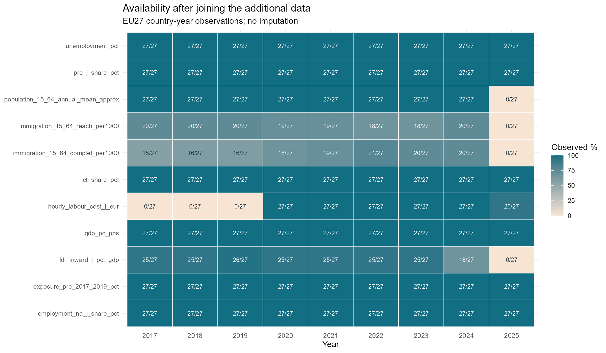

*그림 1. 국가별로 사용할 수 있는 관측 수. 각 셀은 EU27 중 관측 국가 수다.*

## 3. 지역코드·경계 불일치
결합한 지역·연도 표는 3015행이다. NUTS 2024 SHP와 맞지 않는 고유 코드는 **76개**이고, 그중 2024년 원천값이 하나라도 있는 코드는 14개다. 이는 여러 데이터셋에서 반복되는 불일치 행 수와 다르다. 과거 코드·영국 코드·extra-regio 코드를 구분했으며 이름 유사성으로 강제 연결하지 않았다.

| 분류 | 고유 지역코드 수 |
| --- | --- |
| UK_not_in_2024_boundary | 45 |
| code_match_only | 259 |
| extra_regio_no_polygon | 15 |
| old_or_noncurrent_code_requires_crosswalk | 16 |

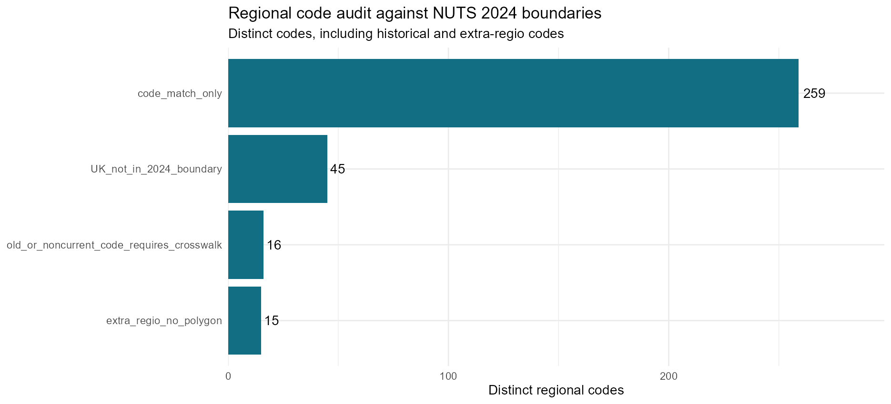

*그림 2. 지역코드 상태. 코드가 일치해도 과거 경계가 동일하다는 보장은 없다.*

지역 회귀는 2024년 EU27, 현행 경계 코드, 세 변수 완전관측, 대표점 경도 −25~45°·위도 34~72° 조건을 적용했다. 최종 표본은 **218개 지역**이다. 이 창 밖의 원격·해외 지역은 거리 대표점 비교 범위를 맞추기 위해 제외했다. 결과를 모든 EU 지역에 일반화하지 않는다. 도형 유효성을 검사·수정했고, 지역별 가장 큰 다각형의 EPSG:3035 중심점을 사용했다.

| 단계 | 지역수 |
| --- | --- |
| 2024년 원천 지역코드 합집합 | 335 |
| EU27 국가코드 | 270 |
| 현행 경계 연결 | 244 |
| 유럽 대표점 범위 | 236 |
| 세 변수 완전관측 | 218 |

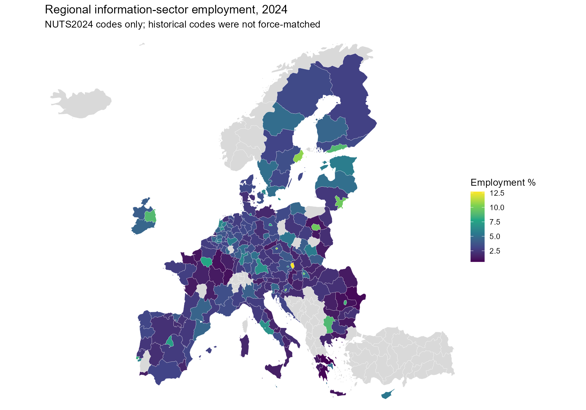

*그림 3. 현행 지역코드의 정보통신업 고용 비율. 회색은 결측 또는 분석범위 밖이다.*

## 4. 공간모형·검정의 사전 구성
주 분석 연도는 2024년이다. W는 k=4 최근접 이웃의 양방향 합집합을 행합 1로 표준화했다. k=3·5를 민감도로 비교했다. 각 분석의 완전관측 표본을 먼저 정한 뒤 W를 다시 구성했다. 연결 성분과 이웃 수를 저장했다. 서로 다른 연도의 국가 행을 쌓아 하나의 Moran 검정을 하지 않았다.

OLS, SAR, SEM, 전체 SDM을 비교했다. 국가 분석에는 사전 노출도의 WX만 유지하는 제한형 SDM도 포함했다. 지역에는 사전 노출도 자료가 없어 제한형 노출도 SDM을 만들지 않았다. 국소 X는 각 구성 안에서 동일하게 유지했다. VIF는 X 또는 X+WX 설계행렬을 대상으로 하며 Wy의 내생성을 VIF로 해결하지 않는다. 변수 표준화는 수치 계산을 돕지만 VIF를 낮추지 않는다.

원변수 Moran 검정은 9,999회 양측 순열검정이다. OLS 잔차는 회귀조정 근사검정과 정규오차 투영 모의실험을 병기한다. 공간모형의 혁신오차는 모형별 정규·등분산 가정하에 생성·재추정한 부트스트랩으로 진단했다. 국가 999회, 지역 199회이며 지역 p값은 특히 몬테카를로 오차를 고려해야 한다. SEM에서는 (I−λW)(y−Xβ)를 진단한다.

> 주 비교의 공간계수 탐색 구간은 기존과 같은 [−0.999, 0.999]다. 경계 추정이 발견돼 고유값에 따른 비특이 구간에서 별도 민감도 분석을 추가했다. 이 확장 구간은 |ρ|·|λ|<1의 안정성 조건과 다르므로 주 비교를 대체하지 않는다. AICc는 관행적 보정 2K(K+1)/(n−K−1)을 사용한 참고 지표이며 공간 ML의 정확한 소표본 보정으로 보장되지 않는다. 서로 다른 결과변수·표본의 AIC를 직접 비교하지 않는다.

## 5. 기존 결과 재현과 추가 변수의 공선성
| 모형 | 기존 AIC | 재현 AIC | 기존 AICc | 재현 AICc | 우도 절대 차이 |
| --- | --- | --- | --- | --- | --- |
| OLS | 88.064421 | 88.064421 | 92.264421 | 92.264421 | 0.000000 |
| SAR | 89.157449 | 89.157449 | 95.052186 | 95.052186 | 0.000000 |
| SDM_exposure | 89.586830 | 89.586830 | 97.586830 | 97.586830 | 0.000000 |
| SDM_full | 78.936620 | 78.936620 | 96.536620 | 96.536620 | 0.000000 |
| SEM | 88.716368 | 88.716368 | 94.611105 | 94.611105 | 0.000000 |

기존 전체 SDM 최대 VIF 13.73에 비해 확장 전체 SDM은 43.29, 확장 제한형은 4.10다. 모든 국소 X를 유지하면서 WX만 제한한 효과와, 노동비용 자체를 제외한 효과를 구분한다. 낮은 VIF만으로 최종 모형을 채택하지 않는다.

| 구성 | 설계 | 최대 VIF |
| --- | --- | --- |
| 기존 통제 + 사전 J 고용비중 | OLS | 3.546 |
| 기존 변수 재현 | OLS | 3.411 |
| 노동비용 제외 + 사전 J 고용비중 | OLS | 2.128 |
| 기존 통제 + 사전 J 고용비중 | SDM_exposure | 4.105 |
| 기존 변수 재현 | SDM_exposure | 3.567 |
| 노동비용 제외 + 사전 J 고용비중 | SDM_exposure | 3.180 |
| 기존 통제 + 사전 J 고용비중 | SDM_full | 43.290 |
| 기존 변수 재현 | SDM_full | 13.730 |
| 노동비용 제외 + 사전 J 고용비중 | SDM_full | 5.888 |

*그림 4. 동일 표본에서 X와 WX 구성별 최대 VIF.*

확장 전체 SDM의 최대 VIF는 공간지연 노동비용(43.29)에서 발생했다. 국소 노동비용까지 제외한 간결 구성은 전체 SDM 5.89, 제한형 3.18까지 낮아진다. 다만 전체→제한형의 제약 LR 참고 p값은 확장 0.000033, 간결 0.00203으로 단순히 WX를 제거하면 설명력이 손실된다. 특히 확장 전체 SDM은 경계 추정이므로 LR의 통상적 점근분포도 주의해서 읽어야 한다. 제한형을 공선성 해소만으로 최종 채택하지 않는 이유다.

## 6. SAR·SEM·SDM 비교와 해석
| 분석 | n | AIC | AICc | BIC |
| --- | --- | --- | --- | --- |
| 기존 통제 + 사전 J 고용비중 | 27 | SDM_full | SEM | SDM_full |
| 산업 J 고용비중 결과 | 27 | SDM_full | OLS | OLS |
| 기존 변수 재현 | 27 | SDM_full | OLS | SDM_full |
| 이입 강도(COMPLET) 결과 | 20 | OLS | OLS | OLS |
| 노동비용 제외 + 사전 J 고용비중 | 27 | SDM_full | OLS | SDM_full |
| NUTS2 지역 탐색 | 218 | SDM_full | SDM_full | SDM_full |

> 표의 AIC·AICc·BIC는 각각 최솟값을 낸 모형 이름이며 최종 채택 결과가 아니다. 확장 SEM의 AICc가 85.31로 낮지만 λ≈−0.999가 탐색 하한에 걸린다. 확장 전체 SDM도 ρ≈−0.999이며, 두 모형의 부트스트랩 경계 도달 비율은 각각 82.5%, 72.4%다. 이 결과를 안정적인 음의 공간효과로 해석하지 않는다.

같은 ICT 결과·27개국·W에서 기존 OLS AICc는 92.26, 확장 OLS는 86.85, 노동비용을 제외한 간결 OLS는 86.83이다. 사전 산업구조를 고려한 두 구성이 기존보다 적합하지만 확장·간결 OLS 차이 0.012만으로 우열을 주장할 수 없다. 전체 SDM의 낮은 AIC와 더 큰 AICc 사이 차이는 작은 표본에서 모수 증가의 비용이 크다는 신호다.

아래 첫 표는 같은 ICT 결과변수와 같은 EU27 표본을 사용하므로 기존·확장·간결 구성 간 정보기준 비교가 가능하다. 산업 고용·이입·지역 분석의 정보기준은 각 분석 내부에서만 판단한다. SAR와 SEM 사이에는 중첩모형 LR 검정을 하지 않았다. 전체 SDM과 SEM의 LR은 공통인자 제약 검정이며, 작은 표본에서 점근 p값을 과신하지 않는다.

| 구성 | 모형 | n | 모수 수 | AIC | AICc | BIC | ρ 또는 λ | 혁신오차 p | 경계 비율 |
| --- | --- | --- | --- | --- | --- | --- | --- | --- | --- |
| 기존 변수 재현 | OLS | 27.000 | 6.000 | 88.064 | 92.264 | 95.839 | 0.000 | 0.062 | 0.000 |
| 기존 변수 재현 | SAR | 27.000 | 7.000 | 89.157 | 95.052 | 98.228 | 0.221 | 0.390 | 0.002 |
| 기존 변수 재현 | SEM | 27.000 | 7.000 | 88.716 | 94.611 | 97.787 | 0.346 | 0.396 | 0.046 |
| 기존 변수 재현 | SDM_full | 27.000 | 11.000 | 78.937 | 96.537 | 93.191 | -0.645 | 0.424 | 0.246 |
| 기존 변수 재현 | SDM_exposure | 27.000 | 8.000 | 89.587 | 97.587 | 99.954 | 0.339 | 0.860 | 0.000 |
| 기존 통제 + 사전 J 고용비중 | OLS | 27.000 | 7.000 | 80.950 | 86.845 | 90.021 | 0.000 | 0.886 | 0.000 |
| 기존 통제 + 사전 J 고용비중 | SAR | 27.000 | 8.000 | 82.367 | 90.367 | 92.733 | 0.159 | 0.166 | 0.003 |
| 기존 통제 + 사전 J 고용비중 | SEM | 27.000 | 8.000 | 77.309 | 85.309 | 87.675 | -0.999 | 0.676 | 0.825 |
| 기존 통제 + 사전 J 고용비중 | SDM_full | 27.000 | 13.000 | 66.230 | 94.230 | 83.076 | -0.999 | 0.822 | 0.724 |
| 기존 통제 + 사전 J 고용비중 | SDM_exposure | 27.000 | 9.000 | 84.149 | 94.737 | 95.811 | 0.208 | 0.050 | 0.004 |
| 노동비용 제외 + 사전 J 고용비중 | OLS | 27.000 | 6.000 | 82.633 | 86.833 | 90.408 | 0.000 | 0.310 | 0.000 |
| 노동비용 제외 + 사전 J 고용비중 | SAR | 27.000 | 7.000 | 82.729 | 88.624 | 91.800 | 0.275 | 0.304 | 0.001 |
| 노동비용 제외 + 사전 J 고용비중 | SEM | 27.000 | 7.000 | 84.486 | 90.380 | 93.556 | 0.149 | 0.996 | 0.099 |
| 노동비용 제외 + 사전 J 고용비중 | SDM_full | 27.000 | 11.000 | 75.867 | 93.467 | 90.122 | -0.814 | 0.518 | 0.548 |
| 노동비용 제외 + 사전 J 고용비중 | SDM_exposure | 27.000 | 8.000 | 84.633 | 92.633 | 95.000 | 0.308 | 0.132 | 0.001 |

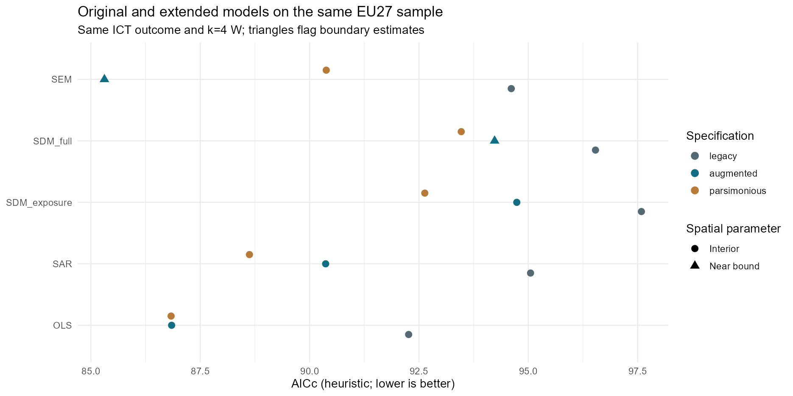

*그림 5. 기존 변수와 확장 변수 모형 비교. 표본·결과변수·W를 고정했다.*

### 추가 결과변수와 지역 분석
### 산업 J 고용비중 결과
| model | n | AIC | AICc | BIC | spatial_parameter | p_bootstrap | boundary_fraction |
| --- | --- | --- | --- | --- | --- | --- | --- |
| OLS | 27.000 | 82.723 | 86.923 | 90.498 | 0.000 | 0.028 | 0.000 |
| SAR | 27.000 | 84.144 | 90.038 | 93.214 | 0.240 | 0.064 | 0.006 |
| SEM | 27.000 | 81.823 | 87.717 | 90.893 | 0.533 | 0.504 | 0.022 |
| SDM_full | 27.000 | 79.430 | 97.030 | 93.684 | -0.075 | 0.642 | 0.069 |
| SDM_exposure | 27.000 | 80.461 | 88.461 | 90.828 | 0.365 | 0.066 | 0.003 |

### 이입 강도(COMPLET) 결과
| model | n | AIC | AICc | BIC | spatial_parameter | p_bootstrap | boundary_fraction |
| --- | --- | --- | --- | --- | --- | --- | --- |
| OLS | 20.000 | 52.207 | 56.493 | 57.185 | 0.000 | 0.818 | 0.000 |
| SAR | 20.000 | 53.935 | 60.397 | 59.910 | -0.192 | 0.520 | 0.105 |
| SEM | 20.000 | 53.945 | 60.407 | 59.920 | -0.210 | 0.320 | 0.308 |
| SDM_full | 20.000 | 55.848 | 73.848 | 64.810 | -0.081 | 0.236 | 0.184 |
| SDM_exposure | 20.000 | 55.611 | 64.944 | 62.581 | -0.139 | 0.626 | 0.100 |

### NUTS2 지역 탐색
| model | n | AIC | AICc | BIC | spatial_parameter | p_bootstrap | boundary_fraction |
| --- | --- | --- | --- | --- | --- | --- | --- |
| OLS | 218.000 | 784.996 | 785.184 | 798.534 | 0.000 | 0.010 | 0.000 |
| SAR | 218.000 | 786.607 | 786.890 | 803.530 | -0.051 | 0.010 | 0.000 |
| SEM | 218.000 | 733.161 | 733.444 | 750.083 | 0.634 | 0.010 | 0.000 |
| SDM_full | 218.000 | 705.282 | 705.815 | 728.973 | 0.405 | 0.070 | 0.000 |

정보통신업 고용비중은 산업 기준, 기존 ICT 전문가 비율은 직업 기준이다. 이입은 일반 인구 이동으로 ICT 인력 이동을 식별하지 않는다. 지역 모형은 지역 간 연관성을 설명하며 국가 모형의 표본 수만 늘린 복제 실험이 아니다.

**추가 결과변수:** 산업 고용 결과는 OLS AICc 86.92와 SEM 87.72가 가깝지만, OLS 혁신오차 p=0.028에 비해 SEM은 0.504로 잔차 공간구조를 줄인다. SEM을 추가 검토할 이유가 있다. 제한형 SDM의 산업 고용 간접·총효과 구간은 음수지만, 여러 결과·모형 중의 탐색적 결과이고 모형 제약과 분모 정의에 의존하므로 티부형 이동의 증거로 선택적으로 강조하지 않는다. 일반 이입 결과는 20개국에서 OLS가 세 정보기준 모두 최저이며, 복잡한 공간모형을 추가할 실익이 확인되지 않았다.

**지역 탐색:** 218개 지역에서 전체 SDM은 AICc 705.82로 SEM 733.44, OLS 785.18, SAR 786.89보다 낮고 최대 VIF는 3.96이다. 원변수 Moran은 작지만 소득·교육을 통제한 OLS 잔차 I=0.2768, 정규 투영 p=0.0002로 공간구조가 남는다. 전체 SDM 혁신오차는 I=−0.0269, 199회 부트스트랩 p=0.070이며 근사 몬테카를로 표준오차는 약 0.026이다. 5% 문턱에서 문제가 해결됐다고 단정할 정밀도는 아니다. 지역 SDM은 후속 검토 후보로 두고 재표본 횟수·이분산·공간 범위·품질 플래그 민감도를 보강해야 한다. 지역 계수를 국가 DMA 효과로 읽지 않는다.

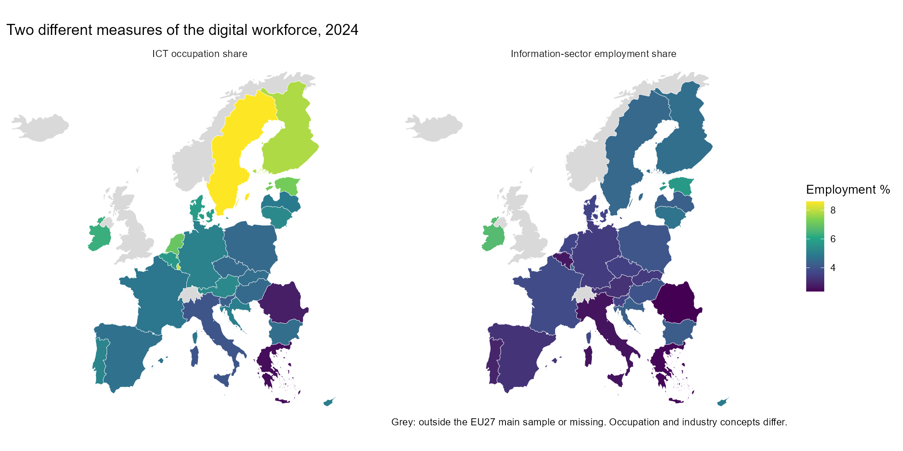

*그림 6. 직업 기준 ICT 고용과 산업 기준 정보통신업 고용의 구별.*

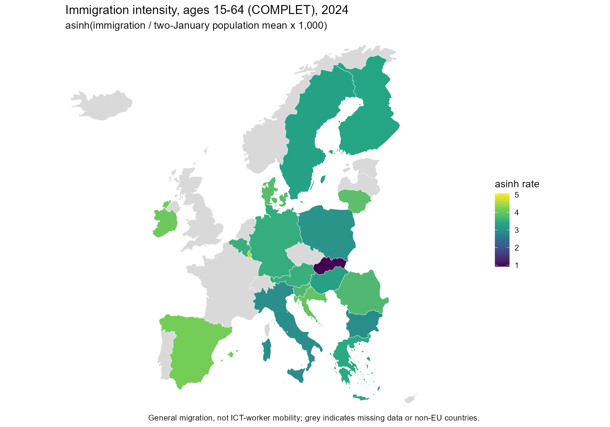

*그림 7. 인구 분모를 적용한 이입 강도. COMPLET 정의만 사용했다.*

## 7. Moran 검정·효과·민감도
| 결과변수 분석 | n | I | p | p_BH | p_BY |
| --- | --- | --- | --- | --- | --- |
| 기존 변수 재현 | 27.0000 | 0.3000 | 0.0066 | 0.0264 | 0.0550 |
| 산업 J 고용비중 결과 | 27.0000 | 0.0239 | 0.4908 | 0.6544 | 1.0000 |
| 이입 강도(COMPLET) 결과 | 20.0000 | 0.0587 | 0.2620 | 0.5240 | 1.0000 |
| NUTS2 지역 탐색 | 218.0000 | 0.0064 | 0.7728 | 0.7728 | 1.0000 |

서로 다른 네 결과변수의 원변수 Moran 검정에는 탐색적 다중검정 참고값으로 BH와 BY 보정 p값을 제공한다. 양의 Moran 값은 비슷한 값의 공간 분포를 나타내며 정책 확산이나 기업 이동의 인과관계를 의미하지 않는다.

기존 ICT 직업 고용의 원변수 Moran’s I=0.3000, 순열 p=0.0066은 재현됐다. 네 결과변수의 BH 보정은 0.0264, 임의 의존성을 허용하는 보수적인 BY 보정은 0.0550이다. 새 산업 고용 결과(I=0.0239, p=0.4908), 이입 강도(I=0.0587, p=0.2620), 지역 J 고용(I=0.0064, p=0.7728)은 이 W·표본에서 뚜렷한 원변수 공간자기상관을 보이지 않았다. 이는 공간적 관계가 전혀 없다는 증명이나 잔차 검정을 생략할 근거가 아니다.

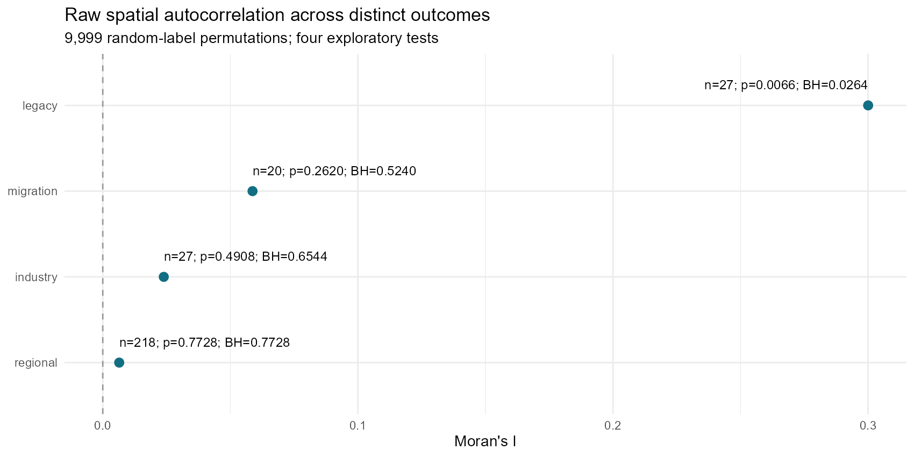

*그림 8. 원변수의 공간자기상관과 다중검정 참고값.*

| 구성 | 효과 | 추정값 | 95% 하한 | 95% 상한 |
| --- | --- | --- | --- | --- |
| 기존 변수 재현 | direct | -0.269 | -0.472 | -0.013 |
| 기존 변수 재현 | indirect | -0.540 | -1.536 | 0.293 |
| 기존 변수 재현 | total | -0.809 | -1.972 | 0.187 |
| 기존 통제 + 사전 J 고용비중 | direct | -0.108 | -0.311 | 0.127 |
| 기존 통제 + 사전 J 고용비중 | indirect | -0.150 | -0.770 | 0.381 |
| 기존 통제 + 사전 J 고용비중 | total | -0.257 | -1.006 | 0.433 |
| 노동비용 제외 + 사전 J 고용비중 | direct | -0.052 | -0.250 | 0.173 |
| 노동비용 제외 + 사전 J 고용비중 | indirect | -0.115 | -0.786 | 0.468 |
| 노동비용 제외 + 사전 J 고용비중 | total | -0.167 | -0.932 | 0.556 |

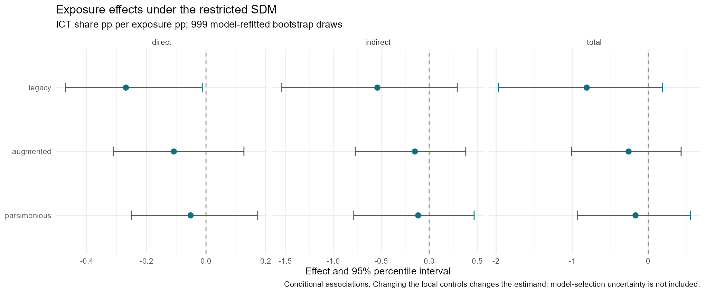

*그림 9. 제한형 SDM의 직접·간접·총효과. 추정계수 자체와 공간승수 효과를 구별한다.*

제한형 SDM에서 기존 직접효과의 95% 구간은 0보다 낮았지만, 산업구조를 추가한 확장·간결 구성은 직접·간접·총효과 구간이 모두 0을 포함한다. 기존 음의 직접효과는 통제변수 구성에 민감하다. 산업구조와 노출도의 공통 배경을 통제하면서 추정 대상의 조건도 달라지므로 이를 DMA의 효과가 사라졌다고 해석하지 않는다.

효과 단위는 사전 마켓플레이스 노출도 1%p당 ICT 고용 비율 변화(%p)다. 직접·간접·총효과는 모형과 X·W를 조건으로 한 연관성이다. SEM의 간접효과 0은 모형 구조에서 오는 제약이다. 부트스트랩 구간은 표본 선택·모형 선택·측정오차의 모든 불확실성을 포함하지 않는다. 간접·총효과 구간이 0을 포함하면 공간 파급을 확정하지 않는다.

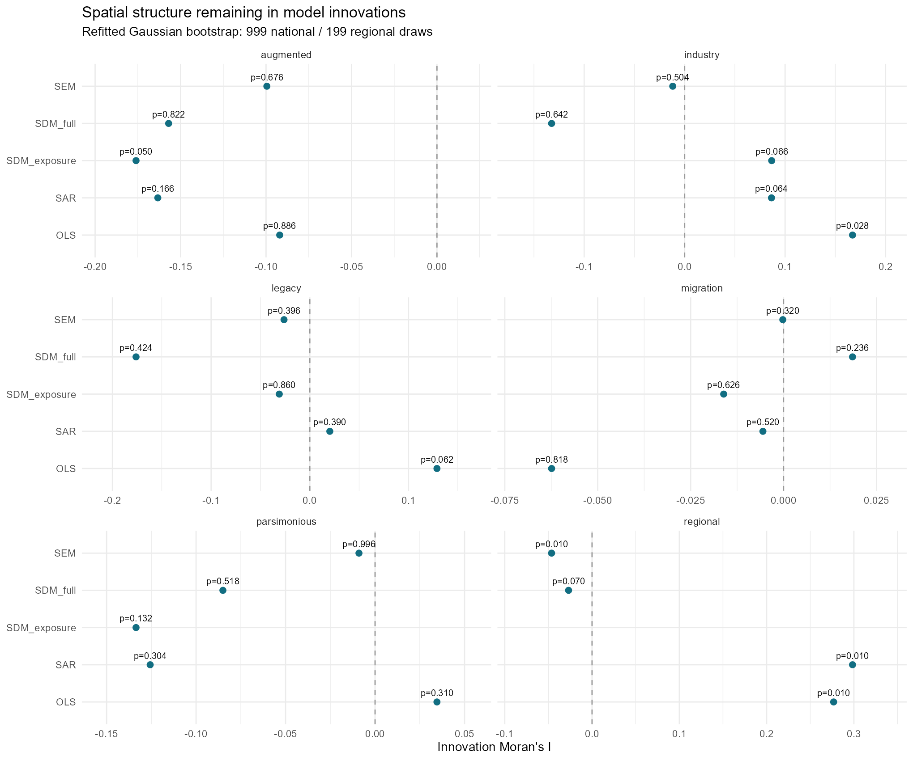

*그림 10. 모형 혁신오차의 Moran 진단. 큰 p값은 모형의 참을 입증하지 않는다.*

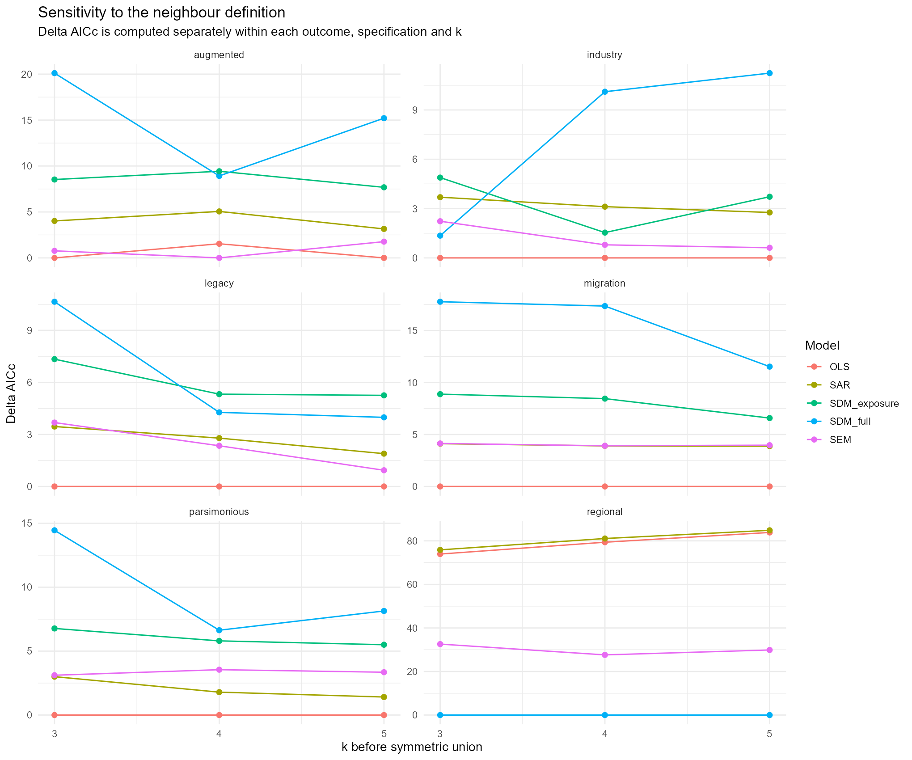

*그림 11. 이웃 수에 따른 상대 적합도 변화. y축은 각 분석·k 내부 차이다.*

국가 주 분석은 국가 한 곳씩 제외하고 W를 다시 구성한 영향도 표도 제공한다. 이는 교차검증 예측 성능이 아니다. 공간계수의 부트스트랩 경계 비율과 k 민감도를 함께 보고 최종 모형 선택을 유보하거나 확장 표본에서 재검토한다.

### 공간계수 탐색 범위의 민감도
| group | model | original_parameter | extended_parameter | original_AICc | extended_AICc |
| --- | --- | --- | --- | --- | --- |
| augmented | SEM | -0.999 | -1.449 | 85.309 | 83.552 |
| augmented | SDM_full | -0.999 | -1.356 | 94.230 | 92.501 |

비특이 고유값 구간으로 하한을 넓히면 확장 SEM의 λ는 약 −1.449, 전체 SDM의 ρ는 약 −1.356으로 이동한다. 따라서 −0.999는 자료가 지지하는 내부 최적점으로 해석할 수 없다. 확장 결과는 다른 모수 제약에서의 진단이며 안정적인 확산 승수, 정책 파급효과 또는 주 분석의 대체 추정치로 제시하지 않는다. 이 부가 비교에는 새 부트스트랩 신뢰구간을 붙이지 않았다.

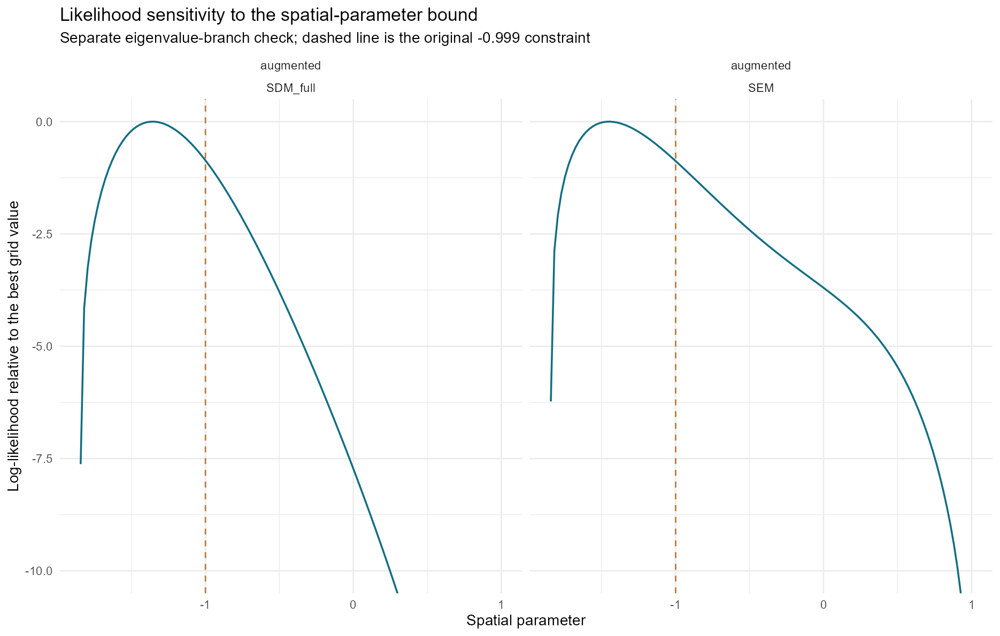

*그림 12. 모수 제약에 따른 우도 변화. 점선은 주 분석의 하한 −0.999.*

## 8. 정책·사건 자료의 사용 범위와 다음 단계
DMA 서비스 달력 24행, ERM 국외 이전 3건, 영국 규제 사건 4건, Apple 기능 적용지역 발표 3개 항목은 맥락 자료로 보존했다. 국가별 노출 차이나 전수 사건 분모가 없어 회귀 X·Y로 자동 변환하지 않았다. 미확인 사건을 0으로 채우거나 여러 목적지에 같은 일자리 수를 복제하지 않았다. iPadOS의 정확한 준수 개시일은 미확인으로 유지했다.

다음 단계는 기업 이전의 실행 여부·출발지·도착지와 서비스별 사전 의존도를 확보하고, 법제·기능의 역외 확산을 직접 코딩하는 것이다. 그 뒤 정책 전 추세·동시기 충격·노출 차이가 확인되면 패널 또는 국가쌍 설계로 확장한다. 지리적 W와 정책 이전 이동 네트워크 W를 비교하되 결측 흐름을 0으로 대체하지 않는다.

## 9. 재현 방법과 산출물
1. ZIP 전체를 압축 해제하고 `DMA_PoC_v3.Rproj`를 연다.
2. `START_HERE.R`을 Source한다. 필요한 패키지가 없으면 최초 설치에 인터넷을 사용한다.
3. `analysis.R`은 원천 CSV 결합·검정·회귀·플롯·HTML 보고서를 생성한다. `config.json`에 난수 시드·반복 수·분석연도를 기록했다.
4. 기존 결과는 `reference/`, 입력은 `inputs/`, 결합 자료·검정표는 `outputs/`, PNG·PDF 플롯은 `figures/`에 있다.
5. 표와 그림만으로 정책 인과효과를 주장하지 않는다. 원천 날짜, 품질 플래그, 제외 국가·지역 목록을 함께 확인한다.

수치 검증은 원천 재구성 대조, 기존 모형·W 재현, spatialreg와 별도 집중우도 계산의 대조, 직접 행렬승수와 고유값 효과 계산의 대조로 수행했다. 별도 Python 계산에서도 29개 모형의 최대 로그우도 차이는 1.7×10⁻¹², Moran 값 차이는 2.4×10⁻¹⁵, 135개 VIF의 최대 차이는 1.3×10⁻¹³ 이하였다. R 패키지 버전과 실행 환경은 `outputs/R_sessionInfo.txt`에 기록했다. 저장된 추정치로 그림·보고서만 다시 만들 때는 `REFRESH_OUTPUTS.R`을 Source한다.

## 10. 원천·방법 문서
- [Eurostat API](https://ec.europa.eu/eurostat/en/web/user-guides/data-browser/api-data-access/api-introduction) — 원천 URL과 품질 코드는 inputs의 각 manifest·codebook 참조.
- [GISCO NUTS 경계](https://gisco-services.ec.europa.eu/distribution/v2/nuts/) — © EuroGeographics / Eurostat GISCO, 2024.
- [EC DMA 서비스 지정 포털](https://digital-markets-act.ec.europa.eu/gatekeepers-portal_en)
- [Eurofound ERM 방법론](https://apps.eurofound.europa.eu/restructuring-events/methodology)
- [spatialreg 최대우도 모형](https://r-spatial.github.io/spatialreg/reference/ML_models.html) 및 [공간승수 효과](https://r-spatial.github.io/spatialreg/reference/impacts.html)
- [spdep 회귀잔차 Moran 검정](https://r-spatial.github.io/spdep/reference/lm.morantest.html)

> 이 보고서의 모든 통계는 함께 제공한 수집 스냅샷에 근거한다. 공식 사이트의 이후 개정 자료와 다를 수 있다.
