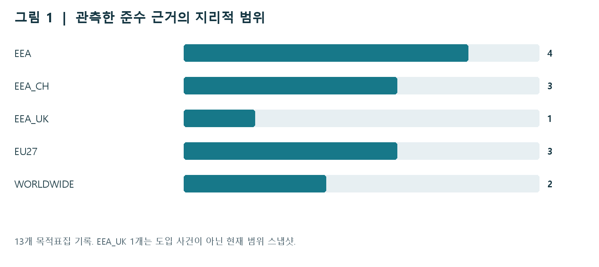
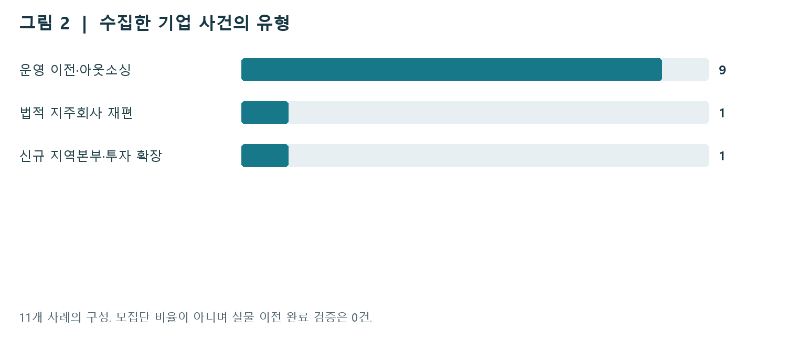
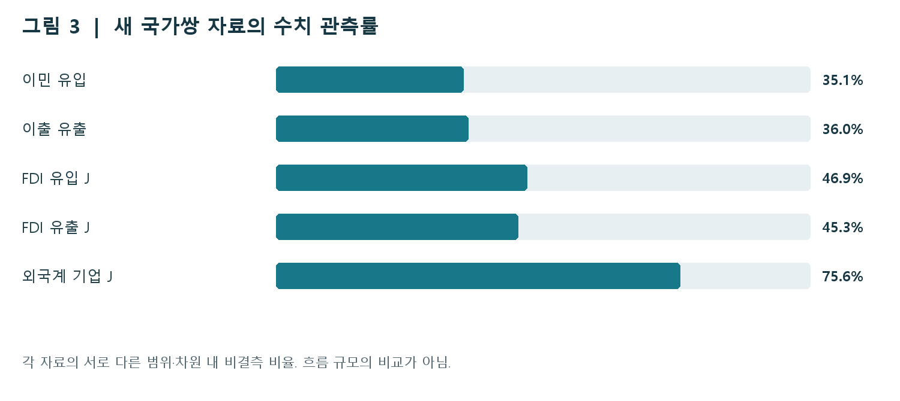

# DMA 규범 확산과 국제 이동을 구분하다

이번 확장은 DMA 준수 변경과 기업·자본·사람의 이동을 각각 관측하는 자료층을 구축했다. 가장 선명한 규범 확산 증거는 Microsoft가 DMA 준수를 이유로 일부 Windows 앱의 삭제 가능성을 전세계에 적용했다고 명시한 공식 자기보고다. 같은 보고서가 Edge와 Bing 변경은 EEA에 한정한다고 구분하므로, 단순한 동시 발표보다 메커니즘의 관측 타당성이 높다. 그러나 모든 기기의 실제 적용이나 DMA가 없었을 때의 반사실을 검증한 것은 아니다. ([Microsoft Windows DMA 준수 보고서, 문단 261·273-276](https://www.microsoft.com/content/dam/microsoft/mscle/documents/presentations/DMA.100160%20-%20Microsoft%20Compliance%20Report%20-%20Annex%2010%20-%20Windows%20%28Non-Confidential%20Version%29.pdf))

자료 수집·검증 기준일: 2026-11-02. 기존 20개 그림 보고서와 추정 결과는 보존했다.

## 두 메커니즘은 다른 관측 단위를 요구한다

### 공개자료는 규범 확산의 구체적 사례를 보여준다

이번 확장은 DMA 준수 변경과 기업·자본·사람의 이동을 각각 관측하는 자료층을 구축했다. 가장 선명한 규범 확산 증거는 Microsoft가 DMA 준수를 이유로 일부 Windows 앱의 삭제 가능성을 전세계에 적용했다고 명시한 공식 자기보고다. 같은 보고서가 Edge와 Bing 변경은 EEA에 한정한다고 구분하므로, 단순한 동시 발표보다 메커니즘의 관측 타당성이 높다. 그러나 모든 기기의 실제 적용이나 DMA가 없었을 때의 반사실을 검증한 것은 아니다. ([Microsoft Windows DMA 준수 보고서, 문단 261·273-276](https://www.microsoft.com/content/dam/microsoft/mscle/documents/presentations/DMA.100160%20-%20Microsoft%20Compliance%20Report%20-%20Annex%2010%20-%20Windows%20%28Non-Confidential%20Version%29.pdf))

수집된 준수 관련 기록은 13개이며 변경 기록과 현재 범위 스냅샷을 구분했다. 기업 자료는 11개 사건, 17개 사건-목적지 관계다. 이 중 국제 운영 이전·아웃소싱은 9건, 법적 지주회사 재편은 1건, 신규 지역본부 확장은 1건이다. 독립 검증된 실물 이전 완료와 실제 국가 간 이동 인원은 관측되지 않았다. 따라서 이 자료로 DMA 때문에 기업이나 노동자가 이동했다고 결론내릴 수 없다. ([준수 기록·범위·결합 감사 (로컬)](../outputs/mechanisms_20261102/compliance/JOIN_AUDIT.json)) ([기업 사건·목적지·결합 요약 (로컬)](../outputs/mechanisms_20261102/firms/summary.json))

국가쌍 이민·이출과 FDI 자료는 이동의 방향·연도·단위를 점검하고 기존 국가-연도 공변량에 연결한다. 일반 이민은 ICT 인력 이민과 다르며, 정보통신업 FDI는 기업 이전과 동일하지 않다. 자료를 하나의 거대한 처치 패널로 합치지 않고, 서로 다른 결과변수와 결측 구조를 보존했다. 기존 국가·지역 공간분석 및 20개 그림 보고서의 추정값은 동결했다.

현재 성과는 인과효과의 확정이 아니라 직접 측정 가능한 결과와 아직 식별되지 않은 부분을 분리한 데 있다. 후속 연구는 동일 서비스의 시장별 기능 변화를 먼저 확인하고, 별도로 기업 의사결정·실행·목적지 고용을 추적해야 한다. 이 두 경로는 동시에 성립할 수 있다.

| 자료층 | 현재 관측 | 현 단계에서 허용하는 결론 |
| --- | --- | --- |
| 서비스 변경 | 공식 발표·보고서·현재 문서 | 지리적 범위와 DMA 귀속 표현의 비교 |
| 기업 사건 | 11건·17개 목적지 관계 | 사례별 과정 추적과 측정 점검 |
| 국가쌍 흐름 | 인원·백만 유로·외국계 기업 지표 | 방향·범위·결측을 보존한 기술 분석 |

### 서비스 시장과 생산요소의 위치를 분리한다

브뤼셀 효과의 결과변수는 EU 규범과 유사한 기능·정책이 EU 밖 동일 서비스에 도입되는지, 언제 도입되는지, 어떤 이용자에게 적용되는지다. 단위는 게이트키퍼-서비스-변경 항목-이용자 시장-시점이다. 개발자의 신청 자격이 전세계라는 표현은 전세계 이용자에게 기능이 제공된다는 뜻이 아니다. 또한 EEA 비EU 국가의 범위 확대는 법적 적용 관계를 확인하기 전에는 자발적 역외 확산으로 확정하지 않는다.

여기서 티부형 경로는 규제 여건 차이에 반응하여 기업·자본·노동이 위치를 선택한다는 검증 가설이다. 단위는 기업/사업장-출발지-목적지-의사결정/실행 시점 또는 출발국-목적국-연도다. 기업 주소 변경, 신규 사무소, 감원, 해외 채용, 실제 근로자 이주는 구별해야 한다. 출발지에서 100명을 감원했다는 사실은 목적지에서 100명이 채용되거나 국경을 넘었다는 증거가 아니다.

특히 소재지를 EU 밖으로 옮기면 DMA 의무가 자동으로 사라진다고 가정할 수 없다. DMA 제1조 제2항은 EU 내 사업이용자나 최종이용자에게 제공되는 핵심 플랫폼 서비스를 게이트키퍼 소재지와 무관하게 적용 대상으로 설명한다. 따라서 검증할 부담 차이는 본사 주소가 아니라 서비스 제공 범위, 조직 기능, 규정별 적용과 실제 비용으로 정의해야 한다. ([DMA 적용 범위, 제1조 제2항](https://eur-lex.europa.eu/eli/reg/2022/1925/2022-10-12))

국가-연도 브리지는 거시적 배경을 덧붙일 뿐이다. 이 브리지에 준수 기록 수를 국가별로 합산하면 한 기업 발표의 분할 방식이 처치 강도가 되고, 전세계 변경을 시장 수만큼 복제하면 독립 표본이 과장된다. 원문 증거의 독립 단위와 정책 적용 단위를 별도로 유지한다.

| 구분 | 권장 결과변수 | 섞으면 안 되는 대용변수 |
| --- | --- | --- |
| 규범 확산 | 비EU 동일 기능의 가용성·도입일 | 보도 수·준수 보고서 수 |
| 기업 이동 | 사업장 폐쇄/신설·기능/고용의 실현 이동 | 법인 주소·감원 발표만 |
| 자본 이동 | 산업별 방향성 FDI·새 투자 실현 | 선택 상대국 합계를 세계 총액으로 해석 |
| 인력 이동 | 출발/도착 거주국과 ICT 직업의 교차 | ICT 취업자 비율 변화·일반 이민 총수 |

## 13개 준수 기록과 11개 기업 사건이 보여주는 차이

### 전세계 적용과 DMA 원인 명시를 따로 코딩했다

그림 1은 Alphabet·Apple·ByteDance·Meta·Microsoft 5개 기업의 목적표집 범위 구성이다. WORLDWIDE 2개, EU27 3개, EEA_CH 3개, EEA 4개, EEA_UK 현재 스냅샷 1개다. 13행 중 정확한 회사 보고 날짜는 3행, 정확한 날짜 미확인은 10행이며 그 10행에 시행 상한만 아는 1행이 포함된다. 전체 게이트키퍼의 준수율이나 확산 비율이 아니며, 항목 분할 방식도 달라 기업별 강도 비교에 쓰지 않는다. ([준수 기록·범위·결합 감사 (로컬)](../outputs/mechanisms_20261102/compliance/JOIN_AUDIT.json))

Microsoft 문단 273-276은 Camera·Cortana·Photos의 전세계 삭제 가능성과 Edge·Bing의 EEA 한정 변경을 직접 대비한다. 문단 261의 2024-02-29는 관련 빌드의 일반 제공일이며 모든 기기의 설치일이 아니다. 기록은 company_reported_implemented로 보존하고 독립 구현 검증과 구분했다. 이 사례는 DMA 명시 귀속과 비EU 범위를 함께 가진 강한 과정 증거지만 단독 인과추정치는 아니다. ([Microsoft Windows DMA 준수 보고서, 문단 261·273-276](https://www.microsoft.com/content/dam/microsoft/mscle/documents/presentations/DMA.100160%20-%20Microsoft%20Compliance%20Report%20-%20Annex%2010%20-%20Windows%20%28Non-Confidential%20Version%29.pdf))

Apple의 전세계 스트리밍 게임 앱 변경은 같은 날의 EU DMA 변경과 구분했다. 전세계 발표는 개발자 피드백을 이유로 들며 DMA 원인을 명시하지 않아 worldwide_change_DMA_cause_not_established로 남겼다. Meta의 EU·EEA·스위스 선택권은 비EU 범위가 명시되지만 장래 발표이므로 실제 시행일을 채우지 않았다. ([Apple EU 변경 발표, 2024-01-25](https://developer.apple.com/news/?id=fsmaf67j)) ([Apple 전세계 스트리밍 게임 변경, 2024-01-25](https://developer.apple.com/news/?id=f1v8pyay)) ([Meta 서비스 선택권 발표, 2024-01-22](https://about.fb.com/news/2024/01/offering-people-more-choice-on-how-they-can-use-our-services-in-the-eu/))

TikTok 초기 발표는 EEA 이용자와 전세계 개발자 자격을 분리했다. 현재 문서의 영국 범위는 2026-11-02 관측된 스냅샷이며 시작일과 DMA 귀속은 미확인이다. 이 날짜를 영국 도입일로 삼거나 2024년까지 소급하지 않는다. Google의 예정 출시일과 “이번 주” 표현도 실제 시행일로 바꾸지 않았다. ([TikTok 초기 DMA 이행 발표](https://newsroom.tiktok.com/tiktoks-compliance-with-the-dma?lang=en-150)) ([TikTok 현재 Data Portability API 범위](https://developers.tiktok.com/products/data-portability-api/)) ([Google DMA 이행 발표, 2024-03-05](https://blog.google/company-news/inside-google/around-the-globe/google-europe/complying-with-the-digital-markets-act/))

### 기업 11건은 이동률보다 사건의 성격을 알려준다

기업 자료는 기존 3건을 재확인하고 8건을 추가한 비대표적 공개 사례집이다. 11개 사건 중 10개는 출발국과 목적국이 알려졌으며, 17개 사건-목적지 관계 중 16개에 양쪽 국가가 있다. 다중 목적지에 전체 감원 인원을 복제하지 않았고 목적지별 인원 배분과 실제 이주 인원은 결측으로 남겼다. 그림 2는 모집단의 이동 구성비가 아니라 수집 표본의 사건 유형이다. ([기업 사건·목적지·결합 요약 (로컬)](../outputs/mechanisms_20261102/firms/summary.json))

Bird는 네덜란드 본사가 유지된다는 본문과 일부 업무의 네 목적지 이전을 구별했다. 120명 감원은 목적지마다 120명 이동으로 읽을 수 없다. Klarna는 2024년 5월 주식교환에 따른 스웨덴-영국 지주회사 재편이 공시되었으나 직원과 실물 사업장 이동을 입증하지 않는다. Revolut 파리는 기존 거점의 이전이 아니라 지역 확장으로 코딩했고 출발국을 임의로 영국이나 리투아니아로 지정하지 않았다. ([Bird ERM 사건, 본사와 일부 운영의 구분](https://apps.eurofound.europa.eu/restructuring-events/detail/202407)) ([Klarna SEC F-1/A 법적 재편 공시](https://www.sec.gov/Archives/edgar/data/2003292/000200329225000015/klarnagroupplcf-1a2.htm)) ([Revolut 파리 지역본부 발표](https://www.revolut.com/en-FR/news/revolut_announces_new_western_europe_hq_based_in_paris_and_will_apply_for_french_banking_licence_to_support_regional_growth/))

2026년 Revolut 사무실 임대 후속 발표는 동일 사건의 상태 갱신이다. 2027년 초 개소 예정과 실제 개소를 구분했다. 사건일이 월까지만 알려진 경우 임의의 월 1일을 부여하지 않는다. BrainRocket의 2026년 발표와 2025년 시작 표현처럼 날짜 순서가 충돌하는 경우도 별도 표시한다. ([Revolut 파리 사무실 임대 후속 발표](https://www.revolut.com/fr-FR/news/revolut_locks_in_paris_headquarters_for_western_europe/))

ERM은 언론 기반 구조조정 발표를 포착하며 규모 기준과 보도 선택에 영향을 받는다. 전수 CSV는 비상업적 연구 신청 절차가 있다. 공개 사건이 없는 국가-연도를 0으로 채우면 미관측과 무사건을 혼동한다. 현재 사례의 원문에서 DMA 동기가 명시되지 않았다는 사실도 DMA 효과가 없다는 인과적 증거는 아니다. ([Eurofound ERM 방법론](https://apps.eurofound.europa.eu/restructuring-events/methodology)) ([Eurofound ERM 전수 CSV 접근 신청](https://apps.eurofound.europa.eu/restructuring-events/calculator))

## 국가쌍 자료는 실제 흐름과 관측 공백을 함께 보존한다

### 사람·투자·외국계 기업은 서로 다른 측정값이다

새 Eurostat 원자료는 이민 유입 73,728행, 이출 유출 67,584행, FDI 유입 J 31,584행, FDI 유출 J 31,584행, 외국계 기업 J 19,200행이다. 집계 지역과 동일국가 관계를 제외한 국제쌍은 총 205,784행, 수치 관측은 85,278행이다. 여러 연령 정의·연령군·기업 범주·지표가 포함되어 행 수는 고유 국가쌍 수가 아니다. 기존 스냅샷은 별도 보존했으며 범위 변경을 경제적 증가로 읽지 않는다. ([신규 국제쌍 자료·관측·결합 요약 (로컬)](../outputs/mechanisms_20261102/flows/fresh/summary.json))

이민은 이전 거주국에서 현재 보고국으로 유입되는 흐름이고 이출은 보고국에서 다음 거주국으로 나가는 흐름이다. 두 출처의 국가쌍 방향을 일치시킨 뒤에도 서로 다른 통계 정의·시점·신고·누락 때문에 mirror 값이 다를 수 있다. 한쪽을 다른 쪽의 자동 대체값으로 쓰거나 양쪽을 더해 총이동으로 만들지 않는다. TOTAL 연령과 15-64세도 별도 계열이다. 직업 분류가 없으므로 현재 값은 일반 인구 이동이다. ([Eurostat 이전 거주국별 이민, migr_imm5prv](https://ec.europa.eu/eurostat/databrowser/view/migr_imm5prv/default/table)) ([Eurostat 다음 거주국별 이출, migr_emi3nxt](https://ec.europa.eu/eurostat/databrowser/view/migr_emi3nxt/default/table))

정보통신업 J의 FDI는 백만 유로 단위 금융 흐름이다. 새 국제쌍에서 음수는 유입 1,735행, 유출 1,300행이며 유효한 값을 삭제하거나 0으로 바꾸지 않았다. TOTAL은 SPE를 포함할 수 있어 TOTAL+SPE를 더하면 중복된다. 순 FDI 변화만으로 신규 사업장·일자리·실물 이전을 결론내리지 않는다. ([Eurostat FDI 흐름, bop_fdi6_flow](https://ec.europa.eu/eurostat/databrowser/view/bop_fdi6_flow/default/table)) ([신규 국제쌍 자료·관측·결합 요약 (로컬)](../outputs/mechanisms_20261102/flows/fresh/summary.json))

외국계 기업 활동의 고용·기업 수·부가가치는 최종통제주체 소재국과 현지 사업체 활동의 관계다. FDI 직접 상대방과 다른 개념이며 국가쌍 이전량이 아니다. WORLD는 국내통제 기업도 포함할 수 있어 외국계 국가집계는 WRL_REST를 사용했다. 선택 상대국 합계를 세계 총계로 쓰지 않는다. 보고되지 않은 셀과 실제 0을 구분하며 음수 부가가치도 보존한다. ([Eurostat 외국계 기업 활동, fats_activ](https://ec.europa.eu/eurostat/databrowser/view/fats_activ/default/table))

| 새 원자료 / 국제쌍 | 연도·단위 | 관측 / 결측 / 전체 셀 |
| --- | --- | --- |
| 이민 유입 | 2017-2024 / 명 | 24,330 / 45,078 / 69,408 |
| 이출 유출 | 2017-2024 / 명 | 22,841 / 40,647 / 63,488 |
| FDI 유입 J | 2017-2024 / 백만 유로 | 13,514 / 15,286 / 28,800 |
| FDI 유출 J | 2017-2024 / 백만 유로 | 13,036 / 15,764 / 28,800 |
| 외국계 기업 J | 2021-2024 / 명·기업 수·백만 유로 | 11,557 / 3,731 / 15,288 |

### 정확한 국가-연도 결합은 관측 부족을 드러낸다

기존 국가 패널은 32개국, 288행이며 2017-2025년을 포함한다. country+year 키의 중복은 0이다. UK/GB 및 EL/GR만 명시적으로 정규화하고, 동일 국가의 같은 연도에 정확히 결합한다. 2026년 사건에 2025년 값을 자동 이월하지 않으며 비유럽 목적지에 유사 국가 값을 대체하지 않는다. ([통합 파일 목록·행수·연도·단위·해시 (로컬)](../outputs/mechanisms_20261102/integration/integration_catalog.csv))

기업 출발지 감사는 사건별 11행 중 6행 결합, 4행 연도 범위 밖, 1행 신규 확장으로 출발국 미보고다. 목적지 감사는 관계별 17행 중 5행 결합, 8행 기존 패널에 없는 국가, 4행 연도 범위 밖이다. 출발지 감사와 목적지 감사의 분모가 다른 이유는 한 사건에 목적지가 여러 개이기 때문이다. 결합 후 17개 관계 행을 보존한다. ([기업 사건·목적지·결합 요약 (로컬)](../outputs/mechanisms_20261102/firms/summary.json))

준수 자료에는 확인된 범위 389행과 국가-연도 브리지 389행이 있다. 그중 변경 근거 358행이 기존 패널에 결합되며, 기록 ID·근거 라벨을 붙인 결과도 288행을 유지한다. 기록이 있는 국가-연도는 32개다. TikTok 현재 스냅샷은 과거 패널에 소급하지 않았고 2025년 지속 적용도 자동 가정하지 않았다. 새 흐름의 국가집계 결합 역시 288행을 보존한다. ([준수 기록·범위·결합 감사 (로컬)](../outputs/mechanisms_20261102/compliance/JOIN_AUDIT.json)) ([신규 국제쌍 자료·관측·결합 요약 (로컬)](../outputs/mechanisms_20261102/flows/fresh/summary.json))

새 흐름의 출발/목적지 비매칭 행은 이민 22,304/22,304, 이출 16,384/20,480, FDI 유입 8,816/6,480, FDI 유출 6,480/8,816, FATS 3,720/1,512이다. 모두 기존 국가표본 밖이며 새 원천의 측정차원 키 중복은 0이다. 이민 출발지 47,104개 매칭 행 중 ICT 비율은 2,392행에서 여전히 결측이다. 행 매칭과 값 관측을 구분했다. ([신규 국제쌍 자료·관측·결합 요약 (로컬)](../outputs/mechanisms_20261102/flows/fresh/summary.json)) ([흐름 결합·공변량 결측·값 보존 감사 (로컬)](../outputs/mechanisms_20261102/flows/fresh/final_value_preservation_checks.csv))

동일 차원 mirror 비교에서 이민은 양쪽 관측 8,236행 중 7,945행, FDI는 7,785행 중 2,670행의 값이 다르다. 이를 평균하거나 상대 방향으로 결측을 메우지 않았다. integration_missingness.csv는 열별 결측, join_coverage_audit.csv는 결합 상태를 보존한다. exact_duplicate_rows는 전체 행 중복이며 키 유일성 감사와 별개다. ([신규 국제쌍 자료·관측·결합 요약 (로컬)](../outputs/mechanisms_20261102/flows/fresh/summary.json))

| 결합 계층 | 키·관계 | 안전장치 |
| --- | --- | --- |
| 국가 공변량 | country + year, many-to-one | 중복 키 0, 정확한 연도만 |
| 기업 관계 | event_id + destination_country | 인원 무배분, 관계 행 보존 |
| 서비스 범위 | event/change + 확인 시장 + 근거 시점 | 미확인 범위와 시행일 미보간 |
| 국가쌍 흐름 | origin + destination + year + 방향/연령/산업/단위 | 집계 범주 분리, 출처 플래그 유지 |

## 후속 설계는 서로 다른 추정대상을 명시해야 한다

### 가설 1: 비EU 이용자에게 동일 기능이 확산되는가

검증 가설 H1은 “DMA에 직접 대응하는 기능이 법적 직접 적용 밖의 이용자 시장에도 확산된다”이다. 결과 A[g,s,k,m,t]는 게이트키퍼 g, 서비스 s, 변경 k, 시장 m, 시점 t의 검증된 기능 가용성이다. 미조사 셀은 NA이고, 기능 부재를 테스트한 셀만 0이다. 처치 T[g,s,k]는 실제 적용 의무·준수일에 근거해야 하며 이번 수집 기록 수가 아니다.

목표 추정대상은 비EU 시장에서 DMA 관련 변경이 없었을 반사실 대비 동일 기능 가용성이 얼마나 달라지는지다. 시행 시점이 알려지면 검증된 비처치/아직 미처치 변경을 비교군으로 하는 코호트별 사건연구를 검토한다. 기본 진단식은 A[g,s,k,m,t] = alpha[g,s,k,m] + lambda[m,t] + sum_l beta[l] × Exposure_pre[g,s,k,m] × 1(t-T[g,s,k]=l) + e 이다. 기준 기간은 l=-1이며 이 식을 이번 자료에 적합하지 않았다.

시장×시점 고정효과는 시장 공통 충격을 흡수한다. 그러나 서비스×시점 고정효과까지 넣을 경우 모든 시장에 동시에 적용된 전세계 변경은 흡수될 수 있다. 식별 변동이 어떤 축에 남는지 설계행렬로 먼저 점검해야 한다. EU 더미와 공통 Post만으로 확산을 추정하면 시장별 차별 기능, 규제 병행, 사전 추세와 보고 선택이 섞인다.

필수 추가 자료는 시장별 반복 기능 테스트, 정확한 롤아웃 날짜와 철회, 현지 동종 규제, 제품 버전, 서비스별 지정·준수일, 사전 EU 의존도다. 기업 자기보고의 DMA 표현은 과정 추적용이며 독립적 처치 배정이 아니다. 시차 도입·효과 이질성이 있으면 단순 양방향 고정효과 평균 대신 코호트와 시점의 추정대상을 명시해야 한다. 연속 노출의 계수도 자동으로 평균 인과효과가 되지 않는다. ([Callaway·Sant’Anna, 다기간 차분의 차분](https://arxiv.org/abs/1803.09015)) ([Callaway·Goodman-Bacon·Sant’Anna, 연속 처치 DiD](https://arxiv.org/abs/2107.02637))

| 증거 수준 | 현재 예시 | 다음 검증 |
| --- | --- | --- |
| 상대적으로 강함 | Microsoft: DMA 명시 + 전세계, 같은 보고서 내 EEA 대비 | 비EU 실제 기기·버전별 테스트 |
| 중간 | Meta: DMA 명시 + 스위스 범위, 장래 발표 | 최초 시행일·기능 실제 가용성 |
| 약함/별도 | Apple 전세계 동시 발표; TikTok UK 현재 범위 | 원인·도입일 확인, 소급 금지 |

### 가설 2: 부담 차이가 기업의 실제 위치 선택을 바꾸는가

검증 가설 H2는 “DMA 관련 부담의 실질적 차이가 기업의 운영 기능·사업장·고용 이전 선택을 바꾼다”이다. 기업 모집단을 사건 이후 기사 검색으로 정하면 이전한 기업만 선택하게 된다. 지정/준수 이전에 존재하던 기업과 사업장을 위험집합으로 정하고 비이전자도 추적해야 한다. 게이트키퍼의 법적 소재지와 기능별 운영 위치를 연결할 안정적인 기업 식별자가 필요하다.

목표 추정대상은 사전 EU 의존도와 적용 의무가 다른 기업 사이에서 실제 이전 위험이 어떻게 변하는지다. 월별 위험모형의 설계 예시는 logit Pr(Move[i,o,d,t]=1 | at_risk) = alpha[i] + delta[t] + beta × BurdenGap_pre[i,o,d] × Post[i,t] + gamma X_pre[i,o,d] 이다. 대안 목적지를 포함하는 선택모형에서는 목적지 선택집합을 명시하고 신규 확장, 법적 재편, 운영 이전을 별도 결과로 둔다.

이 식에서 국가 공통 Post는 시점 고정효과에 흡수되고, 시간불변 부담 차이는 기업/쌍 고정효과에 흡수된다. 상호작용의 실질적 변동과 공통 지지를 확인해야 한다. 세금·임금·시장 접근·언어·기술인력·Brexit·M&A·원격근무·기업 전략은 주요 대안 설명이다. 결과 발생 후의 고용·매출을 무비판적으로 통제하면 정책의 매개경로를 제거할 수 있으므로 사전 공변량을 우선한다.

현재 11건에는 위험집합·분모·완료 여부·목적지 고용이 없으므로 위험률이나 DMA 효과를 추정하지 않는다. 우선순위는 동일 사건의 완료 공시와 출발·목적 사업장 고용, 국가별 기업 종단 식별자, 비이전 비교기업 확보다. EU 밖 이동 후에도 EU 이용자 대상 서비스 의무가 유지되는지를 같이 확인해야 규제 회피와 비용 최적화를 구분할 수 있다. ([DMA 적용 범위, 제1조 제2항](https://eur-lex.europa.eu/eli/reg/2022/1925/2022-10-12)) ([Eurofound ERM 방법론](https://apps.eurofound.europa.eu/restructuring-events/methodology))

### 가설 3: 자본·인구의 방향성 변화는 노출에 따라 다른가

검증 가설 H3는 “사전 DMA 관련 노출이 큰 출발국·산업에서 규제 부담이 낮거나 대안 시장 접근이 좋은 목적지로 향하는 흐름이 상대적으로 변한다”이다. 인구 흐름의 목표 추정대상은 직업별 출발지-목적지 이동의 변화다. 현재 일반 이민만으로 얻는 결과는 전체 인구에 대한 거시적 연관성이며 ICT 노동의 규제 반응으로 좁혀 말할 수 없다.

비음수 인원에 대한 향후 평균식은 E[M[o,d,t]|X] = exp(alpha[o,d] + mu[o,t] + nu[d,t] + beta × Exposure_pre[o] × NonEU[d,t] × Post[t]) 이다. 쌍 고정효과는 불변 양자 관계, 출발국×연도와 목적국×연도는 각국 공통 충격을 흡수한다. 실제 0과 누락을 구별한 완전한 관측틀이 있어야 하며, 선택 파트너를 무관측 0으로 확장해서는 안 된다.

이 식의 식별은 출발국 사전 노출에 따라 목적지 집단 간 흐름의 상대 변화가 다른 데서 온다. Exposure_pre[o]×Post[t]만 넣으면 출발국×연도 고정효과와 완전히 공선적이다. NonEU[d,t]×Post[t]만 넣으면 목적국×연도 고정효과에 흡수된다. 삼중항도 실제 표본에 양쪽 목적지 집단과 노출 변동이 있어야 한다. 공통 충격과 재배분을 분리할 외부 비교군·정책 이전 추세·표본 안정성 검증이 필수다.

부호 있는 FDI 순흐름에는 이 인원 PPML 식을 그대로 적용하지 않는다. FDI는 원단위 수준 또는 단위 선택을 명시한 asinh 변환을 별도 설계로 검토하고, 유입/유출·TOTAL/SPE·투자 구성과 산업을 구별한다. 사건연구에서는 지정·준수 시차, anticipation, 코로나와 다른 규제 충격, 국가쌍 상관과 소수 처치군 추론을 다룬다. 현재 자료는 진단·설계 단계이며 새 회귀는 실행하지 않았다.

### 두 메커니즘의 동시 관측과 반증 기준을 마련한다

전세계 기능 확산과 기업의 해외 운영 이전이 함께 나타나도 모순은 아니다. 이용자에게 적용되는 규범과 생산 요소의 소재지는 서로 다른 결정이기 때문이다. 반대로 EU 내부에서만 기능이 바뀌었다고 기업 이동이 일어났다고 추론할 수 없고, 비EU 투자가 증가했다고 브뤼셀 효과가 실패했다고 결론내릴 수도 없다.

가설을 반증 가능하게 만들려면 사전에 기대 방향과 관측 기준을 고정한다. H1은 직접 적용 밖 시장에서 검증된 동일 기능이 증가하지 않거나 별도 현지법 시행만으로 설명되면 약해진다. H2는 규제 부담 차이보다 기존 비용·시장전략이 이전 시점과 목적지를 설명하고, 노출이 낮은 비교기업에서도 같은 변화가 나타나면 약해진다. H3는 사전 추세 불일치, 특정 금융 허브·SPE 또는 전쟁·팬데믹 영향을 제거하면 변화가 사라지는지 점검한다.

이 검증에서 무효 결과와 관측 실패를 구별한다. 시행일이 없는 발표는 도입 효과의 0이 아니고, 완료 확인이 없는 이전은 미실현 0이 아니다. 표본 크기와 국가 수보다 핵심 결과의 관측 가능성, 비교군의 타당성, 정책 적용의 차이가 중요하다. 공개자료 수집 단계에서는 근거를 확충하는 것이 정교한 모형을 먼저 적합하는 것보다 우선한다.

| 서비스 확산 | 실물 위치 변화 | 허용되는 해석 |
| --- | --- | --- |
| 확인 | 확인 | 두 경로의 공존; 각각 원인 검증 필요 |
| 확인 | 미확인 | 규범 범위 증거; 이동 부재 결론 불가 |
| 미확인 | 확인 | 위치 변화 증거; DMA 원인 별도 검증 |
| 미확인 | 미확인 | 무효 효과가 아니라 식별·관측 공백 |

## 공개 접근과 재현 경로를 고정하고 다음 수집을 좁힌다

### 무료 접근·보존 상태·재현 실행을 구분한다

준수 공식 원문은 9개 모두 본문 확인과 원본 SHA-256 저장을 마쳤다. 기업 원문은 14개 요청 중 13개를 저장했고 SEC 공시는 웹에서 확인한 법적 재편 근거와 로컬 원문 저장 제한을 구분했다. Eurostat 새 수치 원문 5개와 메타데이터 3개를 저장했다. 초기 제한 환경의 DNS 실패 기록은 최종 실제 HTTP 접근 상태와 별도로 보존했다. 최신 성공/실패 상태는 각 SOURCE_MANIFEST.csv가 기준이다. ([준수 기록·범위·결합 감사 (로컬)](../outputs/mechanisms_20261102/compliance/JOIN_AUDIT.json)) ([기업 사건·목적지·결합 요약 (로컬)](../outputs/mechanisms_20261102/firms/summary.json)) ([통합 파일 목록·행수·연도·단위·해시 (로컬)](../outputs/mechanisms_20261102/integration/integration_catalog.csv))

공개 기업·개발자 문서와 Eurostat 조회에는 개인 API 키가 필요하지 않다. ERM 전수 CSV는 공개 페이지 접근과 달리 비상업적 연구 신청이 필요하며 이번에 제출·승인되었다고 가정하지 않는다. 유료 기업 패널이나 계정이 필요한 자료는 이번 결과에 포함되지 않았다. 무료라는 말은 전수·대표성·무제한 자동 다운로드·실행 완료를 보장하지 않는다. ([Eurofound ERM 방법론](https://apps.eurofound.europa.eu/restructuring-events/methodology)) ([Eurofound ERM 전수 CSV 접근 신청](https://apps.eurofound.europa.eu/restructuring-events/calculator))

RStudio에서는 DMA_PoC_v4.Rproj를 연 뒤 RUN_MECHANISMS.R 전체를 Source한다. 기존 project_paths.R 경로 초기화를 재사용하며 새 자료, 통합 목록, 감사표와 ggplot 객체를 불러온다. 그림을 출력해도 기존 회귀나 9,999회 부트스트랩을 재실행하지 않는다. MECHANISMS_REVIEW.ipynb는 동일 CSV 로딩·기본 감사·저장 그림 보기용이다.

integration_catalog.csv에는 자료별 실제 행 수·연도·단위·전체 행 중복·SHA-256이 있다. integration_missingness.csv에는 모든 열의 결측 수를 보존한다. 원문 위치·수집시각·오류·원천 갱신일은 각 축의 SOURCE_MANIFEST.csv를 확인한다. 국가·지역 기존 결과와 기존 20개 그림 보고서는 수정하지 않았다.

| 파일 | 용도 |
| --- | --- |
| RUN_MECHANISMS.R | 새 자료와 세 기술 그림을 RStudio에서 확인 |
| outputs/mechanisms_20261102/integration/ | 자료 목록·결측·브리지·그림 입력·검증 |
| MECHANISMS_REVIEW.ipynb | 읽기·감사·그림 확인 노트북 |
| reports/DMA_Mechanisms_Research_Design_20261102.pdf/md | 이번 설계 보고서 |
| reports/DMA_PoC_20plots_Report.pdf/md | 동결된 기존 20개 그림 해석 |

### 다음 투자는 정확한 시행일과 실제 이전 확인이다

우선 수집 과제는 자료의 규모보다 인과 경로의 병목에 맞춘다. 첫째, Microsoft의 비EU 실제 기능 가용성, Meta의 스위스 시행일, TikTok 영국 범위의 최초 등장과 동기를 확인한다. 각 기록을 서비스-시장-월 관측으로 전환하되 관측되지 않은 과거를 채우지 않는다. 동시 현지법·제품 업데이트를 함께 기록하면 역외 확산과 독자적 제품 전략을 더 명확히 구분할 수 있다.

둘째, 기업 사건의 공식 완료 문서와 출발/목적 사업장 고용을 추적한다. ERM 전수자료 신청 및 비이전 기업 모집단 확보가 이루어지기 전에는 사건률 분석을 시작하지 않는다. 법인 등기·LEI 연결은 기업 동일성 확인에 쓰고, 주소 변경을 실물 이동으로 대체하지 않는다. 사건 총감원과 목적지 배분을 분리한 구조를 유지한다.

셋째, 국가쌍 시계열은 누락·비밀보호·미제공·진짜 0의 구분을 보강하고, ICT 직업×이전 거주국 또는 기업 국가별 고용 자료를 찾는다. 일반 이민 데이터가 더 많아지는 것만으로 ICT 인력 경로가 식별되지는 않는다. FDI에서는 산업 J와 SPE의 영향을 분리하고, 세계 총계와 선택 파트너의 부분합을 명시한다.

결론적으로, 이번 수집은 “EU 규범이 어디까지 적용되는가”를 직접 볼 수 있는 자료와 “생산요소가 어디로 이동하는가”를 기록하는 자료를 분리했다. 앞으로의 연구 가치는 한 계수로 두 이야기를 압축하는 데 있지 않다. 같은 기업·서비스에서 규범의 적용 시장과 조직·인력의 위치가 어떻게 달라지는지 추적하고, 실제 관측이 충분한 경로부터 제한된 인과 질문을 검증하는 데 있다.

| 우선순위 | 필수 보강 | 추정 착수 조건 |
| --- | --- | --- |
| 1. 규범 확산 | 시장별 기능 테스트·시행일·현지법 | 미확인과 부재를 분리한 반복 관측 |
| 2. 기업 위치 | 완료 문서·사업장 고용·비이전 모집단 | 사전 위험집합과 일관된 추적 |
| 3. 흐름·노동 | 직업별 dyad·FDI 세부·비밀보호 상태 | 결측과 진짜 0, 비교집단·사전 추세 |

## 원천과 방법 문헌

[1] [DMA 적용 범위, 제1조 제2항](https://eur-lex.europa.eu/eli/reg/2022/1925/2022-10-12)

[2] [Microsoft Windows DMA 준수 보고서, 문단 261·273-276](https://www.microsoft.com/content/dam/microsoft/mscle/documents/presentations/DMA.100160%20-%20Microsoft%20Compliance%20Report%20-%20Annex%2010%20-%20Windows%20%28Non-Confidential%20Version%29.pdf)

[3] [Apple EU 변경 발표, 2024-01-25](https://developer.apple.com/news/?id=fsmaf67j)

[4] [Apple 전세계 스트리밍 게임 변경, 2024-01-25](https://developer.apple.com/news/?id=f1v8pyay)

[5] [Meta 서비스 선택권 발표, 2024-01-22](https://about.fb.com/news/2024/01/offering-people-more-choice-on-how-they-can-use-our-services-in-the-eu/)

[6] [TikTok 초기 DMA 이행 발표](https://newsroom.tiktok.com/tiktoks-compliance-with-the-dma?lang=en-150)

[7] [TikTok 현재 Data Portability API 범위](https://developers.tiktok.com/products/data-portability-api/)

[8] [Google DMA 이행 발표, 2024-03-05](https://blog.google/company-news/inside-google/around-the-globe/google-europe/complying-with-the-digital-markets-act/)

[9] [Eurofound ERM 방법론](https://apps.eurofound.europa.eu/restructuring-events/methodology)

[10] [Eurofound ERM 전수 CSV 접근 신청](https://apps.eurofound.europa.eu/restructuring-events/calculator)

[11] [Klarna SEC F-1/A 법적 재편 공시](https://www.sec.gov/Archives/edgar/data/2003292/000200329225000015/klarnagroupplcf-1a2.htm)

[12] [Revolut 파리 지역본부 발표](https://www.revolut.com/en-FR/news/revolut_announces_new_western_europe_hq_based_in_paris_and_will_apply_for_french_banking_licence_to_support_regional_growth/)

[13] [Eurostat 이전 거주국별 이민, migr_imm5prv](https://ec.europa.eu/eurostat/databrowser/view/migr_imm5prv/default/table)

[14] [Eurostat 다음 거주국별 이출, migr_emi3nxt](https://ec.europa.eu/eurostat/databrowser/view/migr_emi3nxt/default/table)

[15] [Eurostat FDI 흐름, bop_fdi6_flow](https://ec.europa.eu/eurostat/databrowser/view/bop_fdi6_flow/default/table)

[16] [Eurostat 외국계 기업 활동, fats_activ](https://ec.europa.eu/eurostat/databrowser/view/fats_activ/default/table)

[17] [Callaway·Sant’Anna, 다기간 차분의 차분](https://arxiv.org/abs/1803.09015)

[18] [Callaway·Goodman-Bacon·Sant’Anna, 연속 처치 DiD](https://arxiv.org/abs/2107.02637)

[19] [Bird ERM 사건, 본사와 일부 운영의 구분](https://apps.eurofound.europa.eu/restructuring-events/detail/202407)

[20] [Revolut 파리 사무실 임대 후속 발표](https://www.revolut.com/fr-FR/news/revolut_locks_in_paris_headquarters_for_western_europe/)

[21] [준수 기록·범위·결합 감사 (로컬)](../outputs/mechanisms_20261102/compliance/JOIN_AUDIT.json)

[22] [신규 국제쌍 자료·관측·결합 요약 (로컬)](../outputs/mechanisms_20261102/flows/fresh/summary.json)

[23] [기업 사건·목적지·결합 요약 (로컬)](../outputs/mechanisms_20261102/firms/summary.json)

[24] [통합 파일 목록·행수·연도·단위·해시 (로컬)](../outputs/mechanisms_20261102/integration/integration_catalog.csv)

[25] [흐름 결합·공변량 결측·값 보존 감사 (로컬)](../outputs/mechanisms_20261102/flows/fresh/final_value_preservation_checks.csv)
